# Number-Simplex Reproduction — Complete Research Report for GitHub

**Advisor-ready research report — frozen at the end of 18 November 2026**  
**Research question:** What is the population representation of symbolic numbers **1–9** in human medial temporal lobe (MTL) spike recordings? Does the neural geometry distinguish an ordered number line from a high-dimensional, approximately simplex-like representation?

> **Status note (18 November 2026):** The **selection-aware single-neuron LDA permutation reanalysis is complete** for the current 364-neuron YFM/YFS/YFT cohort. The nominal discovery count fell from **90 to 17 at p < 0.05**, from **153 to 40 at p ≤ 0.125**, and **no neuron survived BH-FDR correction**. The 255-dichotomy YFM shattering analysis is **exploratory**, because LDA feature construction and neuron selection occurred before the SVM test folds. **No further pipeline experiments are reported beyond this date.**
>
> 
> **Scope note:** Results below come from several related but **different analysis cohorts and feature definitions**. In particular, the 11-subject MTL-selected cohort (**554 recorded MTL neurons; 552 in one eligible temporal-feature analysis**) is **not** the same neuron set as the newer YFM/YFS/YFT full recorded-MTL-unit analysis (**364 neurons**). Likewise, the YFU bootstrap analysis is an earlier exploratory study and is **not** evidence that the newer three-subject raw-geometry bootstrap was completed.

## Contents

1. [Questions and high-level roadmap](#1-questions-and-high-level-roadmap)
2. [Data organization, anatomy, and quality checks](#2-data-organization-anatomy-and-quality-checks)
3. [Preprocessing and representation matrices](#3-preprocessing-and-representation-matrices)
4. [Geometric definitions and reference structures](#4-geometric-definitions-and-reference-structures)
5. [Direct raw population geometry](#5-direct-raw-population-geometry)
6. [PCA of raw number centroids](#6-pca-of-raw-number-centroids)
7. [Linear, nonlinear, and sparse autoencoders](#7-linear-nonlinear-and-sparse-autoencoders)
8. [LDA, logistic, and Bayesian decoding](#8-lda-logistic-and-bayesian-decoding)
9. [Eleven-subject posterior-mean geometry](#9-eleven-subject-posterior-mean-geometry)
10. [Poisson controls, fitted line, and recovery](#10-poisson-controls-fitted-line-and-recovery)
11. [Bootstrap and resampling experiments](#11-bootstrap-and-resampling-experiments)
12. [YFM LD population geometry](#12-yfm-ld-population-geometry)
13. [Functional analysis: shattering dimensionality](#13-functional-analysis-shattering-dimensionality)
14. [CCGP and the difference between two generalization questions](#14-ccgp-and-the-difference-between-two-generalization-questions)
15. [Paper Figure 1 and Figure 2: existing tests](#15-paper-figure-1-and-figure-2-existing-tests)
16. [Review limitations and recommended new functional tests](#16-review-limitations-and-recommended-new-functional-tests)
17. [Proposed next-step experimental design and deliverables](#17-proposed-next-step-experimental-design-and-deliverables)
18. [Status, interpretation, and remaining validation](#18-status-interpretation-and-remaining-validation)
19. [Figure and result-file index](#19-figure-and-result-file-index)
20. [Appendix: exact equations and update instructions](#20-appendix-exact-equations-and-update-instructions)
21. [References and provenance](#21-references-and-provenance)

---

## 1. Questions and high-level roadmap

The goal is **neural representation**, not merely the best nine-class decoder. A decoder asks whether a number can be predicted from spike patterns; geometry asks **how the nine numbers are organized** in neural space. Above-chance decoding need not imply a simplex, and a visually simplex-like embedding need not imply reliable number information.

Our work followed multiple complementary branches:

```text
Human intracranial recordings (11 subjects; arithmetic task)
    |
    +--> Behavioral events + sparse spike times + anatomical region tags
              |
              +--> 50–950 ms operand-aligned response windows
                       |
                       +--> Raw 900-ms spike counts (presentations × neurons)
                       |      +--> Number centroids (9 × neurons)
                       |      +--> Raw geometry / split-half / Poisson null
                       |      +--> Unsupervised PCA
                       |      +--> Linear / nonlinear / sparse autoencoders
                       |
                       +--> Time-binned spike counts (presentations × 9N)
                              +--> Single-neuron fixed / optimized LDA
                              +--> Logistic regression, Poisson MLE,
                              |     Gamma–Poisson Bayesian decoding
                              +--> Gamma posterior-mean number centers
                                     +--> Rank / shape / volume / angles / RDM
                                     +--> Same-centroid Poisson null
                                     +--> Fitted number-line recovery
                                     +--> Earlier YFU bootstrap and
                                          synthetic-geometry recovery
```

### Completed pipeline inventory

| Family | Method / analysis | Status and coverage |
|---|---|---|
| Extraction | Sparse MATLAB/HDF5 spike and behavioral-event parsing | Completed, 11-subject work and current 3-subject validation |
| Raw representation | 900-ms population counts, 9 number centroids | Completed; YFM, YFS, YFT; YFU exploratory |
| Raw geometry | Affine rank, distance, effective dimension, split-half, Poisson null | Completed; YFM, YFS, YFT |
| PCA | Centroid PCA, explained variance, 3-D projections | Completed; YFM, YFS, YFT |
| Autoencoders | Linear AE, nonlinear AE, sparse AE | Completed; YFM, YFS, YFT |
| Single-neuron decoding | Fixed 100-ms LDA, optimized-bin/shrinkage LDA | Completed; 364 neurons |
| Other decoders | Gamma–Poisson Bayesian, Poisson MLE, logistic regression | Completed in stated historical cohorts; subject-level results below |
| Significance | Original fixed-hyperparameter LDA permutations | Completed; **selection-uncorrected** for optimized search |
| Significance | Selection-aware LDA permutations (200 per neuron) | **Completed; 364/364 neurons; 17 nominal p < 0.05; zero BH-FDR discoveries** |
| Posterior geometry | Bayesian Gamma–Poisson posterior-mean 9 × features | Completed; 11 subjects and 3-subject revisit |
| Geometric nulls | Pooled-rate Poisson, fitted line, normalized volume | Completed; YFM, YFS, YFT |
| Resampling | YFU labeled/pooled bootstrap and trial-group bootstrap | Completed **for earlier YFU analysis** |
| LDA population geometry | LD1 vs up to LD1–LD3, nine centroids, rank/angles/volume | **Completed descriptively for YFM; supervised representation** |
| Functional linear readout | All 255 dichotomies, 3-fold trial-grouped SVM | **Exploratory completed for YFM; needs nested LDA fitting** |
| Pending validation | Cross-validated crossnobis RSA and end-to-end nested shattering | **Proposed; not performed** |
| Pending validation | Trial-level bootstrap of recent YFM/YFS/YFT raw geometry | **Not performed** |

---

## 2. Data organization, anatomy, and quality checks

### 2.1 Experimental setting

We studied human MTL single-unit/multi-unit spike recordings acquired during an **arithmetic task**. Operands included symbolic Arabic numbers **1–9**. Neural responses were aligned to the onset of each relevant operand presentation. There were multiple presentations per trial, so a **presentation** and a **behavioral trial** are not interchangeable units.

Raw source materials used in the reproduction included:

- Arithmetic behavioral-event tables (`photoBehavEvents`, exported to CSV; event times and `operationFirst`).
- Sparse MATLAB spike matrices (`spikes.mat` / `spikesArithmetic.mat`), read through `h5py` and reconstructed from MATLAB compressed-sparse-column arrays (`data`, `ir`, `jc`).
- Unit-level anatomical labels and original neuron indices.
- Saved derived tables and subject-level Python arrays in the `number-simplex-reproduction` repository.

### 2.2 Anatomical abbreviations

| Label in source | Region | Abbreviation in this report |
|---|---|---|
| `hpc` | Hippocampus | HPC |
| `ent` | Entorhinal cortex | ENT / EC |
| `amy` | Amygdala | AMY |
| `para-hpc` | Parahippocampal cortex | PHC |

### 2.3 **Original 11-subject MTL-selected population**

The counts below are reconstructed from the archived per-neuron region assignments and the earlier Figure 1N decoding table. This is the **MTL-selected population**, not the total number of neurons recorded per subject.

| Subject | HPC | ENT | AMY | PHC | MTL neurons |
|:---|---:|---:|---:|---:|---:|
| YFF | 36 | 1 | 0 | 0 | 37 |
| YFI | 21 | 8 | 0 | 0 | 29 |
| YFJ | 45 | 0 | 0 | 0 | 45 |
| YFK | 26 | 0 | 0 | 18 | 44 |
| YFL | 42 | 15 | 0 | 0 | 57 |
| YFM | 32 | 29 | 0 | 0 | 61 |
| YFP | 43 | 0 | 0 | 0 | 43 |
| YFR | 41 | 0 | 24 | 0 | 65 |
| YFS | 37 | 0 | 22 | 0 | 59 |
| YFT | 27 | 17 | 8 | 0 | 52 |
| YFU | 39 | 0 | 23 | 0 | 62 |
| **Total** | **389** | **70** | **77** | **18** | **554** |

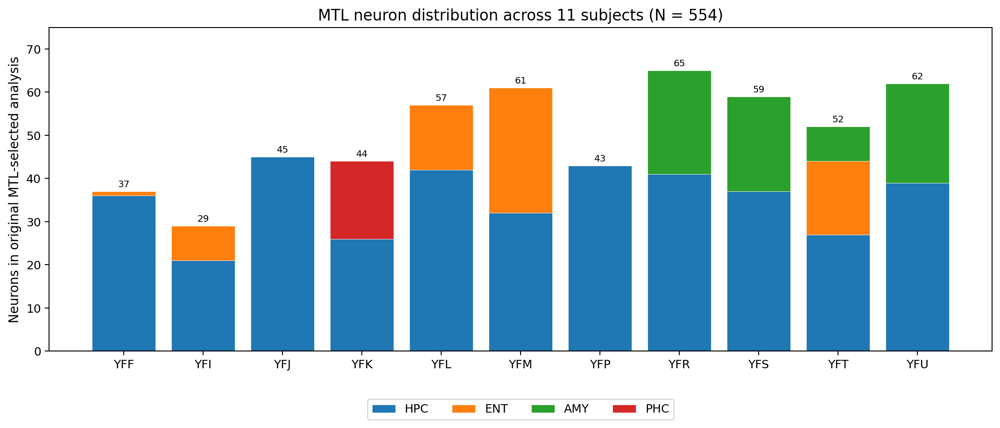

The archived Figure 1N outputs included **554** MTL units; two were marked `threshold_excluded` (YFL and YFR), leaving **552** in the later temporal-feature analysis. A separate earlier status report listed some decoding errors before follow-up corrections. These eligibility/status counts should not be confused with raw units or with statistically significant coding cells.

### 2.4 **Current three-subject full recorded-MTL-unit cohort**

This later analysis intentionally retained **all currently counted MTL units** for the three subjects rather than applying the earlier 11-subject MTL/decoding-filtered selection. Its region distribution was verified against the original November 17 anatomical metadata screenshot.

| MTL region | YFM | YFS | YFT | Total units | Labeled single units (all subjects) |
|---|---:|---:|---:|---:|---:|
| **Hippocampus (HPC)** | **60** | **91** | **45** | **196** | **173** |
| **Entorhinal cortex (ENT)** | **69** | **0** | **29** | **98** | **81** |
| **Amygdala (AMY)** | **0** | **53** | **17** | **70** | **49** |
| **Parahippocampal cortex (PHC)** | **0** | **0** | **0** | **0** | **0** |
| **Total** | **129** | **144** | **91** | **364** | **303** |

Across the current **364** neurons, HPC is **53.8%**, ENT **26.9%**, AMY **19.2%**, and PHC **0%**. These are **region-of-recording counts**, **not** counts of significant number-selective cells. Different brain-region coverage by subject makes region-stratified conclusions important.

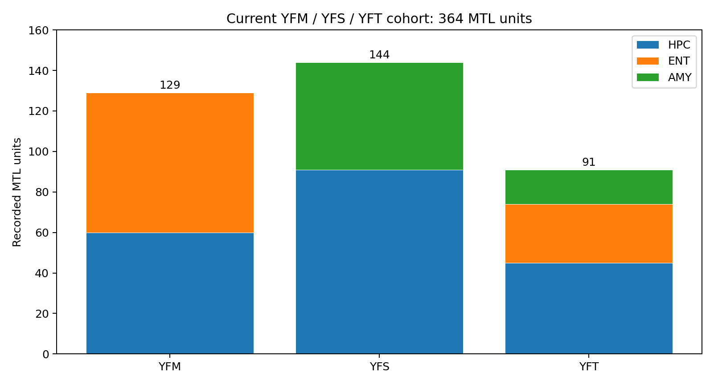


| Subject | All recorded units analyzed | Units labeled single-unit | Number presentations | Behavioral trials | 100-ms temporal features (all units) | Raw spikes counted in extracted windows |
|:---|---:|---:|---:|---:|---:|---:|
| YFM | **129** | 118 | **114** | 78 | 1,161 | 31,928 |
| YFS | **144** | 107 | **264** | 156 | 1,296 | 46,442 |
| YFT | **91** | 78 | **477** | 290 | 819 | 82,456 |
| **Total** | **364** | **303** | **855** | **524** | — | **160,826** |

*Neuron/feature totals and spike totals refer to the extraction checkpoints used for these subjects. The MTL-filtered feature counts for the earlier 11-subject classifier are smaller.*

#### Number-condition balance for YFM, YFS, YFT

| Number | YFM | YFS | YFT |
|---:|---:|---:|---:|
| 1 | 19 | 32 | 62 |
| 2 | 17 | 33 | 48 |
| 3 | 14 | 24 | 52 |
| 4 | 4 | 33 | 57 |
| 5 | 14 | 32 | 53 |
| 6 | 16 | 24 | 56 |
| 7 | 10 | 27 | 43 |
| 8 | 12 | 30 | 50 |
| 9 | 8 | 29 | 56 |
| **Total** | **114** | **264** | **477** |

**Consequences:** YFM is especially unbalanced: there are only **four presentations of number 4**, limiting its maximum stratified CV folds and the reliability of that number's centroid. YFS/YFT have substantially more balanced class counts.

### 2.5 Earlier YFU exploratory data

For YFU, we separately validated a raw **494 × 78** recorded-neuron response matrix and a **494 × 702** time-binned matrix (78 neurons × 9 bins). The subject had **494 presentations** with number counts `[53, 67, 52, 62, 51, 48, 65, 49, 47]`. The YFU MTL-selected classifier used **62** rather than 78 neurons.

YFU raw-count integrity checks: no missing, negative, or noninteger values; total spikes **302,355** in the 900-ms raw windows. Mean across-neuron firing rate approximately **8.719 Hz**.

---

## 3. Preprocessing and representation matrices

### 3.1 Time alignment and rate extraction

For a presentation starting at event time `t0`, the analysis window was **50–950 ms after onset**, or **0.9 s**. The chosen onset followed the task's operand-order logic (`operationFirst`; `tCue1`/`tCue3` as appropriate). We revisited YFS cue alignment and validated YFT feature extraction against independently exported count tables.

Let `s_{in}(t)` denote the spike train for presentation `i` and neuron `n`.

**Raw count** over a 900-ms interval:

```math
x_{in}=\sum_{t\in[t_i+0.05,\,t_i+0.95)}\mathbf 1\{\text{spike of neuron }n\text{ at }t\}.
```

**Mean firing rate (Hz):**

```math
r_{in}=\frac{x_{in}}{0.9\ \mathrm{s}}.
```

For `T` presentations and `N` neurons:

```math
X_{\mathrm{raw}}\in\mathbb R^{T\times N},\qquad y\in\{1,\ldots,9\}^{T}.
```

### 3.2 Temporal population features

Split the same 900-ms window into **9 nonoverlapping 100-ms bins**:

```math
X_{\mathrm{temporal}}\in\mathbb R^{T\times (9N)},\qquad\Delta t=0.1\ \mathrm{s}.
```

Each vector concatenates the spike counts for **all neurons and all time bins**. The exact feature ordering must be consistent across extraction, Bayesian fitting, simulation, and inverse comparisons. One YFU reconstruction initially had a bin-order mismatch; after fixing the feature order and **17 one-spike corrections**, the simulated/reconstructed count table matched exactly to floating-point precision.

### 3.3 Nine number centroids

For each number `k`, with `n_k` recorded presentations, take the mean of its population vectors:

```math
\mu_k=\frac{1}{n_k}\sum_{i:y_i=k}x_i,\qquad M=\begin{bmatrix}\mu_1^\top\\\vdots\\\mu_9^\top\end{bmatrix}\in\mathbb R^{9\times d}.
```

Here `d=N` for raw-count/firing-rate geometry and `d=9N` for temporal-count geometry. **These are empirical condition means**, not individual trial responses and not decoder components.

### 3.4 Important distinctions

| Representation | Data object | Uses number labels to compute centers? | Learned embedding? |
|---|---|---|---|
| Raw presentation response | `T × N` | No | No |
| Raw nine-centroid geometry | `9 × N` | **Yes**, by averaging presentations of each number | No |
| PCA scores | typically `T × q` or `9 × q` | PCA itself is unsupervised; coloring/averaging by number uses labels | **Yes**, linear unsupervised |
| Autoencoder latent vectors | `T × q` | Autoencoder reconstruction fit is unsupervised | **Yes**, learned |
| LDA components | projected number-labeled responses | **Yes**, supervised | Yes |
| Gamma posterior-mean geometry | `9 × (9N)` | **Yes**, class-conditional rate fitting | Model-based rate estimation |

---

## 4. Geometric definitions and reference structures

Given nine row vectors `M`, first center them:

```math
\bar\mu=\frac 19\sum_{k=1}^{9}\mu_k,\qquad C=M-\mathbf 1\bar\mu^\top.
```

Compute the singular-value decomposition:

```math
C=U\operatorname{diag}(\sigma_1,\ldots,\sigma_8,0)V^\top.
```

Because there are nine centered points, **affine rank ≤ 8**. Nine generic noisy high-dimensional points often have rank 8, even without meaningful number coding.

### 4.1 Effective dimensions

Using variance shares `p_a`:

```math
p_a=\frac{\sigma_a^2}{\sum_b\sigma_b^2},\qquad r_{\mathrm{eff}}=\exp\left(-\sum_a p_a\ln p_a\right).
```

**Participation ratio:**

```math
PR=\frac{\left(\sum_a\sigma_a^2\right)^2}{\sum_a\sigma_a^4}=\frac{1}{\sum_a p_a^2}.
```

Both are near 8 when the eight nonzero dimensions have similar variance, and near 1 when one dimension dominates. They measure **isotropy of the empirical centers**, not whether the centers are reproducible.

### 4.2 Pairwise distances and distance CV

```math
D_{ij}=\lVert\mu_i-\mu_j\rVert_2,\qquad CV_D=\frac{\operatorname{SD}\{D_{ij}:i<j\}}{\operatorname{Mean}\{D_{ij}:i<j\}}.
```

A regular simplex has all 36 pairwise distances equal and therefore `CV_D = 0`. Random high-dimensional points can also have comparatively uniform distances due to distance concentration.

### 4.3 Sequential transition angle

For labels in natural order (1 → 2 → ⋯ → 9), define:

```math
v_k=\mu_{k+1}-\mu_k,\qquad\theta_k=\cos^{-1}\left(\frac{v_k^\top v_{k+1}}{\lVert v_k\rVert\,\lVert v_{k+1}\rVert}\right),\quad k=1,\ldots,7.
```

- A perfect increasing straight line gives **0°**.
- An exact regular simplex visited vertex to vertex gives **120°**.
- The **interior** angle at a vertex is the supplement, `180° − θ_k` (so 60° for the regular simplex).

**Caution:** Independent noise can produce near-120° forward angles through shared middle-point contributions. Our controls explicitly tested this failure mode.

### 4.4 Simplex volume, condition number, and normalized shape

Using an edge matrix `E` with rows `(mu_2 − mu_1), ..., (mu_9 − mu_1)`:

```math
V_8=\frac{\sqrt{\det(EE^\top)}}{8!}=\frac{\prod_{a=1}^{8}s_a(E)}{8!}.
```

Numerically, an SVD/log-product is preferable to taking a determinant directly. An empirical `V_8 > 0` implies affine independence but is **not alone evidence of a biological simplex**.

The three-subject follow-up also considered mean-distance-normalized volume:

```math
V_{\mathrm{scaled}}=\frac{V_8}{\left(\frac{1}{36}\sum_{i<j}D_{ij}\right)^8}.
```

This corrects for overall response scale. The **regular-simplex-matched normalized volume** used in the earlier 11-subject analysis is a **different reference normalization**, so its reported values must not be mixed numerically with `V_scaled`.

### 4.5 Hypothesis table

| Candidate model | True geometric structure | Ideal forward angle | Typical warning |
|---|---|---:|---|
| Number line | 1-D ordered centers | 0° | Finite-sample noise creates full-rank *estimated* centers |
| Curved magnitude representation | Low-dimensional smooth ordered curve | Depends on curvature | Rank can exceed intrinsic dimension after noise |
| Regular 8-simplex | 9 equidistant centers | 120° | Geometry can resemble high-dimensional noise |
| Irregular simplex / mixed selectivity | Affinely independent centers; unequal distances | Variable | Full rank alone is generic |
| No-number-identity null | All numbers have same underlying firing rates | Not uniquely defined in truth | Estimated centers still become separated by noise |

---

## 5. Direct raw population geometry

**Goal:** Evaluate number geometry directly in the 900-ms population responses, without relying on decoder-selected features or Gamma posterior means.

We constructed the 9 × N raw number-centroid matrix, measured distance/rank/effective dimension, and compared reliability across data halves. No neuron was preselected by LDA p-value for this analysis.

| Raw geometry metric | YFM | YFS | YFT |
|---|---:|---:|---:|
| Number presentations | 114 | 264 | 477 |
| Neurons | 129 | 144 | 91 |
| Affine rank | 8 | 8 | 8 |
| Mean pairwise centroid distance | 9.806 | 6.011 | 3.746 |
| Effective rank (entropy) | ≈6.30 | ≈6.45 | ≈5.90 |
| Participation ratio | **5.130** | **5.285** | **4.631** |
| Median split-half correlation (approx.) | **+0.79** | **−0.10** | **−0.04** |
| Correlation with ordered number axis (reported raw check) | −0.123 | +0.016 | −0.031 |

**Interpretation:** All three empirical centroid configurations span eight affine dimensions. However, the split-half reproducibility checkpoint was appreciably positive for YFM and close to zero/negative for YFS and YFT. Thus a full-rank configuration is **not sufficient evidence** of a stable number code.

We also generated a **same-centroid Poisson baseline** for raw geometry. In that comparison, the observed participation ratio was unusually low for YFS and YFT relative to the chosen independent-Poisson null, but not for YFM. This is evidence of a difference from **that specific null model**, not an independent proof of a simplex or of reliable number representations. Numerical null p-values for this particular raw analysis are not reproduced here because they were not recoverable from the surviving summary.

**What was *not* done:** A full trial-level bootstrap confidence interval for the newer **YFM/YFS/YFT raw geometry** was proposed but not executed. The split-half comparison above and the simulations below are real completed analyses; they are not substitutes for that bootstrap.

**Original split-half reliability figure:**

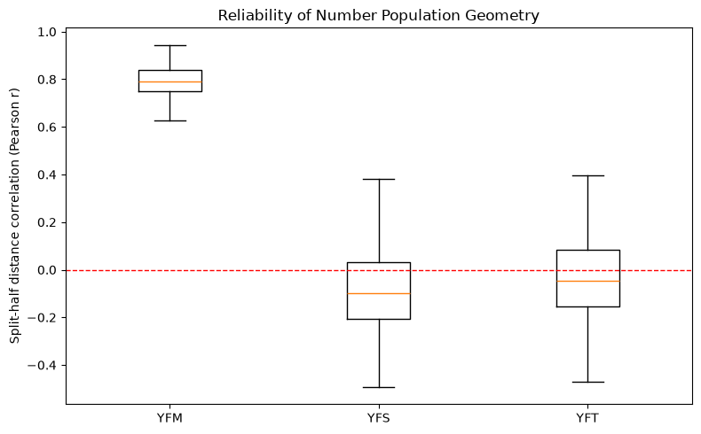

**Original representational-distance matrices:**

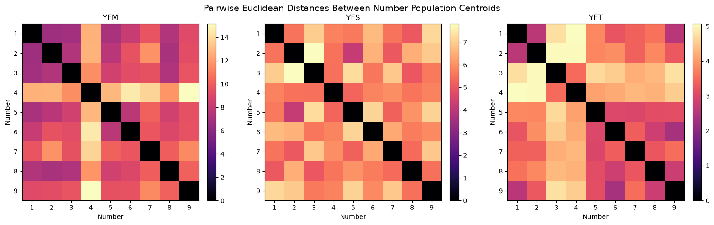

---

## 6. PCA of raw number centroids

Principal component analysis (PCA) decomposes centered population vectors into orthogonal directions ordered by explained variance:

```math
C=U\Sigma V^\top,\qquad \mathrm{ExplainedVariance}_a=100\frac{\sigma_a^2}{\sum_b\sigma_b^2}\%.
```

PCA does **not** use number labels to choose the directions. In the documented **centroid PCA** result, the input consists of the nine number centroids; labeling those nine rows for display uses the known conditions. PCA on all individual presentations and PCA on nine centroids are **not equivalent** and must not be assigned the same explained-variance percentages.

### 6.1 Raw-centroid explained variance

| Subject | PC1 | PC2 | PC3 | Cumulative PC1–3 |
|---|---:|---:|---:|---:|
| **YFM** | **34.02%** | **19.27%** | **12.42%** | **65.71%** |
| **YFS** | **34.11%** | **15.52%** | **12.89%** | **62.52%** |
| **YFT** | **37.78%** | **18.28%** | **13.10%** | **69.15%** |

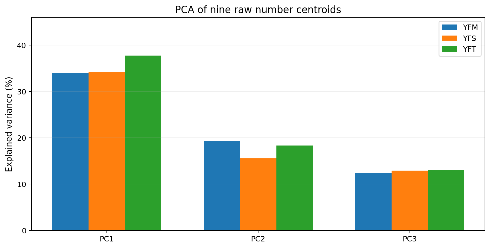

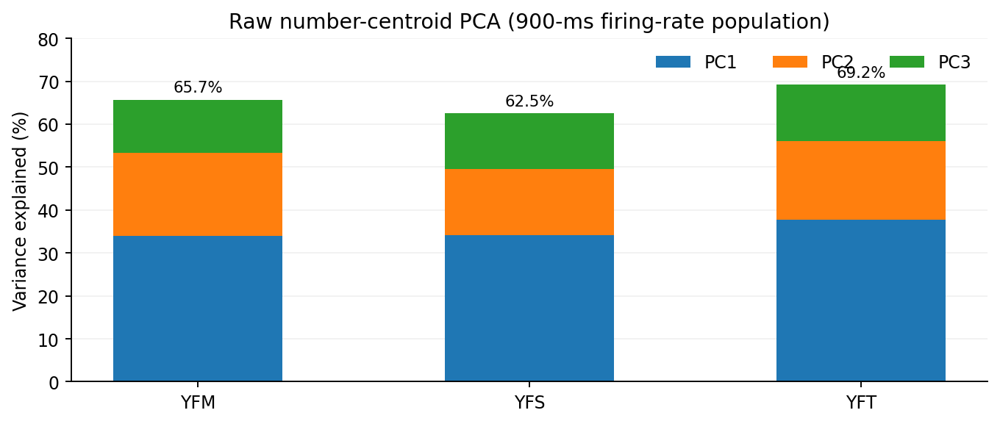

**Interpretation:** Three axes capture roughly **63–69%** of variance among the nine empirical number centroids. This does not establish a meaningful three-dimensional number manifold, and does not by itself demonstrate that individual presentations from different numbers form separable clusters.

### 6.2 Original number-centroid PC scatter plots (recovered)

The original notebook image, not a schematic, **is available**. It shows the nine number centroids in PC1–PC2–PC3 for each subject. The point labels are the presented numbers.

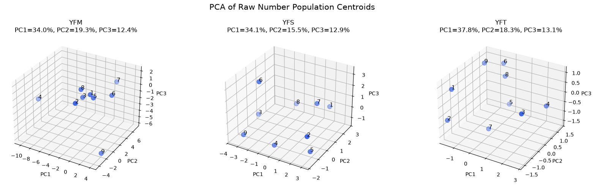

These plots should be read together with the split-half reliability test: a visual separation of nine *centroids* is inevitable to some degree in high-dimensional noisy data and does not prove stable stimulus-specific population coding.

The actual raw-versus-Poisson-null PCA projections were also recovered:

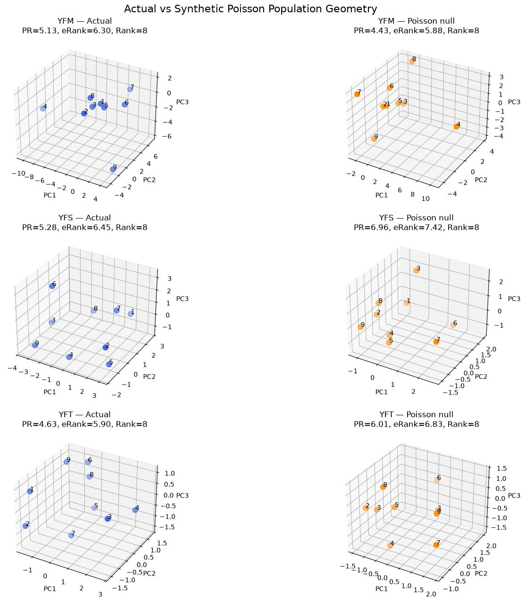

These images use the **original recorded PCA score coordinates**. The bar plot in §6.1 is an additional numerical summary, not a replacement.

---

## 7. Linear, nonlinear, and sparse autoencoders

All three are **unsupervised reconstruction models**: they seek a compressed latent representation that preserves the input, rather than predicting number labels. If `f` is the encoder and `g` the decoder:

```math
z_i=f_\theta(x_i),\qquad\widehat x_i=g_\phi(z_i),\qquad \mathcal L_{\mathrm{recon}}=\frac{1}{Td}\sum_{i,j}(x_{ij}-\widehat x_{ij})^2.
```

The recorded linear and nonlinear comparisons used a **3-dimensional bottleneck**. The sparse autoencoder used **64 latent features**, so its reconstruction MSE is **not** a matched-latent-dimension comparison.

### 7.1 Linear autoencoder (LAE)

A linear encoder/decoder (without nonlinear activations) can learn a subspace equivalent to the leading PCA subspace under appropriate optimization and constraints. The exact weights need not match PCA axes.

| Subject | Linear AE validation MSE | PCA validation MSE |
|---|---:|---:|
| YFM | 1.1192 | 1.0828 |
| YFS | 0.8705 | 0.8705 |
| YFT | 0.9996 | 0.9996 |

The LAE gave nearly the same reconstruction as PCA for YFS and YFT, with somewhat higher error for YFM.

**Original linear-AE 3-D latent plot** (points colored by numbers 1–9):

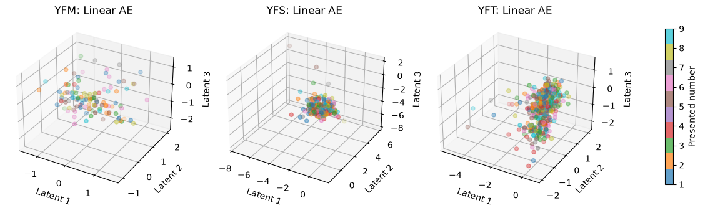

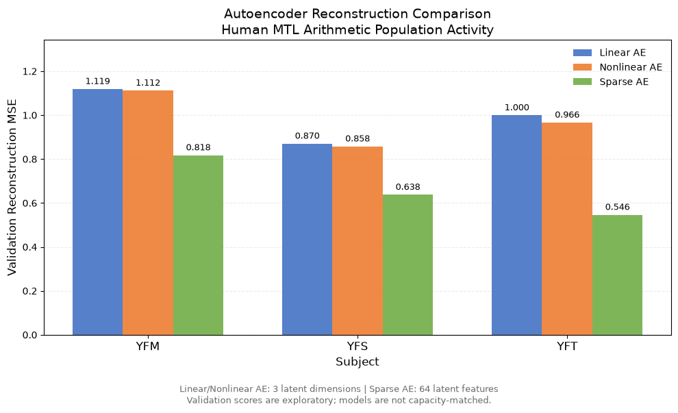

### 7.2 Nonlinear autoencoder (NLAE)

A nonlinear encoder/decoder can capture a curved low-dimensional reconstruction map that a linear PCA subspace cannot.

| Subject | Nonlinear AE validation MSE | PCA validation MSE | Difference (NLAE − PCA) |
|---|---:|---:|---:|
| YFM | 1.1120 | 1.0828 | +0.0292 |
| YFS | **0.8578** | 0.8705 | **−0.0127** |
| YFT | **0.9664** | 0.9996 | **−0.0332** |

The NLAE improved reconstruction slightly for YFS and YFT but not YFM. Better reconstruction did **not** reveal clearly separated, reliable number clusters in the inspected latent plots.

**Original nonlinear-AE 3-D latent plot**:

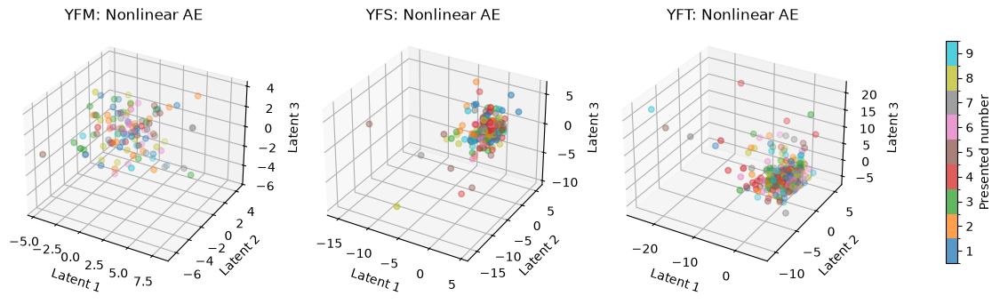

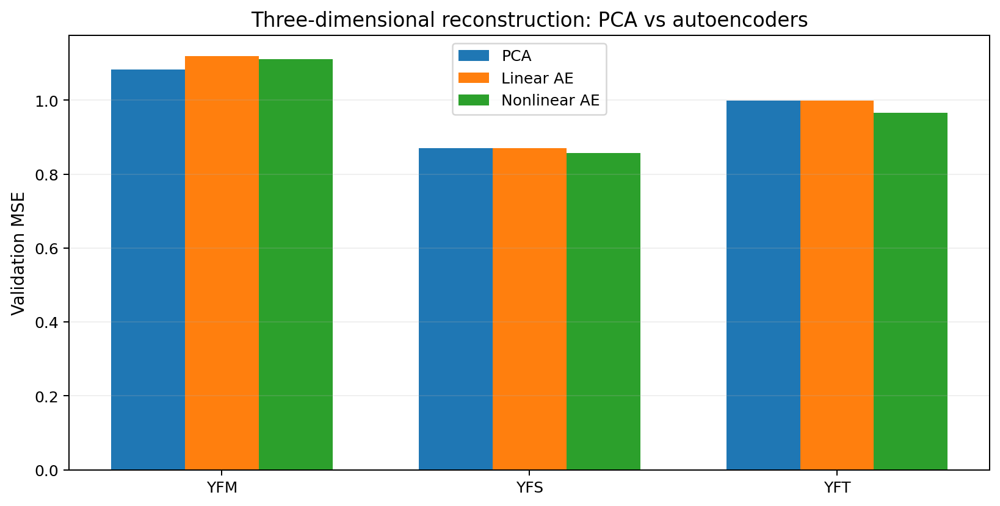

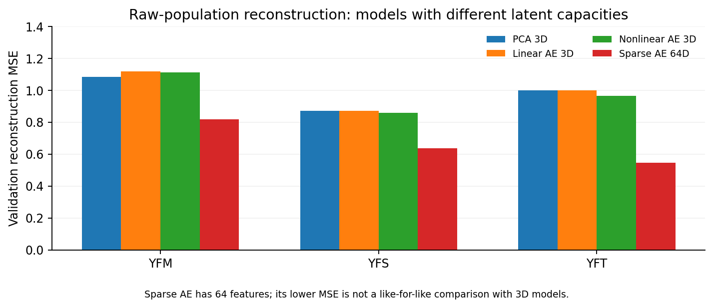

### 7.3 Sparse autoencoder (SAE)

The SAE used a larger, **64-feature latent dictionary** with an activity/sparsity penalty. A generic objective is:

```math
\mathcal L_{\mathrm{SAE}}=\mathcal L_{\mathrm{recon}}+\rho\sum_i\lVert z_i\rVert_1,
```

where `rho` expresses the sparsity strength. This equation defines the *method family*; the precise penalty implementation, optimizer, and hyperparameters should be copied from the notebook before claiming exact architectural reproduction.

| Metric | YFM | YFS | YFT |
|---|---:|---:|---:|
| SAE validation MSE | **0.8177** | **0.6378** | **0.5463** |
| Mean active features — training | 11.22 | 14.75 | 22.50 |
| Mean active features — validation | 29.76 | 26.07 | 27.41 |
| Train–validation number-tuning correlation | **−0.0314** | **−0.0569** | **+0.0423** |

**Main result:** Good reconstruction alone did not produce consistent number-selective features. The near-zero tuning correlations suggest that the learned number-response patterns were **not stable across training and validation** under the statistic we used.

**Original 9-number × 64-feature SAE heatmaps**:

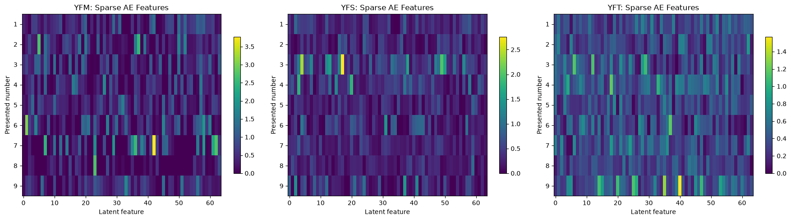

**Original SAE activation distribution comparison**:

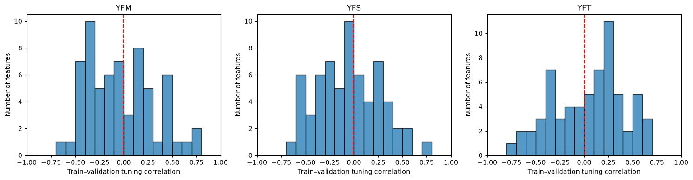 The very different train/validation activation counts are also worth auditing for distribution shift, activation threshold, or overfitting.

**Comparison limitation:** SAE's 64 latent coordinates make its lower MSE unsurprising relative to a 3-D bottleneck; one cannot claim that it better discovers *number representations* without matched-capacity and held-out tuning analyses.

---

## 8. LDA, logistic, and Bayesian decoding

### 8.1 What decoding tests

For a 9-class decoder, nominal equal-class chance is:

```math
P_{\mathrm{chance}}=1/9=0.1111\ldots=11.11\%.
```

Accuracy and balanced accuracy:

```math
\mathrm{Accuracy}=\frac1T\sum_{i=1}^{T}\mathbf1\{\widehat y_i=y_i\},\qquad\mathrm{BalancedAccuracy}=\frac19\sum_{k=1}^{9}\mathrm{Recall}_k.
```

Ordinary accuracy is sensitive to label imbalance. For one-neuron decoding, each example is that neuron's temporal response vector; for **population decoding**, all eligible neurons' temporal features are concatenated. These are distinct experiments.

### 8.2 Fixed temporal LDA vs optimized temporal LDA

**LDA:** linear discriminants based on between-class differences relative to a shrinkage-regularized within-class covariance. The replication used `LinearDiscriminantAnalysis(solver="lsqr", shrinkage=gamma, priors=uniform)`, with zero-within-class-variance features removed **inside each training fold only**.

- Window: **50–950 ms** following relevant operand onset.
- Candidate bin sizes: **60, 75, 90, 100, 150, 180, 225, 300, 450, 900 ms**.
- Candidate shrinkage values: **0.2, 0.5, 0.8**.
- Up to 10 stratified folds; for **YFM**, minimum class size **4** implied 4 folds.
- The current fixed reference used **100-ms bins**. The optimized version chose `(bin size, gamma)` to maximize cross-validated observed accuracy.
- **Important:** The optimized accuracy itself was selected on the same CV scoring results. It is **not an unbiased nested held-out accuracy**.

### 8.3 New three-subject, **single-neuron** comparison

| Subject | Neurons | Mean fixed LDA | Mean optimized LDA | Mean Gamma–Poisson Bayesian |
|---|---:|---:|---:|---:|
| **YFM** | 129 | 10.96% | **14.57%** | 12.51% |
| **YFS** | 144 | 11.16% | **13.45%** | 11.27% |
| **YFT** | 91 | 11.31% | **12.94%** | 11.50% |

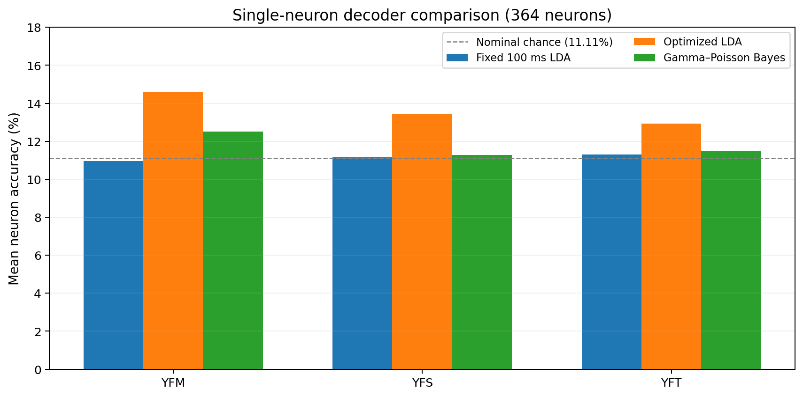

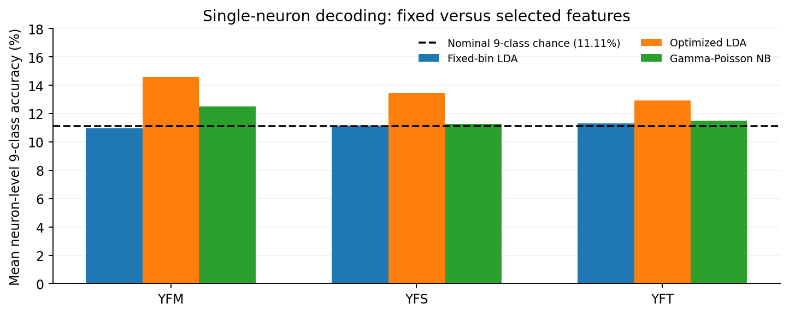

**Original 3 × 3 paired per-neuron scatter plot** of fixed/optimized LDA and Bayesian decoding:

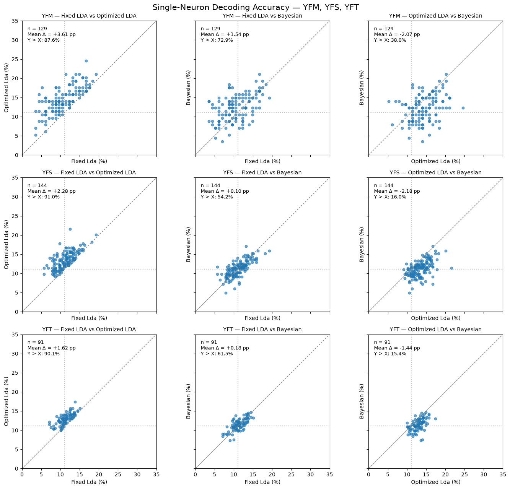

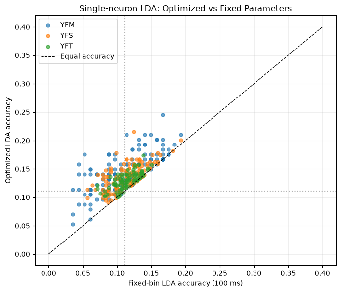

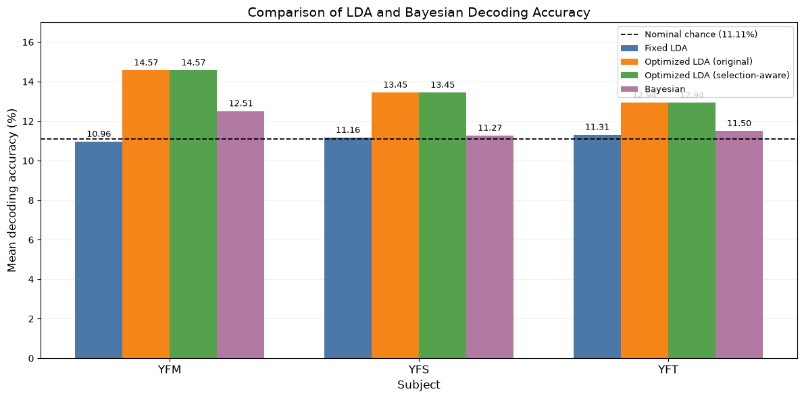

**Figure interpretation:** The original and selection-aware optimized-LDA bars show the **same observed maximum cross-validation accuracies**. The selection-aware correction changes the shuffled-label reference distribution and associated p-values—not the observed optimized scores.

Paired observed mean changes and proportion of neurons improved:

| Subject | Optimized − fixed (pp) | Neurons improved | Bayesian − fixed (pp) | Neurons improved | Bayesian − optimized (pp) |
|---|---:|---:|---:|---:|---:|
| YFM | +3.61 | 87.6% | +1.54 | 72.9% | −2.07 |
| YFS | +2.28 | 91.0% | +0.10 | 54.2% | −2.18 |
| YFT | +1.62 | 90.1% | +0.18 | 61.5% | −1.44 |

**Finding:** Optimized LDA had the highest *selected/observed* mean neuron accuracies. Bayesian single-neuron decoding was closer to fixed LDA. We must not interpret the optimized advantage as an unbiased out-of-sample gain until evaluated with **nested tuning and outer CV**.

### 8.4 Original optimized-LDA permutation screen

The initial optimized analysis used **200 shuffles** per neuron, but held each neuron's **observed best bin size and shrinkage fixed** in the null. Previously reported descriptive screen counts:

| Subject | Neurons | Original `p < 0.05` | Original `p ≤ 0.125` |
|---|---:|---:|---:|
| YFM | 129 | 25 | 47 |
| YFS | 144 | 40 | 64 |
| YFT | 91 | 25 | 42 |
| **Total** | **364** | **90** | **153** |

These are **not the corrected selection-aware findings** and should not yet be reported as definitive coding-neuron counts. The paper-style `p ≤ 0.125` exploratory selection threshold and the more stringent `p < 0.05` significance threshold have different uses. Neither is automatically an FDR-adjusted result.

### 8.5 Corrected **selection-aware** LDA permutations — completed

The **selection-aware** null repeats the **same 30-hyperparameter search** used on the observed labels for each shuffled set of labels, rather than keeping the optimized real-label settings fixed. This tests the *best-selected CV score* against a null that receives an equal opportunity to search. The latest checkpoint contains 200 permutations per neuron. The empirical p-value is:

```math
p_{\mathrm{perm}}=\frac{1+\sum_{b=1}^{200}\mathbf{1}\{A_b^{\mathrm{null, optimized}}\geq A_{\mathrm{observed, optimized}}\}}{201}.
```

The final outcome is:

| Subject | Tested neurons | Original fixed-setting null p<0.05 | **Selection-aware p<0.05** | Original p≤0.125 | **Selection-aware p≤0.125** |
|---|---:|---:|---:|---:|---:|
| **YFM** | **129** | 25 | **3** | 47 | **11** |
| **YFS** | **144** | 40 | **9** | 64 | **18** |
| **YFT** | **91** | 25 | **5** | 42 | **11** |
| **Total** | **364** | **90** | **17** | **153** | **40** |

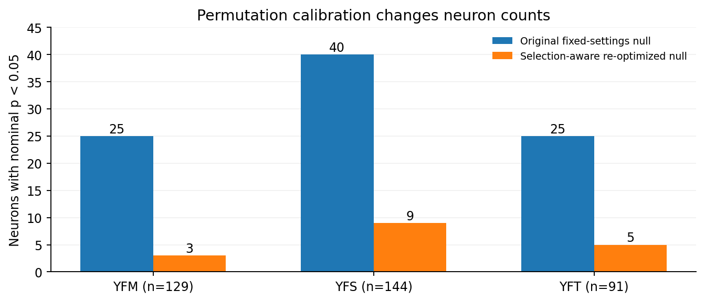

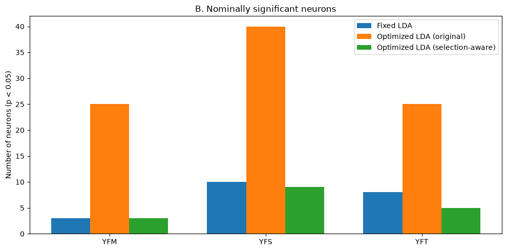

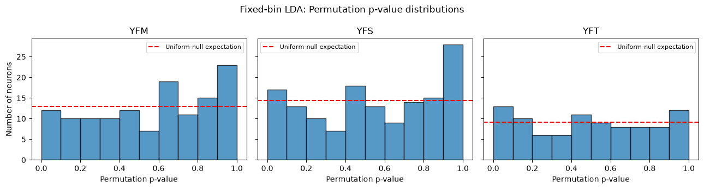

**Scope note:** The histogram screenshot is from the **fixed-bin** LDA permutation results; it is not a histogram of the final selection-aware optimized-LDA p-values.

- **Smallest corrected permutation p-value:** `0.004975` (the minimum attainable with 200 shuffles).
- **Smallest Benjamini–Hochberg adjusted q-value:** approximately `0.5174`.
- **Neurons with BH-adjusted q < 0.05:** **zero**.
- **Fixed-100-ms LDA:** 21 nominal p<0.05 discoveries across the same 364-unit cohort (the per-subject breakdown was not retained in the verified summary).
- **Exploratory comparison of mean optimized observed accuracy versus mean optimized-null accuracy:** YFM `14.57% vs 14.83%`, YFS `13.45% vs 13.34%`, YFT `12.94% vs 12.86%`. These are per-neuron descriptive averages, not cohort-level inferential p-values.

For reference, under a complete null with well-calibrated nominal p-values, the expected number of p<0.05 results among 364 tests is `364 × 0.05 = 18.2`. The observed 17 is close to that benchmark, but this does **not** prove that all neural responses lack number information. It means that this specific optimized single-neuron test produced **no FDR-supported discoveries** under the corrected procedure.

**Statistical distinction:** Selection-aware permutations correct significance for hyperparameter search. They do **not** convert the maximum CV accuracy selected on the observed data into an unbiased estimate of predictive accuracy. To estimate generalization, the complete bin-size/shrinkage optimization must be performed inside a nested **outer** cross-validation loop. Likewise, reusing fully fitted supervised LDA components in a downstream SVM creates a separate source of test-label leakage.

### 8.6 Earlier **11-subject population-level** decoder comparison

This historical population-level experiment uses a **different unit subset and validation design** from §8.3. It compared a 100-ms LDA baseline, multinomial logistic regression, Poisson MLE classifier, and Gamma–Poisson classifier.

| Subject | Population LDA | Multinomial logistic | Poisson MLE | Gamma–Poisson |
|---|---:|---:|---:|---:|
| YFF | 18.35% | 18.27% | 18.35% | 19.27% |
| YFI | 18.39% | 17.39% | 22.12% | 22.12% |
| YFJ | 14.88% | 11.28% | 19.30% | 16.67% |
| YFK | 22.82% | 13.89% | 21.93% | 16.67% |
| YFL | 15.83% | 12.27% | 14.91% | 15.79% |
| YFM | 14.87% | 14.95% | 14.04% | 12.28% |
| YFP | 17.12% | 13.27% | 13.29% | 15.19% |
| YFR | 14.65% | 10.52% | 11.28% | 11.28% |
| YFS | 9.12% | 6.44% | 12.88% | 10.61% |
| YFT | 16.34% | 12.36% | 13.63% | 13.63% |
| YFU | 8.50% | 10.12% | 10.93% | 10.93% |
| **Subject-average** | **15.53%** | **12.80%** | **15.70%** | **14.95%** |

Across subjects the Poisson MLE, LDA, and Gamma–Poisson performed similarly on average (roughly 15–16%); changing decoders did not yield a large systematic improvement. **Do not average or pool these accuracies with the single-neuron results above.** One exploratory Bayesian grid used nested grouped CV by **behavioral trial**, with outer and inner folds to prevent two presentations of the same trial leaking across training and test.

### 8.7 Gamma–Poisson model: equations

For class `k`, temporal feature `j`, count `X_ij`, and time bin `Δt`, the rate `lambda_kj` is measured in spikes/s:

```math
X_{ij}\mid(y_i=k),\lambda_{kj}\sim\operatorname{Poisson}(\lambda_{kj}\Delta t),\qquad\Delta t=0.1\ \mathrm{s}.
```

Use a Gamma prior in **shape–rate** parameterization:

```math
\lambda_{kj}\sim\operatorname{Gamma}(\alpha_j,\beta),\quad E[\lambda_{kj}]=\alpha_j/\beta.
```

For `n_k` class-`k` training presentations and `S_kj = sum X_ij`:

```math
\lambda_{kj}\mid D\sim\operatorname{Gamma}(\alpha_j+S_{kj},\beta+n_k\Delta t).
```

**Posterior mean geometry coordinate (Hz):**

```math
\widehat\lambda_{kj}^{\mathrm{post}}=\frac{\alpha_j+S_{kj}}{\beta+n_k\Delta t}.
```

**MLE comparison:**

```math
\widehat\lambda_{kj}^{\mathrm{MLE}}=\frac{S_{kj}}{n_k\Delta t}.
```

In one later empirical-Bayes geometry run, the feature-specific prior mean used the **pooled MLE with a positive floor**, `m_j = max(pooled_mean_rate_j, 0.01 Hz)`, and prior strength `beta = 0.1 s`, giving `alpha_j = beta*m_j`. Earlier Bayesian decoder tuning explored a **different** `(m, tau)` grid; those prior choices should not be conflated.

**Posterior predictive class likelihood:** Integrating the Poisson likelihood over the Gamma posterior gives a negative-binomial/Gamma–Poisson predictive distribution:

```math
p(x_j\mid k,D)=\frac{\Gamma(a_{kj}+x_j)}{\Gamma(a_{kj})\,x_j!}\left(\frac{b_k}{b_k+\Delta t}\right)^{a_{kj}}\left(\frac{\Delta t}{b_k+\Delta t}\right)^{x_j},\quad a_{kj}=\alpha_j+S_{kj},\;b_k=\beta+n_k\Delta t.
```

The Naive Bayes decoder sums per-feature **log** predictive probabilities; the geometry uses **posterior means**. These are related but **not identical operations**: neither posterior sampling nor posterior-predictive probabilities serve as the geometry coordinates in the analyses reported below.

---

## 9. Eleven-subject posterior-mean geometry

For each MTL-filtered subject we formed a nine-row class-rate matrix:

```math
\Lambda_s^*\in\mathbb R^{9\times p_s},\qquad p_s=9N_s.
```

These are the **nine posterior-mean rate vectors**, not raw single-trial spike counts, and not supervised LDA components.

### 9.1 Dimensionality across the 11 subjects

| Subject | Temporal features | Affine rank | PC1 variance of 9 posterior centers | Effective rank | Participation ratio |
|---|---:|---:|---:|---:|---:|
| YFF | 333 | 8 | 38.81% | 6.23 | 4.77 |
| YFI | 261 | 8 | 34.73% | 6.69 | 5.42 |
| YFJ | 405 | 8 | 48.38% | 5.36 | 3.64 |
| YFK | 396 | 8 | 34.24% | 6.65 | 5.43 |
| YFL | 513 | 8 | 40.78% | 6.11 | 4.56 |
| YFM | 549 | 8 | 43.21% | 5.93 | 4.27 |
| YFP | 387 | 8 | 52.74% | 4.94 | 3.21 |
| YFR | 585 | 8 | 22.47% | 7.56 | 7.12 |
| YFS | 531 | 8 | 23.61% | 7.49 | 6.98 |
| YFT | 468 | 8 | 23.83% | 7.38 | 6.78 |
| YFU | 558 | 8 | 45.77% | 5.69 | 3.96 |

All have rank 8, the **maximum** for nine centered points. This is an algebraic property of estimated high-dimensional centroids and cannot itself establish a biologically meaningful simplex.

### 9.2 Shape diagnostics and transition angles

| Subject | Distance CV | Regular-simplex-matched normalized volume | Mean forward transition angle |
|---|---:|---:|---:|
| YFF | 0.172 | 0.431 | 118.61° |
| YFI | 0.208 | 0.550 | 123.13° |
| YFJ | 0.261 | 0.274 | 119.29° |
| YFK | 0.151 | 0.527 | 119.42° |
| YFL | 0.192 | 0.413 | 118.48° |
| YFM | 0.226 | 0.386 | 115.12° |
| YFP | 0.241 | 0.214 | 121.82° |
| YFR | **0.081** | **0.804** | 118.06° |
| YFS | **0.080** | **0.779** | 119.04° |
| YFT | **0.089** | **0.740** | 120.16° |
| YFU | 0.194 | 0.343 | 124.83° |

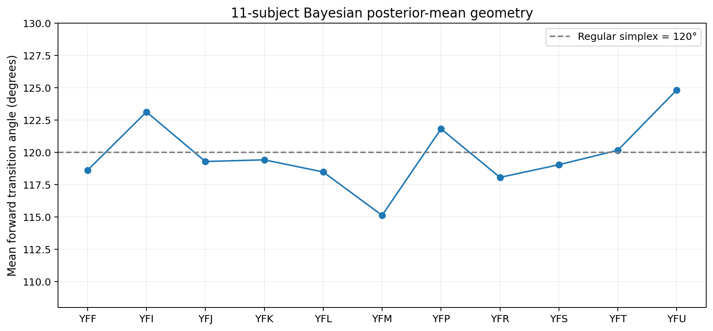

**YFR/YFS/YFT** were more isotropic under these particular posterior-center shape measurements (smaller distance CV, higher effective rank and regular-simplex relative volume). **YFP/YFJ/YFU** were more anisotropic. These are descriptive *shape* comparisons and are **not** by themselves demonstrations of robust number coding.

We also computed Gram-matrix regularity error, centroid angular spread, condition number and isotropy ratio in the earlier full geometry workbook. Example: YFP Gram error approximately **1.223** and relative volume **0.214**, whereas YFR Gram error approximately **0.351** and relative volume **0.804**.

### 9.3 Is the neural representation a simple ordered line?

Tested neural Euclidean distances against `|i−j|` and ordered linear/logarithmic magnitude-axis fits. The label-order tests in the earlier 11-subject analysis used **20,000 permutations**.

**Main reported results:**

| Hypothesis / test | Outcome across 11 subjects |
|---|---|
| Pearson correlation of neural vs numerical distance | **0/11 significant** at uncorrected `p < 0.05` |
| Spearman correlation of neural vs numerical distance | **0/11 significant** |
| Linear-magnitude 1-D axis (permuted number order) | **0/11 significant** |
| Logarithmic-magnitude 1-D axis (permuted number order) | **0/11 significant** |
| Mean number-to-number forward transition angle | Approximately **115–125°** |

These tests suggest no obvious **privileged ordered magnitude axis** in these estimated posterior-mean representations. They do **not** prove a simplex against *all possible* nonlinearly curved, mixed-selectivity, or noise-only alternatives.

---

## 10. Poisson controls, fitted line, and recovery

This was a central methodological contribution: a geometry-estimation pipeline can produce rank 8 and approximately 120° angles **even when the true generating geometry is not an 8-simplex**.

### 10.1 Updated three-subject Gamma posterior geometry

The more recent reanalysis applied the **same geometry function** to YFM/YFS/YFT 9 × (9N) posterior-mean temporal-rate matrices. These results are **not** interchangeable with the older 11-subject, MTL-filtered results of §9.

| Metric | YFM | YFS | YFT |
|---|---:|---:|---:|
| Affine rank | 8 | 8 | 8 |
| Entropy effective rank | **7.1579** | **7.8121** | **7.7679** |
| Participation ratio | **6.3574** | **7.6303** | **7.5448** |
| Simplex volume (unscaled, feature-space units) | **30.9281** | **0.4663** | **0.01175** |
| Mean pairwise distance | **7.3956** | **4.2627** | **2.6972** |
| Pairwise distance CV | **0.1697** | **0.0525** | **0.0595** |
| Mean interior angle | 61.47° | 59.97° | 59.99° |
| **Mean forward transition angle** | **118.53°** | **120.03°** | **120.01°** |

The large differences in unscaled volume across subjects are confounded by distance scale; this motivated explicit normalized-volume comparisons.

### 10.2 Control A — same-centroid / no-number-code Poisson null

**Construction:** For every temporal feature, estimate the overall pooled spike-count mean across all labels. For each number's original count of presentations, simulate independent Poisson spike counts using **the same feature-specific mean regardless of number**. Refit Gamma posterior means, then recompute all geometry metrics. We ran **200 simulations per subject**.

```math
X^{\mathrm{null}}_{ij}\sim\operatorname{Poisson}(\overline x_j),\qquad\overline x_j=\frac1T\sum_i X_{ij},\qquad\text{independent of }y_i.
```

| Metric (simulation mean) | YFM | YFS | YFT |
|---|---:|---:|---:|
| Effective rank | **7.0464** | **7.8736** | **7.8377** |
| Simplex volume | 23.0887 | 0.0940 | 0.0081 |
| Mean pairwise distance | 7.1504 | 3.4743 | 2.5607 |
| Distance CV | 0.1839 | 0.0508 | 0.0522 |
| Mean forward angle | **119.51°** | **120.00°** | **120.47°** |

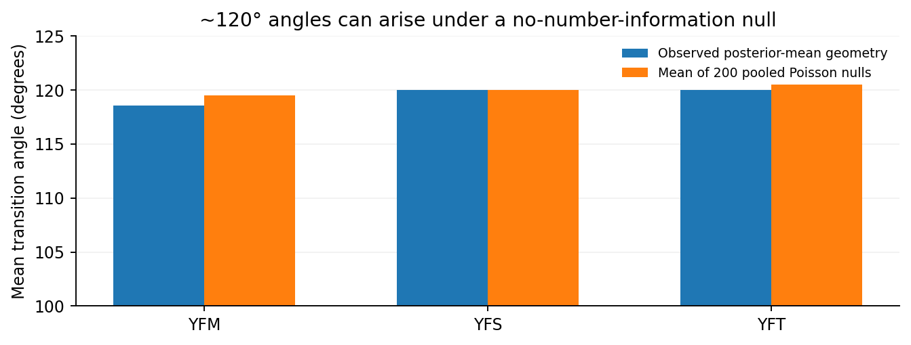

**Key result:** An underlying **same-centroid** (no number identity effect) independent-Poisson process also produced **estimated full rank**, effective rank near eight, and forward angles near **120°**. Therefore those statistics alone cannot distinguish true simplex coding from finite-sample noise.

**Null limitation:** This simulation retained the pooled feature means and label counts but **did not preserve all original neuron-neuron temporal correlations, trial-group dependence, or non-Poisson overdispersion**. It is a useful benchmark, not a fully realistic neural null.

### 10.3 Control B — fitted one-dimensional number line

**Ground truth:** Fit a linear trend of featurewise activity against centered number `(k−5)` and construct nonnegative class rates:

```math
\lambda^{\mathrm{line}}_{kj}=\lambda_{0j}+(k-5)b_j,\qquad k=1,\ldots,9.
```

In the implemented synthetic construction, feature slopes were clipped to keep rates nonnegative and bounded relative to the baseline. Simulate the same class counts via Poisson spike generation, refit posterior centers, and measure recovered geometry (**200 simulations per subject**).

By construction the **true** line geometry has affine rank **1**, entropy effective rank **1**, and forward angle **0°** whenever its steps are nondegenerate and collinear.

| Recovery metric (simulation mean) | YFM | YFS | YFT |
|---|---:|---:|---:|
| **True generating rank** | **1** | **1** | **1** |
| **Recovered estimated affine rank** | **8** | **8** | **8** |
| **Recovered effective rank** | **7.0158** | **7.3310** | **7.5831** |
| Recovered simplex volume | 33.4280 | 0.1505 | 0.0115 |
| Recovered mean pairwise distance | 7.5469 | 3.7861 | 2.7118 |
| Recovered distance CV | 0.1705 | 0.0912 | 0.0726 |
| **Recovered forward angle** | **118.69°** | **118.73°** | **119.55°** |

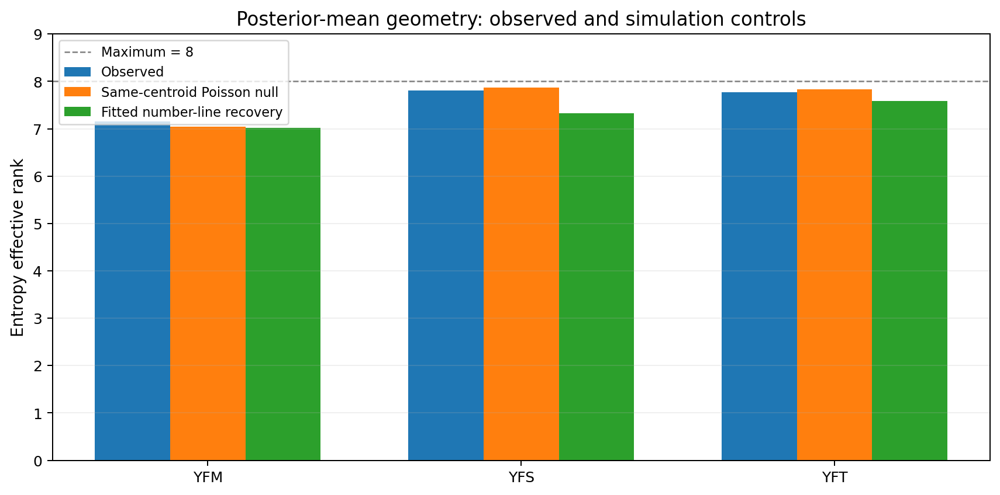

**Original synthetic one-dimensional number-line figure** (exact ground truth on the left, its noisy Poisson-derived observations on the right):

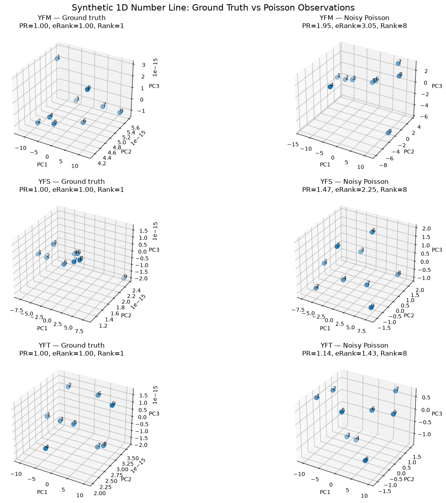

**Key result:** Our method can recover a seemingly high-rank, ~120° geometry from an actual **one-dimensional** ground-truth code. This is a direct caution against interpreting empirical transition angles without matching sampling noise and neuron/trial counts.

### 10.4 Mean-distance-normalized volume: observed versus controls

We used `V_scaled = V_8/(mean pairwise distance)^8` and compared observed values to the 200 Poisson simulations from each control. The table reports the **percentile of observed volume in the simulated distribution**, not a conventional corrected hypothesis-test p-value:

| Subject | Observed percentile vs same-centroid null | Observed percentile vs fitted line recovery |
|---|---:|---:|
| YFM | 76.5th | **99.5th** |
| YFS | **0.5th** | **100th** |
| YFT | **3.5th** | **99th** |

The observed normalized volumes were high relative to the **fitted-line** model for all three subjects, but **YFS and YFT were lower than the same-centroid independent-Poisson baseline**. A single 'simplex versus number line' contrast is therefore insufficient; null assumptions, scale normalization, sampling variability, and trial correlations matter.

> **Do not claim:** “These percentiles prove an 8-simplex.” The line slopes were **estimated from the data**, clipped for rate validity, and the controls do not match every aspect of the neural variability. A stronger test would calibrate the complete model-fitting process and include correlated/overdispersed and mixed-selectivity baselines.

### 10.5 Earlier YFU simulation and recovery explorations

We also investigated recovery from a range of **known, constructed ground-truth arrangements**, rather than assuming an empirically observed shape was the truth. Earlier YFU pipelines included a straight number line, logarithmic line, curved low-dimensional path, regular simplex, irregular simplex, random high-dimensional, and no-number-signal examples.

The following historical summary values are **recovered estimated effective rank** from these *different methods* and should not be merged with the newer three-subject simulation table:

| Synthetic ground truth | Recovered Gamma/posterior effective rank | Recovered LDA effective rank |
|---|---:|---:|
| Straight line | **6.974** | **2.678** |
| Logarithmic line | 7.060 | 3.307 |
| Curved path | 7.343 | 3.821 |
| Regular simplex | 7.918 | 7.803 |
| Irregular simplex | 7.734 | 7.063 |
| Random high-dimensional | — | 6.480 |
| No-number-signal null | — | 6.895 |

The synthetic line's recovered representational-distance ordering was much more preserved in one experiment (**RDM correlation approximately 0.938**) than its recovered rank might suggest. **Lesson:** effective rank, transition angles, and ordered-distance recovery measure different properties. A recovered high rank can be primarily sampling artifact without erasing every trace of the true latent ordering.

---

## 11. Bootstrap and resampling experiments

### 11.1 What a bootstrap is in this project

A **within-number bootstrap** resamples trials/presentations **with replacement**, separately for each number, recomputing nine empirical centroids and geometry. It assesses uncertainty in a statistic *conditional on the observed sampling process*. A **trial-block bootstrap** resamples entire behavioral trials to keep related operand presentations together. A **pooled/no-label null** pools responses across numbers before rebuilding group-size-matched centers. These procedures answer different questions.

We did **not artificially add Gaussian noise** to these empirical-resampling controls: variability came from the observed spike-count population vectors. Separately, the model-based recovery controls **did simulate Poisson counts** from hypothesized ground-truth rates.

### 11.2 Earlier YFU centroid and pooled-noise resampling

The earlier YFU comparison used **494 presentations** and evaluated five population configurations in **both** raw 900-ms counts and 100-ms temporal features:

1. Original number-labeled centroids.
2. Bootstrap centroids, resampled from within each number.
3. Pooled-label-ignored centroids, preserving each number's sample size.
4. One randomly selected labeled presentation vector per number.
5. One pooled/no-label presentation vector per nominal number.

The pooled-noise experiment used **1,000 resamples**; a duplicate-vector problem in one single-vector control was corrected by sampling **without replacement** where necessary.

**YFU raw 900-ms counts (78-dimensional):**

| Statistic | Original centroids | Within-number bootstrap (mean) | Pooled label-free centroids (mean) |
|---|---:|---:|---:|
| Affine rank | 8.0000 | 8.0000 | 8.0000 |
| Mean pairwise distance | **5.1072** | 7.1984 | **5.1393** |
| Distance CV | 0.1034 | 0.1117 | 0.1128 |
| Effective dimension | **6.6710** | 6.5693 | **6.4512** |
| Relative simplex volume | **0.7093** | 0.6788 | **0.6511** |

**YFU 100-ms temporal counts (702-dimensional):**

| Statistic | Original centroids | Within-number bootstrap (mean) | Pooled label-free centroids (mean) |
|---|---:|---:|---:|
| Affine rank | 8.0000 | 8.0000 | 8.0000 |
| Distance CV | **0.0642** | 0.0647 | **0.0594** |
| Effective dimension | **7.6605** | 7.6466 | **7.6072** |
| Condition number | 1.3860 | 1.3992 | 1.4296 |
| Relative simplex volume | **0.9265** | 0.9260 | **0.9138** |

A recorded interval for **within-number YFU temporal bootstrap** was:

| Statistic | Bootstrap mean | 2.5th–97.5th percentile |
|---|---:|---:|
| Affine rank | 8.0000 | 8.0000–8.0000 |
| Effective dimension | **7.6466** | **7.4510–7.8117** |
| Relative simplex volume | **0.9260** | **0.8868–0.9589** |

**Critical observation:** Pooled/no-label controls produced extremely similar shape statistics to the original YFU number centroids, especially in temporal high-dimensional space. High rank and nearly regular volume thus cannot be assigned uniquely to number identity.

### 11.3 Additional YFU trial-level bootstrap and reliability

A separate historical YFU run performed **500 trial-group bootstrap resamples** on raw population responses. Recorded diagnostics included:

- Mean original pairwise **squared** centroid distance: **18.1005** (squared-count units).
- Mean bootstrap standard deviation of that squared-distance quantity: approximately **4.1994**.
- Split-half representational-distance-matrix correlation approximately **−0.1093**.

This illustrates uncertainty and weak reproducibility in one raw YFU analysis. **Be careful:** squared distance `||a−b||²`, raw Euclidean distance `||a−b||`, and noise-corrected cross-validated squared distance are distinct quantities. One exploratory cross-validated squared-distance result was negative on average; negative cross-validated estimates are possible after noise correction and should not be turned into a Euclidean metric or a negative physical distance.

### 11.4 Clear scope boundary

| Resampling method | YFU earlier | New YFM/YFS/YFT |
|---|---|---|
| Original number centroids | Done | Done |
| Within-number bootstrap | **Done** | **Not done** |
| Pooled/no-number-label resampling | **Done** | Analogous model-based Poisson null done; not same nonparametric test |
| Split-half reliability | Done | Done |
| Trial-group bootstrap | **Done (500 YFU resamples)** | **Not done** |
| Same-centroid Poisson simulations | Part of broader exploratory controls | **Done (200/subject)** |
| Fitted number-line Poisson recovery | Earlier synthetic experiments | **Done (200/subject)** |

---

## 12. YFM LD population geometry

**Motivation:** After examining raw firing-rate, autoencoder, and posterior-mean representations, we reconstructed subject YFM's single-neuron temporal discriminant coordinates and concatenated them into a neural population feature matrix. Unlike raw PCA and autoencoders, this is a **supervised representation**, because the original multiclass LDA uses the stimulus identities.

### 12.1 Construction of the two feature spaces

For each of the 129 current YFM neurons, binned spike counts were projected onto class-discriminant temporal axes estimated from a regularized generalized eigenproblem. We retained the first axis (LD1) or up to the first three axes (LD1–LD3). Missing axes were zero-padded. These discriminant axes were constructed from all available YFM labels for the current descriptive notebook; they are **not guaranteed to match MATLAB `fitcdiscr` eigenvectors exactly**.

| Matrix | Shape | Rows | Columns | Supervision |
|---|---|---|---|---|
| `Z1` | **114 × 129** | Number presentations | LD1 from each neuron | Full-data number labels used |
| `Z3` | **114 × 387** | Number presentations | Three slots per neuron | Full-data number labels used |
| `C1` | **9 × 129** | Mean of each number | Same LD1 features | Descriptive centroids |
| `C3` | **9 × 387** | Mean of each number | Same LD1–LD3 features | Descriptive centroids |

### 12.2 Descriptive YFM LD-centroid geometry

| Statistic | LD1, 129 neurons | LD1–LD3, 129 neurons |
|---|---:|---:|
| Affine rank of nine class centers | 8 | 8 |
| Effective rank | **7.0082** | **7.2808** |
| Participation ratio | **6.2647** | **6.6400** |
| Mean forward transition angle | **119.4911°** | **119.3433°** |
| SD of transition angles | 10.3485° | 8.6881° |
| Log simplex volume (implementation units) | 4.7614 | 7.6951 |
| Mean pairwise centroid distance | 8.8667 | 12.5591 |
| Pairwise distance CV | 0.1783 | 0.1556 |

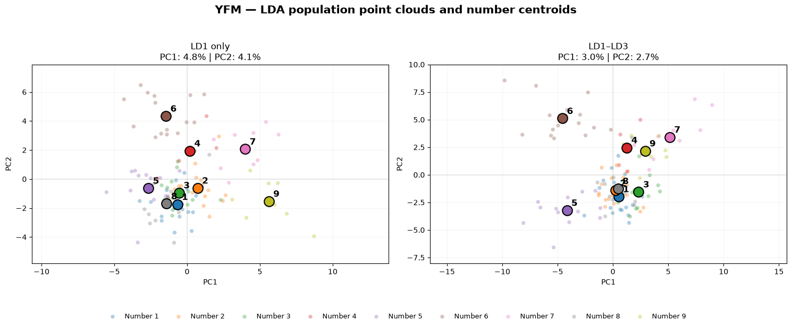

This is a **PCA of individual presentation-level LDA features**. The original plotted PC1+PC2 variance is approximately **8.9% for LD1** and **5.7% for LD1–LD3**. These percentages are **not comparable** to the PCA of nine raw firing-rate centroids in §6. The original YFM plots also show appreciable overlap between presentation clouds, even if nine centroid markers are visually separated.

In another notebook view we used separate **static 3D** PCA plots with presentation clouds, labeled number centroids, covariance ellipsoids, and the closed **1→2→…→9→1** centroid path. That closed polygon is a visualization convention; the complete 8-simplex would have **36 distinct edges**, not merely nine sequential connections. YFM's number 4 has only four presentations, making any number-4 covariance ellipsoid especially unstable.

**Interpretation:** Higher apparent effective rank, larger distances, or higher log-volume from LD1–LD3 are descriptive properties of a **larger, supervised feature space**. They do not by themselves establish a reproducible number simplex. In particular, LDA was fitted on the same labels later used to compute these centers.

---

## 13. Functional analysis: shattering dimensionality

### 13.1 Definition and theoretical benchmark

**Shattering dimensionality (SD)** asks how many arbitrary binary partitions of conditions can be distinguished by linear readouts. A dichotomy assigns each of the nine number identities to one of two groups, without asking the classifier to identify the exact number. The two sides of a split are interchangeable.

```math
N_{\mathrm{dichotomies}}=\frac{2^9-2}{2}=255=\binom{9}{1}+\binom{9}{2}+\binom{9}{3}+\binom{9}{4}.
```

| Partition type | Example partition (class 1 vs rest) | Number of unique dichotomies |
|---|---|---:|
| **1 vs 8** | `{3}` vs `{1,2,4,5,6,7,8,9}` | 9 |
| **2 vs 7** | `{2,6}` vs all other numbers | 36 |
| **3 vs 6** | `{1,4,9}` vs all other numbers | 84 |
| **4 vs 5** | `{1,3,5,7}` vs all other numbers | 126 |
| **Total** | All nontrivial partitions, counted once | **255** |

A 1D ordered number line can linearly realize only a restricted collection of partitions. Nine perfectly affinely independent noiseless centers in eight dimensions can support all 255 via suitable affine hyperplanes. However, **theoretical separability of fitted centers** does not equal **accurate held-out classification in noisy single-trial data**.

### 13.2 What the Hayden/Zhu manuscript did

The paper's Figure 2 shattering analysis used the selected temporal LDA projections of number-tuned neurons, a **linear SVM** with ridge regularization, all **255** splits, binary-side downsampling to balance class sizes, up to **five stratified CV folds**, and **160 repetitions** of the balancing procedure. It compared against **160 label shuffles**, performed a separate magnitude-residualized analysis, and restricted condition-mean PCA to dimensions 1–4 as a capacity benchmark. The full paper SSD used no preliminary PCA reduction on neural data. See paper Methods, printed lines 1702–1801 (PDF pp. 57–60).

The manuscript reported **dot-task SSD 0.7302 ± 0.0203** (n=10 subjects); a subject-level three-dimensional lower-bound criterion for symbolic-number shattering also appears in Figure 2. These results already exist in the manuscript, so simply repeating SSD is **not a new test**.

### 13.3 Our exploratory YFM experiment: 255 linear SVMs

We used the **original uncorrected p≤0.125** per-neuron selection criterion, which retained **47 of 129 YFM neurons** (the corrected p≤0.125 criterion retains only **11**, under the later selection-aware permutations). The recorded experiment used:

- Input: the **same 114 YFM presentations**, each represented by either 47 LD1 scores or 141 LD1–LD3 scores.
- Output for each dichotomy: binary label `z=1` if the presented number is in one chosen group, and `z=0` otherwise.
- Training procedure: a **separate `LinearSVC(C=1.0, class_weight='balanced', dual='auto')`** for every dichotomy, inside an `StandardScaler` + classifier pipeline.
- Evaluation: **`StratifiedGroupKFold(n_splits=3, shuffle=True, random_state=42)`**, grouping related operand presentations by original arithmetic-trial ID; train on two folds and test on the third.
- Metric: mean **balanced binary accuracy** across valid folds, then mean across all 255 dichotomies. If a grouped fold lacked a binary class, the implementation skipped that fold; all 255 dichotomies had at least one evaluable fold.
- Difference from the paper: **no 160 repeated downsamplings**; our `class_weight='balanced'` and balanced evaluation differ from the paper's explicit binary-side balancing. This is a **first-pass adaptation**, not an exact replication.

Balanced accuracy is the mean of the two binary-group recalls, avoiding the dominance of the larger group:

```math
\operatorname{BA}=\frac12\left[\frac{\mathrm{TP}}{\mathrm{TP}+\mathrm{FN}}+\frac{\mathrm{TN}}{\mathrm{TN}+\mathrm{FP}}\right].
```

For a dichotomy `d`, we averaged fold-level BA; the reported SSD is the mean over all dichotomies:

```math
\operatorname{SSD}=\frac{1}{255}\sum_{d=1}^{255}\operatorname{BA}_d.
```

| YFM shattering result | **LD1** | **LD1–LD3** |
|---|---:|---:|
| Selected neurons | 47 | 47 |
| Population features | **47** | **141** |
| Evaluated dichotomies | **255** | **255** |
| Mean SSD | **0.7287 (72.87%)** | **0.7891 (78.91%)** |
| Median dichotomy accuracy | 0.7340 | 0.7874 |
| SD across dichotomies | 0.0668 | 0.0515 |
| Difference from LD1 | — | **+0.0604 (+6.04 percentage points)** |
| Nominal binary chance | 0.5000 | 0.5000 |

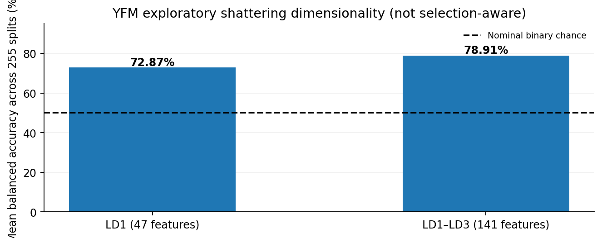

**Meaning of 78.91%:** Averaging over all 255 binary category membership tasks, the 141-feature representation obtained **78.91% mean balanced held-out SVM accuracy**, *conditional on the already-fitted supervised LDA features*. It does **not** mean nine-class number decoding accuracy, that 78.91% of all partitions were perfectly separated, or that a held-out SVM fold was truly unseen to the **LDA preprocessing stage**.

**Most important caveat:** Both the 47-neuron selection and the `Z1`/`Z3` discriminant coordinates used information from **all 114 presentations and their number labels** before the three grouped SVM folds were defined. Hence downstream SVM CV alone does **not** establish genuinely out-of-sample shattering. Shuffling only binary labels while holding these supervised features fixed would not repair this leakage. No valid SSD null p-value has been computed for these YFM scores.

### 13.4 How to turn the exploratory SSD into valid evidence

Use an **outer grouped CV** by arithmetic trial. For each outer training split, re-optimize bin widths/shrinkage and neuron selection using **only that split**, fit supervised LDA directions within its training presentations, project held-out presentations through these **fixed training-derived directions**, and then train/evaluate all 255 binary SVMs within their appropriate training/test partitions. Recompute the *entire* sequence under each label permutation so that null data receive the same optimization flexibility. Avoid testing the same held-out set both for selecting the best pipeline and for estimating its final score.

Then perform a matched **dimensionality-restricted SSD** comparison on 1–8 reliable class-mean PCs or another train-only subspace estimator. Report SSD by split type (1-vs-8, 2-vs-7, 3-vs-6, 4-vs-5) and relative to matched line/curve/random-code/simplex controls.

---

## 14. CCGP and the difference between two generalization questions

**CCGP = cross-condition generalization performance.** It is already in Figure 2; it is not an untried test. Unlike ordinary SSD, it removes **entire number identities** from the training set to ask if a category axis learned on some numbers generalizes to **different numbers**.

For example, consider `small={1,2,3,4}` versus `large={5,6,7,8,9}`. Train a binary classifier on `{1,3,4}` against `{5,6,7,9}`, then test on **all presentations** of the held-out number pair `{2}` against `{8}`. Repeat this pairing across other training/held-out number combinations. The original paper uses **11 predefined interpretable dichotomies** (magnitude, parity, prime, powers, visual/keypad, verbal groupings), with linear logistic classification and within-training balancing (paper Methods, PDF pp. 61–63).

| Question | Ordinary SSD | CCGP |
|---|---|---|
| What is the binary task? | Arbitrary number grouping | Interpretable categorical grouping |
| Do training data include presentations of the test number identity? | Generally **yes**, from different trials | **No**, whole number identities are held out |
| What is tested? | Flexible linear separability of familiar conditions | Transfer of a reusable category axis to novel conditions |
| Typical chance reference | Balanced binary 0.5 | Balanced binary 0.5 |
| Manuscript already includes it? | **Yes**, Figure 2H/R | **Yes**, Figure 2I/S |

The manuscript reports generally **weak CCGP** for most tested dichotomies, with a comparatively more generalizable **small/large** axis. The pairing of high SSD and low CCGP suggests flexible condition memorization with relatively little categorical abstraction on those tested axes, **not** proof of a mathematically regular simplex or absence of every other abstract variable.

A useful **additional** analysis would be a **parallelism score** for candidate number-category axes, introduced in the broader abstraction literature. Parallelism assesses whether corresponding class-separation directions remain aligned across different contexts. It complements CCGP, but should not be portrayed as a new proof of simplex structure without noise-matched nulls.

---

## 15. Paper Figure 1 and Figure 2: existing tests

**Manuscript:** Zhu et al., *A number simplex in the human medial temporal lobe*, 2026 bioRxiv, DOI `10.64898/2026.06.25.734462`. We restrict the proposed contribution to its **Introduction, Figure 1, and Figure 2**; cross-format alignment and arithmetic-transformation analyses in Figures 3–4 are not the present report's focus.

### 15.1 Introduction: central motivating claims

- A one-dimensional ordered magnitude axis captures some numerical behavior, but does not naturally provide independent readouts for many arbitrary numerical subsets.
- A simplex-like configuration of distinct number-specific population patterns can be more **expressive** and support more arbitrary linear dichotomies.
- Temporal spike responses may encode information that is obscured by a single mean firing rate.
- Distinguish **linear-readout capacity**, **stable abstract generalization**, and **geometric shape**. They are related but not interchangeable.

### 15.2 Figure 1: neuron-level information and temporal coding

| Figure 1 panels | Manuscript procedure | Our related work / gap |
|---|---|---|
| A–C | Recording locations and arithmetic/dot-counting task timing | Verified stimulus-aligned sparse spike extraction and region metadata |
| D–H | Single-neuron firing rates, rasters, PSTHs, temporal-LDA components | Fixed 100-ms vs 30-configuration temporal LDA comparison |
| I–L | Additional arithmetic and dot examples of temporal-component separation | LDA feature and visual control replication |
| M–P | Fraction of coding neurons and held-out nine-class decoding improvement with temporal features | Compared fixed, optimized, and Gamma–Poisson; **selection-aware permutation correction** |
| Q–R | Regional group comparisons using subject random effects | Three-subject anatomy audit; limited power for regional inference |
| S–T | Number-preference distribution | Not independently extended here; selection bias remains relevant |

**Manuscript-reported examples:** Arithmetic coding-cell prevalence increased from **3.36%** under firing-rate representation to **24.80%** under temporal components, with a reported **3.79 percentage-point mean single-neuron accuracy gain**. For dot counting, the paper reported **6.37% → 36.90%** coding-cell prevalence. These are **paper estimates**, not our new selection-aware estimates (paper pp. 5–9).

**Specific Figure 1 weakness addressed:** The paper's Methods describe retaining the real-label optimized temporal bin size and shrinkage during label-shuffle tests. Our corrected test re-optimizes the candidate model search for each permutation, reducing the current 364-neuron nominal p<0.05 count from 90 to 17 (none at BH q<0.05). That result directly supports a more defensible inferential procedure, but the newest three-subject unit cohort is not identical to the paper's earlier 11-subject unit selection.

### 15.3 Figure 2: population-geometry and functional tests already done

| Figure 2 panel(s) | Manuscript test | Scientific question | Additional safeguard / gap |
|---|---|---|---|
| C, M | Population temporal-component tuning heatmap | Do numbers recruit distributed patterns? | Quantify held-out tuning stability |
| D, N | 3D PCA projected number-activity distributions | Do centroids appear to lie off an ordered line? | Descriptive projection; not proof of 8D signal |
| E–F, O–P | Split-half angles; noisy log-line and simplex controls | Are sequence transitions closer to simplex than to a fitted line? | Include **number-blind**, curve, correlated-noise, and random-code controls |
| G, Q | Euclidean distance versus numerical distance | Are neural distances related to number magnitude? | Cross-validated RDM and model-comparison statistics |
| H, R | **255-dichotomy SSD**, residual magnitude removal, 1–4 condition-mean PC controls | Can arbitrary groupings be linearly read out, and with how many PCs? | **Nested supervised extraction**; extend 1–8D with uncertainty |
| I, S | **CCGP** for 11 numerical/visual/verbal dichotomies | Are number-category axes reusable across held-out identities? | Parallelism and cross-operand generalization |
| J–K, T–U | Variance attributed to linear/log magnitude axes versus residual | Is a canonical number line dominant in the reliable condition structure? | Independent split means and nuisance controls |
| L, V | Canonical 1–9 order rank among all `9!` orderings | Is natural numerical ordering uniquely privileged? | Sensitivity analyses / valid permutation scheme |

**Correctly scoped conclusion:** Figure 2 provides **several** tests beyond PCA and transition angles. The most valuable contribution is not to rebrand existing SSD, CCGP, PCA controls, or number-line variance as new discoveries. Rather, strengthen **independent validation** of the feature-based geometry and compare the evidence against a *broader, better calibrated model family*.

---

## 16. Review limitations and recommended new functional tests

### 16.1 Reviewer-facing concerns and what our current evidence contributes

| Review concern or possible alternative explanation | Relevant completed evidence | Stronger proposed test | Current limitation |
|---|---|---|---|
| Optimizing single-neuron LDA may inflate significance | **90 → 17 nominal discoveries** after selection-aware null; none BH-FDR | Outer nested held-out decoding, full-pipeline permutation | Cohort differs from earlier manuscript selection |
| Rank eight and 120° may reflect sampling noise | Number-blind Poisson and true-line simulation recover near-120°/high rank | Cross-validated signal geometry and parametric bootstrap | Current Poisson null omits observed correlations and overdispersion |
| Line-versus-simplex is too narrow a comparison | Fitted line can produce estimated eight-dimensional geometry | 1D line, 2D curve, irregular 8D simplex, random high-D mixed selectivity, no-number null | Need matched feature counts, class counts, and noise |
| SSD may inherit test labels from supervised LDA | Exploratory YFM SSD LD1 **0.7287**, LD1–LD3 **0.7891** | Fully nested shattering with trial-grouped CV and end-to-end permutations | Current SVM test folds are not independent of LDA fitting |
| Class-mean geometry may not reproduce | YFM positive raw split-half correlation, YFS/YFT weak negative; uneven counts | Split-half crossnobis RDM, test/retest and bootstrap CI | Stable centroid evidence not established across subjects |
| Operand/cue/motor context confounds stimulus value | Two operand presentations per arithmetic trial | Cross-operand transfer, cue-position stratification, response-matched controls | May reduce power in sparsely sampled classes |
| Region-level non-significance may mean low power | Highly uneven HPC/ENT/AMY sampling | Subject-aware intervals, regional power analysis | Too few subjects in some regions |
| Temporal advantage may be model search rather than neural timing | Fixed/optimized/Bayesian comparisons differ; selected CV optimism | Pre-registered temporal bins, nested CV and temporal time-shuffle null | Current optimized accuracy is model-selected |

### 16.2 Candidate new tests ranked by contribution to Figure 2

| Priority | New or extended analysis | What it *functionally* shows | Original references | Difficulty/requirements |
|---|---|---|---|---|
| **A1** | **Fully nested SSD** with trial grouping and end-to-end shuffled labels | Arbitrary-grouping capacity survives independent feature construction | Rigotti 2013; Bernardi 2020 | High compute; all 255 splits and 30 LDA settings |
| **A2** | **Cross-validated crossnobis RSA**, model-based rank/geometry comparison | Number-specific distances reproduce across independent trials; differentiate line/curve/simplex/random predictions | Diedrichsen & Kriegeskorte 2017 | Needs noise covariance shrinkage, split independence, matched simulations |
| **B1** | **Parallelism score** for candidate category axes | Whether readout directions generalize consistently across numerical contexts beyond CCGP | Bernardi 2020 | Need enough trials per category/context; null calibration |
| **B2** | **Neuron-count capacity curves** | Whether linearly decodable capacity grows reproducibly with more neurons, not just dimensionality bookkeeping | Rigotti 2013; Chung et al. 2018 | Repeated neural subsampling / balance trials |
| **B3** | **Cross-operand or cross-cue transfer** | Whether numerical population geometry is abstract to task role and sensory presentation position | Bernardi 2020; context-generalization literature | Group by original trial; control cue/order and response |
| **B4** | **Cross-temporal representational generalization** | Whether number axes are stable or time-specific in the response period | temporal-decoding literature | Non-overlapping bins, train/test separate trial groups |
| **B5** | **Synthetic recovery and type-I error benchmarking** | Whether the analysis identifies true geometry and how often noise fakes an 8-simplex | Cover 1965; Chung 2018; representational model comparison | Must preserve class counts, rates, Fano factor, covariance, temporal structure |

**Two best immediate contributions:** A1 + A2. These provide genuinely different evidence: the first measures functional linear-readout capacity without circularity; the second measures reproducibility of the 36 pairwise geometric differences and statistically compares alternative geometric hypotheses. A result failing either test is also scientifically informative.

### 16.3 Why CCGP and parallelism are different from shattering

- **Shattering:** arbitrary dichotomies are separable on held-out *presentations* of known conditions.
- **CCGP:** a category boundary transfers to *entirely unseen number conditions* within the specified dichotomy; **already implemented in Figure 2**.
- **Parallelism score:** the *direction* representing a contrast is approximately the same across multiple configurations or contexts; complements CCGP and is not a generic dimensionality scalar.
- **Crossnobis:** estimates independent-test-reproducible **pairwise geometry**, not linear classification capacity.
- **Neuron-count scaling:** examines how measured function changes as more neurons contribute, subject to matched test set and noisy null.

---

## 17. Proposed next-step experimental design and deliverables

### 17.1 Strict outer/inner evaluation design for candidate Figure 2 addition

```text
For each subject (never pool non-simultaneously recorded patients):
  1. Construct trial-grouped outer folds, keep all presentations
     from an arithmetic trial together.
  2. Within outer training data only:
       - remove bad / silent features using train-only rules
       - choose temporal bin width and shrinkage for each neuron
       - test neuron selection on train-only resampling
       - fit temporal LDA transformations on train-only labels
       - standardize resulting population features on train only
       - train all 255 binary linear classifiers
  3. Project the held-out outer presentations without refitting.
  4. Score all 255 binary dichotomies on held-out data.
  5. Repeat with label permutations through the full fitting pipeline.
  6. Compare with raw 900-ms rate and fixed 9-bin temporal controls.
  7. Repeat with number-blind, noisy-line, curved 2D, irregular
     simplex, regular 8D simplex and mixed-selectivity simulations.
```

The exact inner/outer scheme must also handle binary-partition imbalance: some held-out grouped folds may lack one side. Report coverage of folds/splits, avoid dropping difficult splits selectively, and use paired same-trial partitions across model comparisons where possible.

### 17.2 Crossnobis representational dissimilarity matrix (RDM)

We have **36 unique number pairs**. For independent trial sets A and B, and noise-covariance estimate `Σ` from training-only residuals, evaluate cross-validated Mahalanobis distances:

```math
d_{ij}^{\mathrm{cross}}=(\mu_i^A-\mu_j^A)^\top\Sigma^{-1}(\mu_i^B-\mu_j^B).
```

The expression is schematic and assumes the partitions and covariance estimate are appropriately independent/regularized. Cross-validated distances can be negative in finite samples; this is not a computational error. Under the usual assumptions, their expectation is zero for identical true condition means, unlike ordinary positively biased squared Euclidean distances.

Use all 36 pairwise distances to test whether the observed geometry replicates and whether line, smooth curve, irregular simplex, regular simplex, or noise-only model predictions better explain it. Use subject-level uncertainty and stimulus-label permutations, not a naive inference treating 36 distances as independent subjects.

### 17.3 Planned figures for a revision

| Panel | New result to report | Reviewer question addressed |
|---|---|---|
| A | Original versus corrected **per-neuron** permutation p-value distributions and paired changes | Is Figure 1 temporal tuning significance selection-aware? |
| B | Fully nested 255-split SSD for raw, fixed bins, LD1, LD1–LD3, with null intervals | Is high shattering a generalizable property? |
| C | Cross-validated SSD across dimensions 1–8 with subject CIs | What reliable dimension is needed for measured capacity? |
| D | Crossnobis 9×9 RDM and split-half geometry reliability | Are number-specific distances reproducible? |
| E | Recovery/false positive rates from number-blind, 1D, curved, random and simplex ground truths | Are current geometry tests specific? |
| F | Neuron-count scaling and optionally operand-role transfer | Is the readout robust and context-general? |

### 17.4 Interpretations to avoid before validation

- Do not equate **rank eight** with the existence of a reliable **eight-dimensional neural signal**.
- Do not interpret a mean transition angle near **120°** as unique evidence for a simplex; even a true line recovered from noisy counts can display this value.
- Do not interpret `SSD = 0.7891` as a valid above-null p-value; selection and LDA were not nested in the SVM CV.
- Do not interpret **zero FDR single-unit discoveries** as proof that *population* information must be absent.
- Do not conflate **self-reconstruction error** from unsupervised AEs with **number-specific discriminability**.
- Do not compare absolute volumes or PC explained variances between raw 900-ms rates, Gamma–Poisson posterior means, and supervised LD features without matching scales and definitions.

---

## 18. Status, interpretation, and remaining validation

### 18.1 Findings supported by the analyses so far

1. **Data engineering:** We reconstructed operand-aligned spike-count features from sparse MATLAB matrices and validated the presentation/feature tables.
2. **Direct raw geometry:** Nine estimated number centroids had rank 8 for YFM/YFS/YFT, but split-half reliability varied greatly; YFS and YFT were weak under the tested raw reproducibility measure.
3. **Unsupervised compression:** Raw-centroid PCs 1–3 explained about 63–69% of the nine-center variance; linear/nonlinear autoencoders did not automatically reveal a stable, well-separated nine-number organization.
4. **Sparse features:** The SAE reconstructed activity with a larger latent dictionary, but learned number tuning did not generalize strongly between training and validation.
5. **Decoding:** Optimized single-neuron LDA gave higher *selected* observed accuracy than fixed LDA; selection-aware p-values yielded only 17/364 nominal p<0.05 discoveries (no BH-FDR discoveries). Population LDA/Poisson/Bayesian methods had broadly similar historical 11-subject mean accuracies.
6. **Posterior geometry:** Approximately 120° turns, effective rank near 8, and full affine rank were common in observed posterior-mean configurations.
7. **Null-model warning:** Same-centroid Poisson noise and especially **true one-dimensional line** simulations sometimes recovered almost the same high-dimensional, ~120° appearance. These statistics are **not specific evidence of a neural simplex**.
8. **Current scientific target:** Establish whether the **reliably number-dependent component** of the response geometry is more simplex-like than a line, curve, correlated-noise, or mixed-selectivity alternative.

### 18.2 Important remaining checks (not already completed)

| Priority | Task | Reason |
|---|---|---|
| **Completed** | Re-optimized bin/shrinkage within each permutation for all 364 neurons | Corrected the inferential null for the original per-neuron hyperparameter search |
| **High** | Trial-block raw geometry bootstrap for YFM/YFS/YFT | Quantify uncertainty and dependence of operand presentations within trials |
| **High** | Label-shuffle **by trial/block** controls preserving trial structure | Directly test number-specific structure without Poisson-independence assumptions |
| **High** | Nested outer-CV evaluation for optimized LDA accuracy | Correct optimism in *accuracy*, not merely in permutation p-value |
| **Medium** | Correlated/overdispersed point-process null and neuron-count-matched tests | Distinguish genuine structure from unrealistic Poisson assumptions |
| **Medium** | Re-export original PCA/autoencoder latent scatter figures and train/val curves | Show embedding quality using actual score coordinates |
| **Medium** | Prior-strength and bin-width sensitivity for posterior geometry | Determine robustness to feature construction and empirical-Bayes shrinkage |
| **Medium** | Control for operand position, arithmetic operation, and motor/response planning | Separate number identity from task confounds |
| **Medium** | Cross-format (Arabic symbol vs dot numerosity) generalization where data permit | Distinguish abstract number from stimulus-format-specific activity |

### 18.3 Interpretation to use in advisor discussion

> We reproduced several geometry and decoding approaches on human MTL number-related spike responses. Direct raw analyses, PCA, linear/nonlinear/sparse autoencoders, optimized LDA, and Gamma–Poisson posterior-center analyses give complementary views of the data. Estimated number centroids often show high affine rank and near-120° transition angles, but the same geometric signatures can emerge when we simulate counts from either a shared/no-number centroid or a true one-dimensional number line. Consequently, our strongest conclusion so far is **methodological**: finite-sample high-dimensional geometry and model-based estimation can generate simplex-like statistics without establishing a reliable number simplex. The completed selection-aware permutations show markedly weaker single-neuron significance; future independently fitted shattering, cross-validated geometry, and trial-structured robustness checks are needed before stronger claims about number-specific neural geometry.

---

## 19. Figure and result-file index

The bundled `figures/` directory contains **original notebook images** (copied from available prior exports) together with **report-generated summary charts** (constructed only from the recorded numerical tables). They are not new statistical analyses. All images linked in this Markdown are included in the downloadable ZIP.

| Figure | GitHub-relative path | What it displays |
|---|---|---|
| 1 | `figures/mtl_region_distribution.png` | 554 earlier selected MTL neurons across 11 subjects and 4 regions |
| 1b | `figures/three_subject_mtl_regions.png` | **364 current cohort MTL units** across YFM/YFS/YFT and 4 regions |
| 2 | `figures/raw_pca_explained_variance.png` | Raw-centroid PC1/PC2/PC3 variances for YFM/YFS/YFT |
| 2b | `figures/raw_pca_3d_original.png` | **Original** 3-D PC score plot of the nine number centroids |
| 2c | `figures/raw_geometry_vs_poisson_original.png` | **Original** raw-centroid versus Poisson-null 3-D geometry plots |
| 2d | `figures/raw_geometry_split_half_reliability_original.png` | **Original** split-half reliability boxplots |
| 2e | `figures/raw_geometry_rdm_original.png` | **Original** distance-matrix plots |
| 3 | `figures/autoencoder_validation_mse.png` | PCA vs linear and nonlinear 3-D reconstruction MSE |
| 3b | `figures/linear_ae_latent_original.png` | **Original** three-dimensional linear AE embeddings |
| 3c | `figures/nonlinear_ae_latent_original.png` | **Original** three-dimensional nonlinear AE embeddings |
| 3d | `figures/sparse_ae_feature_heatmap_original.png` | **Original** sparse AE feature heatmap |
| 3e | `figures/sparse_ae_activation_distribution_original.png` | **Original** sparse AE activation distributions |
| 3f | `figures/autoencoder_reconstruction_original.png` | **Original** MSE comparison of all three autoencoders |
| 4 | `figures/single_neuron_decoders.png` | Fixed LDA, optimized LDA, Bayesian mean single-neuron accuracies |
| 4b | `figures/single_neuron_decoder_scatter_original.png` | **Original** fixed/optimized/Bayesian paired 3 × 3 scatter |
| 5 | `figures/posterior_mean_transition_angles.png` | Eleven-subject posterior-mean forward transition angles |
| 6 | `figures/geometry_recovery_effective_rank.png` | Observed vs same-centroid/null and fitted-line recovered effective ranks |
| 6b | `figures/ground_truth_number_line_original.png` | **Original** 1-D synthetic line ground truth versus noisy observations |

**Additional inlined figures in this final edition:** `figures/advisor_raw_centroid_pca_summary.png`, `advisor_autoencoder_validation_summary.png`, `advisor_single_neuron_decoding_summary.png`, `advisor_permutation_correction.png`, `advisor_poisson_angle_control.png`, `advisor_shattering_dimensionality.png`, and `yfm_lda_presentation_clouds_original.png`, `original_fixed_vs_optimized_lda_scatter.png`, `original_lda_bayesian_accuracy_4way.png`, `original_lda_significant_neurons_3way.png`, and `original_fixed_bin_permutation_histograms.png`. These are already displayed in their relevant analysis sections and are included in the ZIP.

**Additional original notebook plots that may still be useful to export** (not in the supplied bundle):

- Any separate *single-presentation* PC score cloud (different from the nine raw-centroid score plot supplied here), including train/validation or operation-stratified overlays.
- Train-versus-validation AE latent plots and learning curves with per-number centroids.
- A separate SAE **held-out number-tuning stability** visualization if available.
- Final corrected selection-aware permutation p-value histograms and original-versus-corrected paired plots.
- Geometry null percentile histograms for volume/rank/angles, and trial-block bootstrapped uncertainty intervals after those analyses are run.

Useful previously recorded repository paths (verify exact names in your local clone):

```text
number-simplex-reproduction/
├── data/raw/<subject>/arithmetic/
├── notebooks1/                        # early data / Figure 1N analyses
├── notebooks2/final_analysis.ipynb     # newer LDA notebook
├── tables1/                           # early subject / Bayesian / geometry exports
│   ├── figure1N_all_subjects_decoding.csv
│   └── gamma_poisson/
├── tables2/                           # optimized and permutation CSVs
│   ├── single_neuron_lda_optimized.csv
│   ├── single_neuron_lda_permutation_results.csv
│   └── ...
├── server_lda/
│   ├── selection_aware_permutations.py
│   ├── results_selection_aware/YFM_neuron_*.npz
│   ├── results_selection_aware/YFS_neuron_*.npz
│   ├── results_selection_aware/YFT_neuron_*.npz
│   └── logs/selection_aware.log
└── figures/                             # original notebook figures / exports
```

> To use this report in GitHub, place `NUMBER_SIMPLEX_RESEARCH_SUMMARY.md` at your repository root and copy the bundled `figures/*.png` files into a root-level `figures/` directory, or adjust paths accordingly. Existing local figures with identical names should be backed up before replacing them.

---

## 20. Appendix: exact equations and update instructions

### A. Neural distance versus numerical distance

For labels `a,b` and their population vectors `mu_a,mu_b`, compare the upper triangle of the neural representational distance matrix to linear and log numerical distance:

```math
D_{\mathrm{neural}}(a,b)=\lVert\mu_a-\mu_b\rVert_2,\quad D_{\mathrm{linear}}(a,b)=|a-b|,\quad D_{\mathrm{log}}(a,b)=|\ln a-\ln b|.
```

A permutation test permutes the assignment of number labels to the nine neural centers and recomputes the correlation or axis-fit score. Because there are **36 dependent number-pair distances**, naive independent-pair p-values can be misleading; number-label permutation is more appropriate for the canonical ordering question.

### B. Fitted one-dimensional magnitude axis

For a centered nine-number matrix `C` and centered scalar number covariate `z_k = k−5` (or centered `ln k`):

```math
\widehat b=\frac{z^\top C}{z^\top z},\qquad\widehat C=z\widehat b,\qquad R^2_{\mathrm{axis}}=\frac{\lVert\widehat C\rVert_F^2}{\lVert C\rVert_F^2}.
```

High `R²_axis` relative to **shuffled number orderings** would support the numerical magnitude ordering along a privileged 1-D axis. Our earlier posterior-center 11-subject order permutation analysis found **0/11 significant** linear or log-axis fits at the reported uncorrected `p < 0.05` threshold.

### C. Gamma–Poisson empirical-Bayes initialization

Using pooled *training-only* counts for decoder evaluation:

```math
m_j=\max\left(\frac{\sum_{i\in\mathrm{train}}X_{ij}}{T_{\mathrm{train}}\Delta t},\varepsilon\right),\quad\varepsilon=0.01\ \mathrm{Hz},\quad\alpha_j=\beta m_j,\quad\beta=0.1\ \mathrm{s}.
```

For descriptive full-dataset geometry, posterior means can be fitted using the full dataset **without claiming cross-validated classification performance**. For prediction, all rate and hyperparameter calculations must be confined to the relevant training folds.

### D. Common traps and safeguards

1. **Unit-count mismatch:** Label reports with **the current 364 recorded MTL units** versus **the earlier 11-subject MTL-selected 554/552**. A feature matrix with 9 × 61 YFM features belongs to a different subset than 9 × 129.
2. **PCA denominator:** PCA on **nine class means** differs from PCA on **all presentations**. Never transfer explained-variance ratios between them.
3. **Geometry versus evidence:** Rank 8 among nine high-dimensional noisy centers is expected even under many nulls. Cross-validated reliability and matched controls are crucial.
4. **Angle orientation:** Forward transitions use `(mu[k+1]−mu[k])` and `(mu[k+2]−mu[k+1])`; the interior angle is supplementary. Their regular-simplex references are 120° and 60°, respectively.
5. **Bayesian units:** Posterior mean `lambda` is **Hz** when exposure `Δt` appears in the model. Count/bin parameterizations without `Δt` are a different representation.
6. **Cross-validation leakage:** Group behavioral trials when presentations from a trial may be statistically dependent; run feature selection/prior estimation *inside* training folds.
7. **LDA selection:** Fixed-parameter permutations after observed parameter optimization are not selection-aware. Reoptimize every shuffle for significance; use nested CV for an unbiased estimate of accuracy.
8. **Bootstrap ≠ Poisson null:** Within-number resampling quantifies variability in the empirical data; model-based Poisson simulations test a *generative model*, and label shuffling tests number associations under an exchangeability assumption.
9. **Comparisons across scaling:** Absolute volumes depend strongly on response scale and feature dimension. Do not compare 900-ms counts, Hz, temporal bins, or regular-simplex-relative volumes as if units were identical.
10. **Biological interpretation:** Task phase, operand position, response planning, unequal trial counts, and region-specific sampling can all induce apparent number-related structure.

### E. Follow-up reporting checklist for selection-aware and nested analyses

The selection-aware neuron-count results in §8.5 are complete. For any future rerun or independent validation:

1. Confirm the number of completed permutations per neuron and align outputs by `(subject, original neuron index)`.
2. Report both uncorrected p and BH-FDR q, including the minimum attainable p from the permutation count.
3. For **new, nested** SSD, report the outer trial-grouped folds, train-only selection, train-only temporal-LDA fitting, and complete end-to-end permutation calibration.
4. Distinguish *effect-size estimates* (held-out accuracy, crossnobis distance) from *p-values* and model-selection scores.
5. Export subject-level confidence intervals and noise-model sensitivity analyses; avoid treating 255 dichotomies or 36 pairwise distances as independent biological subjects.

### F. Reproducibility and evidence notes

- Result values are transcribed from **completed notebook/checkpoint summaries** and archived project discussions available through **18 November 2026**.
- The region-by-subject table is derived from the earlier per-neuron MTL Figure 1N trace; the total is cross-checked to **554**. The original numerical metadata/CSV remains the authority if any tagging was revised subsequently.
- **Original notebook screenshots and summary plots** are bundled in the `figures/` folder. Files ending `_original.png` (and the named YFM LDA cloud plot) were copied from available earlier exports; other summary charts were generated from recorded numeric tables. Original figures are labeled `_original.png` to distinguish them from report-generated summary views.
- Some optimizer hyperparameters, raw-geometry null p-values, and numerical PCA coordinate arrays are **not independently verifiable from the surviving summary alone**. However, the **original PCA/AE/SAE figures were recovered and included**. Consult the notebook for pixel-independent score coordinates or to regenerate the plots.
- **Current status is a frozen end-of-day research snapshot**, not a claim about any later computation, server availability, or manuscript revision.

---

**Working conclusion:** Neural number representations should be characterized by **stable, number-dependent population structure measured against appropriately matched controls**, not by maximal affine rank or a mean transition angle near 120° alone.


---

## 21. References and provenance

### A. Manuscript being reproduced

- **Zhu, H., et al. (2026).** *A number simplex in the human medial temporal lobe.* bioRxiv preprint. DOI: [10.64898/2026.06.25.734462](https://doi.org/10.64898/2026.06.25.734462). Figure 1 (PDF pp. 5–9), Figure 2 (pp. 9–14), single-neuron decoding Methods (pp. 42–49), and shattering/CCGP Methods (pp. 57–63). **Paper values are labeled as such and separated from our reproductions.**

### B. Foundations for the additional proposed tests

- **Cover, T. M. (1965).** Geometrical and statistical properties of systems of linear inequalities with applications in pattern recognition. *IEEE Transactions on Electronic Computers*. DOI: [10.1109/PGEC.1965.264137](https://doi.org/10.1109/PGEC.1965.264137). The combinatorial linear-separability background.
- **Rigotti, M., et al. (2013).** The importance of mixed selectivity in complex cognitive tasks. *Nature*. DOI: [10.1038/nature12160](https://doi.org/10.1038/nature12160). Original high-dimensional mixed-selectivity/shattering-function perspective.
- **Bernardi, S., et al. (2020).** The geometry of abstraction in the hippocampus and prefrontal cortex. *Cell*. DOI: [10.1016/j.cell.2020.09.031](https://doi.org/10.1016/j.cell.2020.09.031). Shattering, CCGP, and parallelism score as complementary functional metrics.
- **Chung, S., Lee, D. D., & Sompolinsky, H. (2018).** Classification and geometry of general perceptual manifolds. *Physical Review X*. DOI: [10.1103/PhysRevX.8.031003](https://doi.org/10.1103/PhysRevX.8.031003). Classification capacity and geometry of neural manifolds.
- **Diedrichsen, J., & Kriegeskorte, N. (2017).** Representational models: A common framework for understanding encoding, pattern-component, and representational-similarity analysis. *PLOS Computational Biology*. DOI: [10.1371/journal.pcbi.1005508](https://doi.org/10.1371/journal.pcbi.1005508). Cross-validated representational model comparison / RSA foundation.
- **Stringer, C., et al. (2019).** High-dimensional geometry of population responses in visual cortex. *Nature*. DOI: [10.1038/s41586-019-1346-5](https://doi.org/10.1038/s41586-019-1346-5). Neural population dimensionality and variance spectra; **not a direct substitute for cross-validated number geometry**.

### C. Data and verification statement

The tables summarize **recorded earlier notebook values, source summaries, and original exported images available through November 18, 2026**. This report was **assembled and reconciled** for GitHub, not recomputed against raw `spikes.mat` for every section. Different source cohorts (11-subject selected MTL versus updated YFM/YFS/YFT recorded units), different feature spaces (raw Hz / temporal spike counts / posterior Hz / supervised LD scores), and different analysis versions are explicitly identified. No statistical test is described as completed unless its result is present in the source notes. In particular, **nested SSD, crossnobis, parallelism, and full synthetic 1D/2D/8D recovery are proposals, not completed experiments**.

### D. GitHub usage

Keep this file and the bundled image directory together:

```text
NUMBER_SIMPLEX_RESEARCH_SUMMARY.md
figures/
  ... all figure files referenced above ...
```

GitHub renders the relative `figures/` image paths (for example, ``) relative to the Markdown file. Display mathematics is written as fenced `math` blocks to avoid GitHub Markdown parsing issues; equations shown as inline `$...$` would also be supported. Open the Markdown on GitHub to navigate its table of contents and see every included plot.

**End of the end-of-day advisor report — November 18, 2026.**
