# Number-simplex project — advisor research summary

**Status:** November 18, 2026 • **Scope:** manuscript Introduction and Figures 1–2 only • **Purpose:** summary of reproduced analyses, limitations, and possible additions to a revision.

> **Central result:** We have built and checked multiple independent representations of numbers 1–9 from human MTL spikes. Several geometric metrics and exploratory linear-readout tests indicate high *apparent* dimensionality. Crucially, matched random-Poisson controls also produce full affine rank and ~120° transition angles, and correcting the LDA permutation procedure reduces the nominally significant neurons from 90/364 to 17/364 (zero BH-FDR discoveries). The most valuable contribution is a **noise-calibrated, selection-aware test of reliable functional number geometry**, not a new rank statistic.

## A. Research question and manuscript framing

The submitted study (*Zhu et al., A number simplex in the human medial temporal lobe*, June 2026 preprint) argues that numbers 1–9 in human MTL are represented by simplex-like high-dimensional population responses rather than mainly by a privileged one-dimensional number line. Figure 1 establishes temporal number sensitivity at the neuron level. Figure 2 argues that the population geometry is folded and supports many arbitrary binary linear readouts. Our question is which aspects remain reliable under independent-trial validation, matched noise, and alternative feature extraction.

The manuscript contains 11 arithmetic-task patients (10 also dot-counted) and 554 MTL isolated units in its reported cohort (HPC 389, ENT 70, AMY 77, PHC 18). The analyses below concern **arithmetic symbolic numerals**, with a newer YFM/YFS/YFT data set for detailed comparison and other subjects in earlier checks. The manuscript's Figure 2 typically retains neurons at original `p <= 0.125` and up to three LDA temporal components per neuron. These are **subject-specific** populations, not pooled across patients for the main geometry.

## B. Data and preprocessing — what was actually constructed

- From behavioral event files and sparse spike matrices, align spikes to arithmetic **operand onsets** (not merely cue position). For the original arithmetic extraction use the 50–950 ms post-onset window, duration 0.9 s; concatenate operand-1 and operand-2 presentations with stimulus labels 1–9. Retain trial IDs because two presentations can derive from the same original arithmetic trial.
- **Raw rate representation:** for each presentation and neuron, sum spikes in the 0.9-s window and divide by 0.9 s. This gives a presentation-by-neuron matrix; no LDA or autoencoder is required.
- **Temporal representation:** partition 0.9 s into bins, e.g. nine 100-ms bins; use presentation-by-(neuron × time) spike-count features.
- **Unsupervised vs supervised:** raw PCA and autoencoders use neural features without number labels during fitting. LDA uses number labels and creates supervised coordinates. A later SVM uses those coordinates but cannot be considered independent if earlier LDA used its test presentations.

| Subject | Presentations | MTL neurons in current raw-rate matrix | Raw-rate X shape | Number centroids |
|---|---:|---:|---|---|
| YFM | 114 | 129 | 114 × 129 | 9 × 129 |
| YFS | 264 | 144 | 264 × 144 | 9 × 144 |
| YFT | 477 | 91 | 477 × 91 | 9 × 91 |
| **Total** | **855** | **364** | different subjects (not one stacked population) | separate geometry |

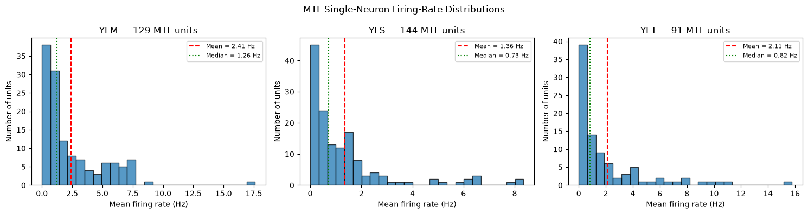
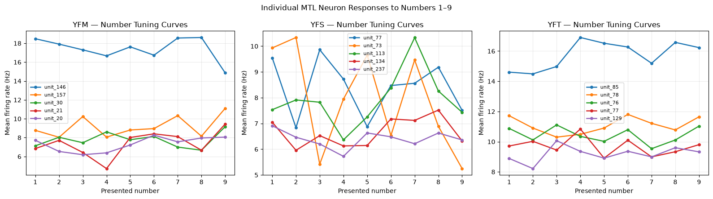
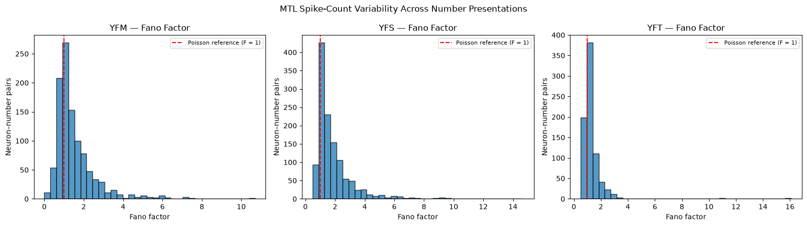
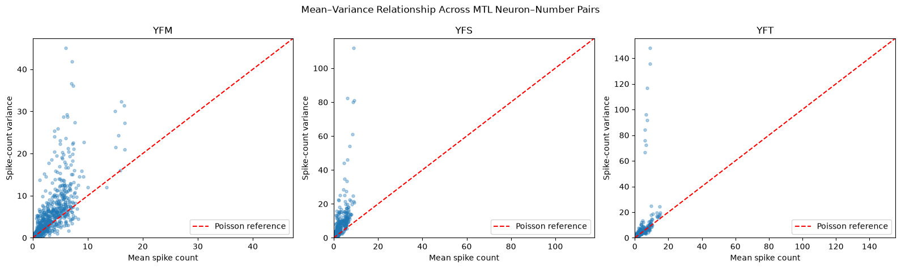
These updated MTL neurons are a **different set/count** from older sorting and from the original manuscript, so direct numerical comparisons require matched unit identity and analysis criteria. An earlier YFU extraction produced 494 presentations × 78 recorded units (62 MTL units used in one later temporal analysis); class counts for numbers 1–9 were `[53,67,52,62,51,48,65,49,47]`. The raw YFU count matrix contained 302,355 spikes, all nonnegative integers with no missing values.

**YFM class imbalance:** presentation counts `{1:19,2:17,3:14,4:4,5:14,6:16,7:10,8:12,9:8}`. Number 4 has only four observations. Class imbalance complicates centroids, covariance ellipsoids, permutations, and split-half analyses.

## C. Raw population geometry: PCA and descriptive statistics

For number k, calculate the class mean vector `mu_k = mean(X[y == k], axis=0)`. Center the nine means across conditions and examine their singular values, PCA and pairwise distances. **Affine rank 8 is generic for nine noisy points in sufficiently high dimensions**; it is not evidence by itself of an underlying eight-dimensional neural signal.

| Subject | Affine rank | Effective rank | Participation ratio | Mean pairwise centroid distance | Correlation neural distance vs. numerical distance |
|---|---:|---:|---:|---:|---:|
| YFM | 8 | 6.30 | 5.130 | 9.8062 | −0.1226 |
| YFS | 8 | 6.45 | 5.285 | 6.0108 | +0.0161 |
| YFT | 8 | 5.90 | 4.631 | 3.7459 | −0.031 (approx.) |

`Effective rank = exp(-sum_i p_i log p_i)` and `participation ratio = (sum_i lambda_i)^2 / sum_i lambda_i^2`, where `lambda_i` are nonnegative eigenvalues of the centered centroid covariance and `p_i = lambda_i / sum_j lambda_j`. These quantify the spread of signal *and estimation noise* across axes, not reliable signal dimensionality.

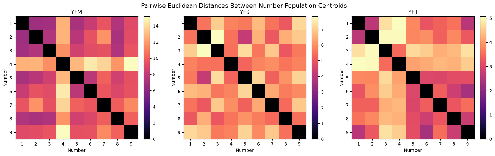

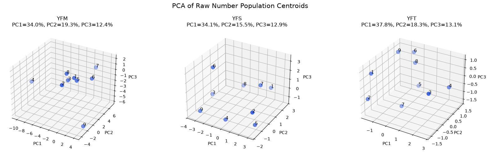
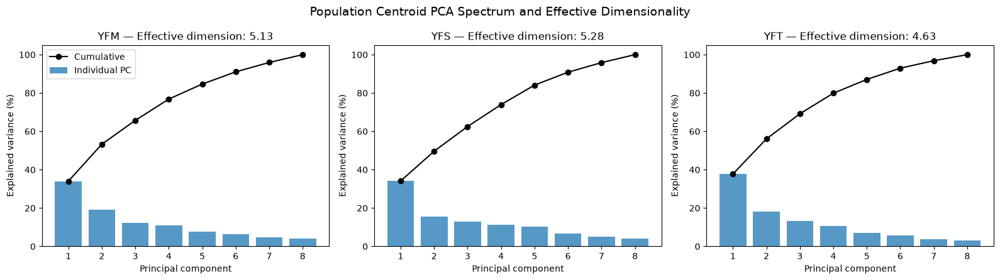

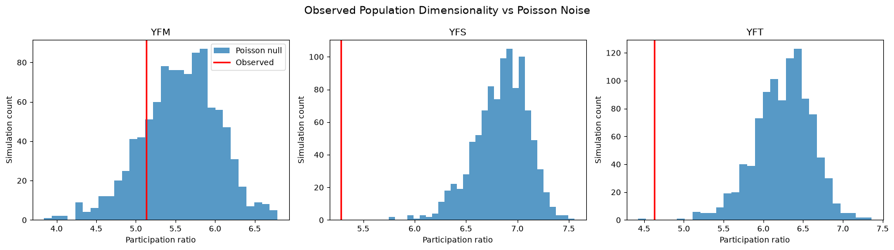
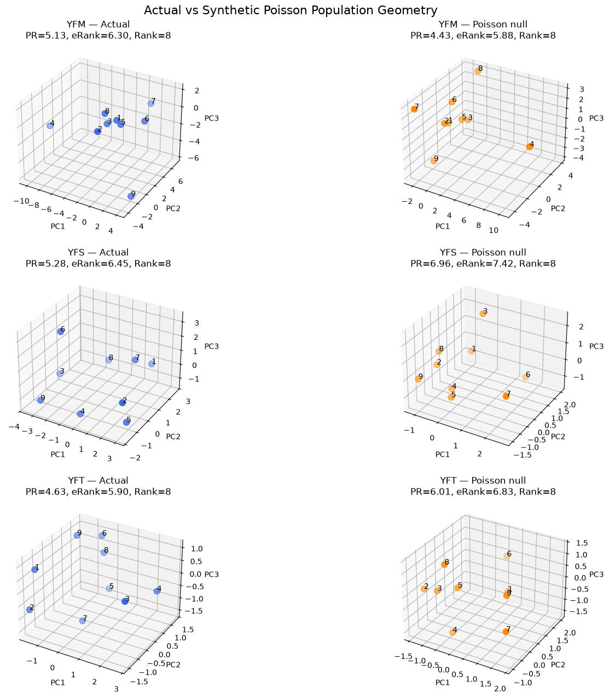
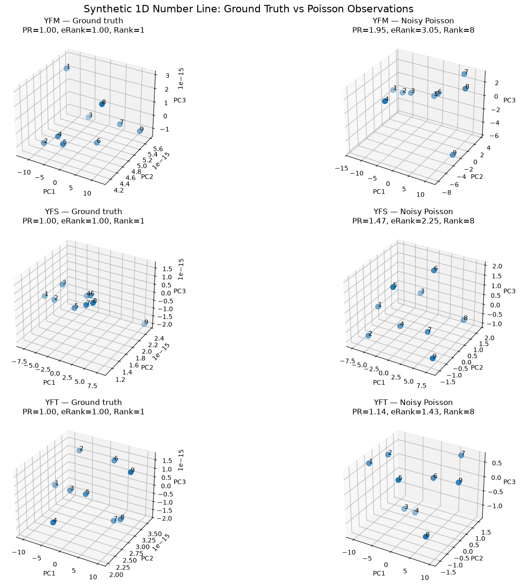

### Raw class-centroid PCA variance

| Subject | PC1 | PC2 | PC3 | First three total |
|---|---:|---:|---:|---:|
| YFM | 34.02% | 19.27% | 12.42% | 65.71% |
| YFS | 34.11% | 15.52% | 12.89% | 62.52% |
| YFT | 37.78% | 18.28% | 13.10% | 69.15% |

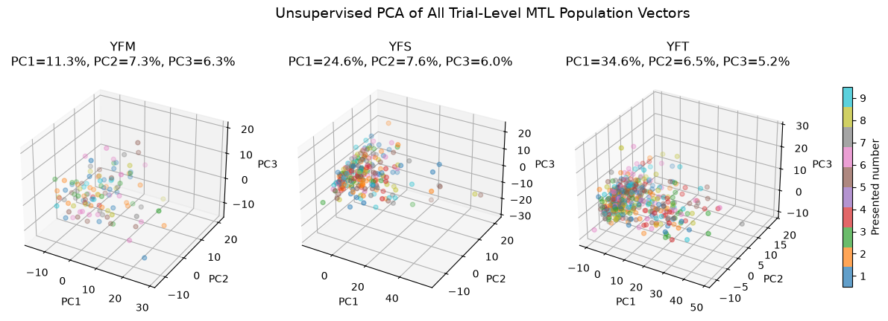
**Interpretation:** PCA of *nine means* and PCA of *all 114/264/477 presentations* are different objects. Three-dimensional plots of PCA projections are visual summaries, not inferential geometric tests. A small/weak numerical-distance correlation is insufficient to identify a simplex, and failure to support a straight line does not rule out an arbitrary smooth nonlinear curve.

## D. Unsupervised autoencoders versus PCA (completed)

We trained the following on **standardized raw 900-ms population firing-rate vectors**, with no number labels or temporal-spike bins as model input. The targets were the same neural response vectors (reconstruction), not nine-class classification:

1. **Linear autoencoder:** input dimension `p` → 3 → `p`, no nonlinearities; MSE loss optimized by Adam. A well-trained linear rank-3 AE should recover the PCA rank-3 subspace for squared-error reconstruction, though optimizers/validation results can differ.
2. **Nonlinear autoencoder:** `p → 32 → 3 → 32 → p`, ReLU hidden layers, MSE/Adam and early stopping. Tests whether a nonlinear three-dimensional manifold compresses the data more accurately than a linear 3D code.
3. **Sparse autoencoder:** `p → 64 → p`, ReLU encoder, linear decoder, L1 latent penalty of `0.01` and normalized decoder columns. Tests distributed/sparse overcomplete features, **not a three-dimensional latent hypothesis**.

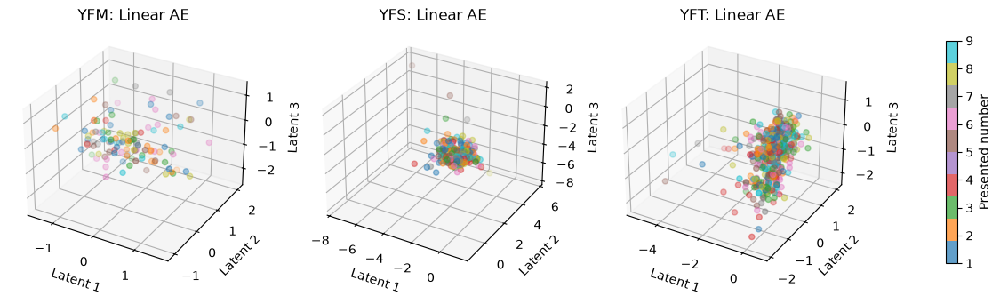
### Held-out reconstruction MSE (smaller is better)

| Model | YFM | YFS | YFT |
|---|---:|---:|---:|
| 3D PCA | 1.0828 | 0.8705 | 0.9996 |
| Linear 3D AE | 1.1192 | 0.8705 | 0.9996 |
| Nonlinear 3D AE | 1.1120 | 0.8578 | 0.9664 |
| Sparse 64-feature AE | 0.8177 | 0.6378 | 0.5463 |
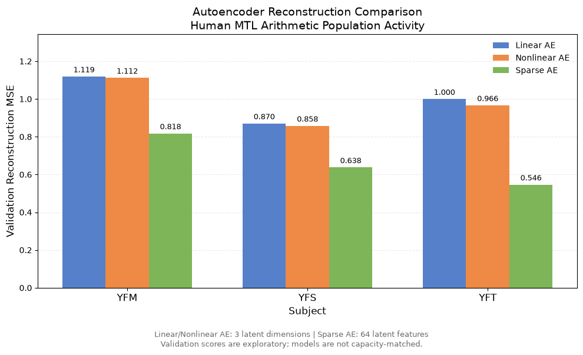

**Important control:** The sparse AE is more expressive (64 latent features versus three), so its lower reconstruction loss does **not** prove sparse number representation or superiority at a matched dimensionality. Sparse train MSEs were `0.1581/0.3192/0.3063` (YFM/YFS/YFT); average nonzero test features approximately `29.76/26.07/27.41` out of 64. Correlations of sparse feature-number tuning between train and validation were near zero (`−0.0314/−0.0569/+0.0423`): no evidence here for stable number-specific sparse axes. No VAE, denoising AE, or contrastive AE is documented as completed.

**Takeaway:** reconstruction ability is a different target from *reliable number geometry*. The AE experiments did not independently establish a high-dimensional number simplex.

## E. Figure 1: firing-rate and temporal decoding reproduction

The manuscript contrasts whole-window spike counts (one feature/neuron) and temporally binned spikes, where single-neuron multiclass LDA reads out numerical identity. On the paper's 11 patients, temporal number-coding prevalence increased from 3.36% to 24.80% for arithmetic; for dot counting 6.37% to 36.90%. Paper-reported mean arithmetic per-neuron temporal decoding gain was +3.79 percentage points. Exact figures are manuscript-reported, not our new results.

An **earlier broad replication** returned FR coding `26/552=4.71%` and temporal coding `160/552=28.99%` at nominal p<0.05. Across subjects, mean `4.82 ± 0.60% SEM` versus `29.28 ± 2.30% SEM`, paired `t(10)=10.51`, `p≈1.0e−6`. Separately, a 554-unit decoding inventory had 523 successful per-neuron FR/temporal rows, 29 missing-status YFI rows and two threshold-excluded; their mean FR accuracy was 10.54% versus temporal 14.49% (+3.94 pp). **These are earlier replications with incomplete rows and do not automatically establish a valid all-hyperparameter permutation p-value**. They also predate the updated 364-unit YFM/YFS/YFT sorting.

Our updated single-neuron comparison used three approaches:

- **Fixed 100-ms temporal LDA:** nine features per neuron from 50–950 ms; predeclared bins, no per-neuron tuning over bin lengths.
- **Optimized temporal LDA:** search 10 bin widths `[60,75,90,100,150,180,225,300,450,900]` ms times three LDA shrinkages `[0.2,0.5,0.8]` = **30 configurations**; select the greatest cross-validated nine-class accuracy for each neuron (4-fold CV in the newest reproduction). The manuscript's methodological description requests up to 10 folds and reduces when classes are sparse.
- **Gamma–Poisson Bayesian naive Bayes:** fixed nine 100-ms bins with gamma priors and posterior/predictive Poisson modeling as an alternative regularized count classifier. This is a distinct classifier, not another LDA.

### Mean neuron-level nine-class accuracy

| Subject (neurons) | Fixed LDA | Optimized LDA | Gamma–Poisson NB |
|---|---:|---:|---:|
| YFM (129) | 10.96% | 14.57% | 12.51% |
| YFS (144) | 11.16% | 13.45% | 11.27% |
| YFT (91) | 11.31% | 12.94% | 11.50% |

Nominal nine-class chance is 11.11%. These are **mean across neurons**; they are not the same as pooling all neurons into one subject-level classifier. Mean optimized accuracy alone does not test whether bin/gamma selection is statistically significant.

### Key permutation correction (most consequential result)

The initial approach optimized a neuron's bin size and shrinkage on real labels, but each shuffled-label null held those chosen settings fixed. That understates the null's opportunity to overfit while searching 30 configurations. The corrected **selection-aware null** repeats the entire 30-setting optimization for each of 200 label permutations, using the shuffled labels for selection and scoring; p-value `(1 + #null >= observed)/201`.

| Subject | Units | Original fixed-settings null: p<0.05 | Selection-aware null: p<0.05 | Original p≤0.125 | Selection-aware p≤0.125 |
|---|---:|---:|---:|---:|---:|
| YFM | 129 | 25 | 3 | 47 | 11 |
| YFS | 144 | 40 | 9 | 64 | 18 |
| YFT | 91 | 25 | 5 | 42 | 11 |
| **Total** | **364** | **90** | **17** | **153** | **40** |

Across 364 selection-aware p-values: **zero BH-FDR discoveries**; smallest p `0.004975`, smallest adjusted q approximately `0.5174`. Original observed/neuron mean accuracy and corrected shuffled-optimization mean were approximately YFM `14.57% / 14.83%`, YFS `13.45% / 13.34%`, YFT `12.94% / 12.86%`. These are descriptive means over neurons and shuffled procedures, not a single matched patient-level p-value. The fixed-bin procedure produced 21 nominal p<0.05 neurons in the three-subject comparison (subject-specific counts not carried into this report).

**Interpretation:** 17 nominal discoveries among 364 tests is close to the 18.2 expected at p<0.05 under a complete null. This is evidence that the **specific single-neuron optimized-significance claims should be revisited**, not proof that no population number information exists. Any feature selection at p≤0.125 and supervised LDA extraction subsequently used in Figure 2 also requires a nested or independently fitted validation design.

## F. Bayesian count representation and rate-versus-temporal controls

For temporally binned counts `x_ij` at bin width Δt, one model is `x_ij | y=k, λ_kj ~ Poisson(λ_kj Δt)` with prior `λ_kj ~ Gamma(α_j, β)` (shape/rate parameterization). The posterior mean rate is `λ*_{kj} = (α_j + sum_{i:y_i=k} x_ij) / (β + n_k Δt)`. We used shared `β=0.1` seconds and a pooled training-feature prior with floor 0.01 Hz in one calibration; **fit priors within training folds** for predictive comparisons.

For YFU, we validated an example 494×558 100-ms temporal count matrix (62 MTL units×9 bins), and the real posterior-rate centers were 9×558. Reconstructed rates matched the count-based formula to a mean absolute error ≈`1.736e−5 Hz` after correcting bin ordering and small count discrepancies. A simulated random-Poisson dataset based on saved rates gave a high *uncentered* posterior-center correlation `r=0.9745` but only `r=0.3608` after centering across number labels. Thus high raw-rate correlation can be driven by common neuron/bin means, not reliable number distinctions.

The YFU posterior-rate centroid geometry was: affine rank 8; effective rank `5.6859`, mean transition angle `124.8348°`. The Poisson-simulated comparison was rank 8, effective rank `5.7382`, angle `124.6934°`. These similar values are **a crucial counterexample**: they do not independently prove a simplex. A number-blind pooled-rate null is still required for testing number-dependent structure; simulation from class-conditioned estimated rates tests a different property (whether the fitted model reproduces aspects of the data).

A later three-subject gamma-posterior-mean analysis used 9×1161 (YFM), 9×1296 (YFS), 9×819 (YFT) feature matrices. A number-blind random-Poisson control was run 200 times per subject using pooled feature-wise rates and the same number counts. Even the null generated ~120° transition angles and high effective ranks:

| Subject | Observed angle | Null mean angle | Observed effective rank | Null mean effective rank | Observed PR | Null mean PR |
|---|---:|---:|---:|---:|---:|---:|
| YFM | 118.534° | 119.515° | 7.158 | 7.046 | 6.357 | 6.131 |
| YFS | 120.031° | 119.996° | 7.812 | 7.874 | 7.630 | 7.750 |
| YFT | 120.012° | 120.475° | 7.768 | 7.838 | 7.545 | 7.683 |
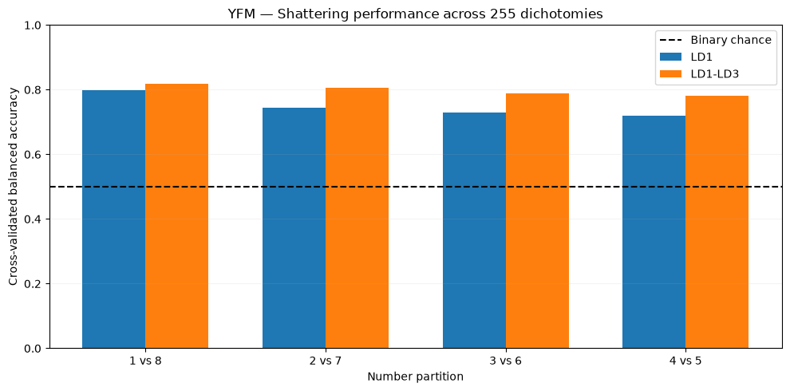

**Caveat:** these are posterior-rate *estimated-centroid* metrics, not the earlier raw 0.9-s firing-rate-vector metrics or the later LD1/LD1–LD3 metrics. The 200 simulations provide reference distributions, but no subject-level p-values are claimed here without the actual tail counts.

## G. Geometric metrics on single-neuron LDA population features (YFM)

Reconstructed single-neuron temporal discriminant coordinates were concatenated across neurons. This is a **supervised** representation: its fitting used labels across all presentations. We compared first component only (`Z1`, 114×129) against up to the first three (`Z3`, 114×387), with zero padding for missing components.

| Metric | LD1 all 129 neurons | LD1–LD3 all 129 neurons |
|---|---:|---:|
| Affine rank of nine means | 8 | 8 |
| Effective rank | 7.0082 | 7.2808 |
| Participation ratio | 6.2647 | 6.6400 |
| Mean sequential transition angle | 119.4911° | 119.3433° |
| SD of transition angle | 10.3485° | 8.6881° |
| Log simplex volume (implementation units) | 4.7614 | 7.6951 |
| Mean pairwise centroid distance | 8.8667 | 12.5591 |
| Distance CV | 0.1783 | 0.1556 |

The first-three-components representation has more uniform apparent centroid spread and more total separation, but its larger dimension and supervised fitting make raw log-volume and distance scale comparisons non-causal. The static three-dimensional PCA plots (clouds, centroids, covariance ellipsoids, closed 1→…→9→1 path) are **descriptive**, and the drawn closed polygon is not a full 8-simplex. Our LDA generalized-eigenvector construction is not identical in all respects to MATLAB `fitcdiscr` or scikit-learn LDA with `solver='lsqr'`.

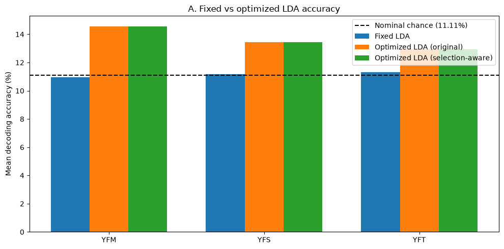
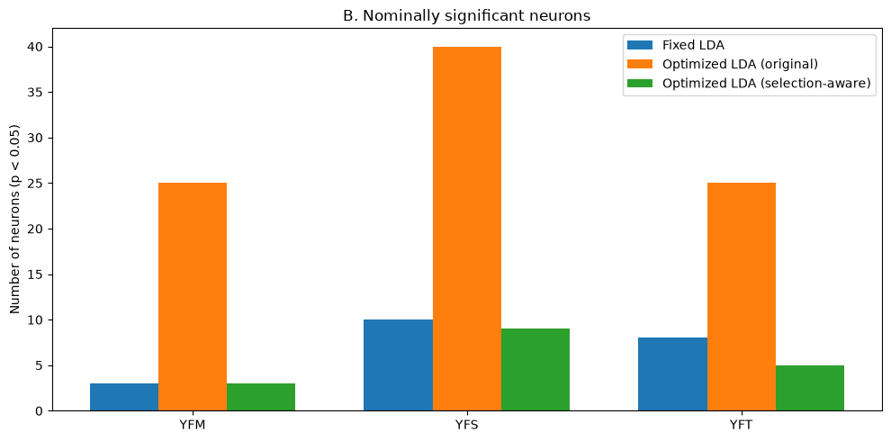
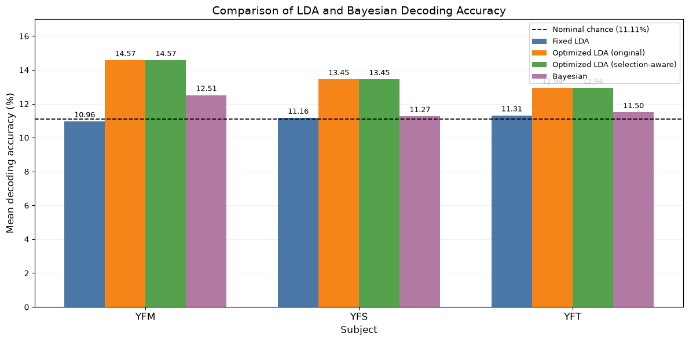
## H. Functional test performed today: exploratory SSD shattering (YFM)

Paper's concept: there are `(2^9−2)/2 = 255` unique nontrivial binary partitions of nine digits; partitions comprise `9` one-vs-eight, `36` two-vs-seven, `84` three-vs-six, and `126` four-vs-five. Binary labels identify *membership in a number subset*, not the precise digit.

We used the **original uncorrected p≤0.125 neuron selection**, yielding **47 YFM neurons**. For the binary SVM we used 47 LD1 features or 141 LD1–LD3 features, `StandardScaler` fitted on the training portion, `LinearSVC(C=1, class_weight='balanced')`, and `StratifiedGroupKFold(n_splits=3, groups=original_trial_id)`. Per partition, train a binary linear SVM on two folds, evaluate on the third; average balanced accuracy across valid folds. Average the 255 partition scores. No numerical label is held out as a *number identity* in SSD (unlike CCGP); different presentations of the same number can occur in training and testing.

| Measure | LD1 | LD1–LD3 |
|---|---:|---:|
| Features | 47 | 141 |
| Tested partitions | 255 | 255 |
| Mean balanced accuracy (exploratory SSD) | **0.7287** | **0.7891** |
| Median | 0.7340 | 0.7874 |
| SD across partitions | 0.0668 | 0.0515 |
| Improvement | — | **+6.04 percentage points** |

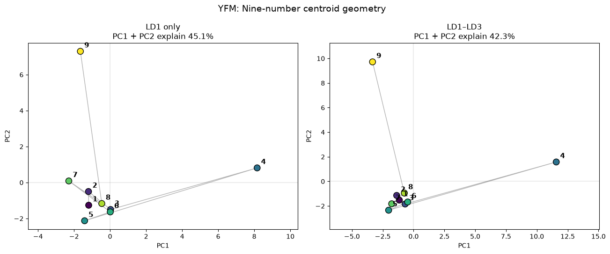
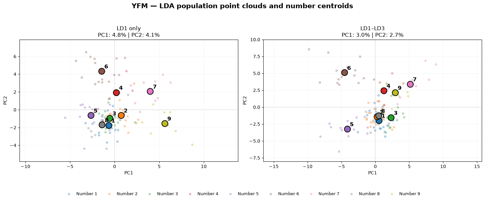
**Critical limitation:** both `Z1` and `Z3` were constructed with LDA using **all 114 labels**, even those later included in SVM test folds; neuron selection likewise used the full data. Thus the SVM has grouped trial folds but its inputs are *not independent of test labels*. The observed high SSD **cannot yet support an inferential claim or be compared as a validated replication of the manuscript's SSD**. Shuffling labels only at the fixed-SVM stage would not repair this. The manuscript itself already performs SSD, magnitude residualization, and low-dimensional PCA controls; our key new analysis would be end-to-end nested SSD.
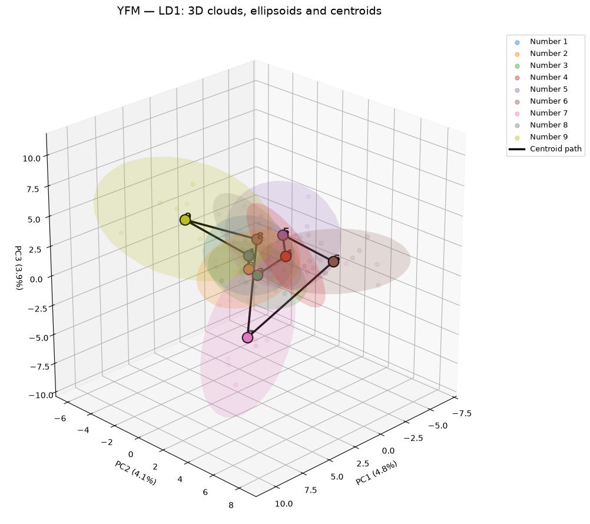
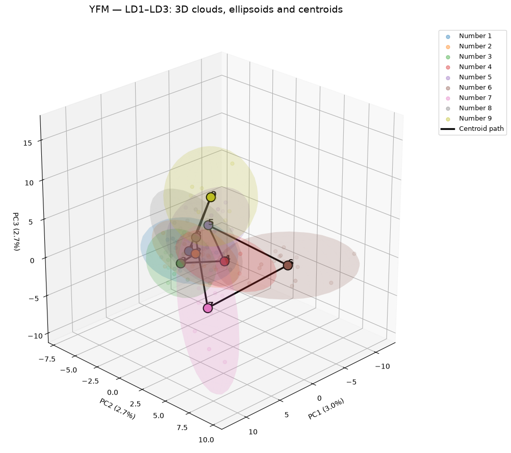
## I. Paper's existing Figure 1–2 tests versus proposed contribution

### Figure 1 (already in manuscript)

- Example firing-rate tuning, rasters, PSTHs, temporal-component LDA, neural decoding of 1–9, FR-vs-temporal improvements.
- Single-neuron shuffle significance (paper uses the real-label optimized bin and gamma settings during shuffles), rate and temporal coding-cell fractions, regional GLMM comparisons, preferred-number distributions.
- The strongest direct improvement is **re-optimizing the 30 candidate settings inside every permutation** and holding out original arithmetic trials when estimating numbers' predictability. Evaluate corrected results without implying corrected nominal p<0.05 means evidence of widespread tuning.

### Figure 2 (already in manuscript)

1. PCA visualization and example population tuning heatmap.
2. Split-half sequential transition angles, noisy log-number-line and matched-simplex controls.
3. Euclidean neural distance vs absolute numerical distance (mixed effects).
4. All-255-partition linear SVM SSD; magnitude-residualized SSD; PCA-restricted SSD at 1–4 dimensions.
5. CCGP across 11 meaningful numeric/visual/verbal dichotomies (hold out one number from each group).
6. Variance along linear and log-number-line projections vs residual condition-mean variance.
7. Position/rank of canonical 1→9 ordering among the 9! possible line orderings.

The paper reports dot-task mean SSD `0.7302 ± 0.0203` across n=10 subjects, arithmetic high SSD, and lower-bound PCA results for symbolic stimuli near three dimensions. It reports generally weak CCGP near chance except a stronger small–large distinction. **Neither high SSD nor low CCGP uniquely establishes a regular simplex or a specific coding mechanism.**

### Highest-value proposed tests (not in the reported Figure 2 pipeline)

| Priority | Test | New question answered | Main guardrail |
|---|---|---|---|
| **1** | **Fully nested, trial-grouped SSD and nulls** | Does arbitrary-partition capacity survive independent supervised feature fitting? | Repeat neuron selection, bin/gamma search, LDA and SVM in each training fold; repeat entire pipeline under permutations. |
| **2** | **Cross-validated crossnobis RSA / geometry** | Are the 36 pairwise number distances reliably nonzero and their shape reproducible? | Independent splits, noise-covariance shrinkage, subject-level uncertainty and matched model recovery. |
| 3 | **Capacity versus neuron count** | Is high-dimensional linear-readout ability robustly distributed across neurons? | Equalize trials/features, repeat neuron subsampling, compare against number-blind and low-rank nulls. |
| 4 | **Operand-role and temporal generalization** | Does number geometry survive context/motor/position changes? | Train on operand 1; test on operand 2 and vice versa, plus cue-/response-matched controls. |
| 5 | **Parallelism score (PS) for abstract axes** | Are condition-difference directions consistent across different numerical contexts? | Benchmark against matched random geometries; the paper already computes CCGP, but PS is complementary. |
| 6 | **Line/curve/irregular simplex/random mixed-selectivity recovery** | Which ground-truth geometry could pass the current tests under observed noise? | Match number counts, baseline rates, Fano/noise covariance, and feature selection; score false-positive and recovery rates. |

Crossnobis and PS are not equivalents of SSD. Crossnobis tests reproducible geometry; PS tests consistency of candidate abstract-category axes; neuron-count capacity tests robustness of function. Related foundations include Rigotti et al. (2013), Bernardi et al. (2020), Diedrichsen & Kriegeskorte (2017), and Chung et al. (2018).

## J. Reviewer-facing issues and precise proposed responses

| Review concern / logical weakness | What we found | Proposed response |
|---|---|---|
| Geometry may arise from noise or arbitrary mixed selectivity | Raw and posterior means have generic affine rank 8; Poisson null yields ~120° | Matched null family and calibrated significance for **reliable** centroid structure, plus synthetic power analysis. |
| Angles ≈120° are not a unique simplex fingerprint | Observed and no-number Poisson controls show similar angle means | Report null percentile/p-values, not only angle proximity; test 1D line, nonlinear 2D curve, random points, and irregular 8D simplex. |
| Supervised temporal feature selection inflates separation | Selection-aware 17/364 vs 90/364 nominal | Nested training-only optimization and permutation across the full procedure. |
| Weak single-neuron number signal versus rich population | Corrected single-unit FDR discoveries = 0; exploratory SSD 0.7891 | Preserve distinction: population information may exist without significant individually tuned units, but must be demonstrated independently. |
| Motor plan, operand identity/position and task context | Arithmetic contains two operand presentations per trial | Group by trial; cross-operand/cue-position generalization; matched-response confound analyses. |
| Unequal class counts and uncertain geometry | YFM number 4 has only four presentations | Balanced/resampled subject-level confidence intervals; avoid interpreting unstable per-class ellipsoids. |
| Regional comparison may lack statistical power | Paper Figure 1 region GLMM has nonsignificant region effect | Report uncertainty and detectable effect sizes; absence of significance ≠ regional equivalence. |
| Generalization of symbolic vs dot and other tasks | Outside our current Figure 1–2 scope | Flag as later manuscript issue, not the central claim of this analysis. |

## K. What we can safely claim today

1. **Completed:** raw population extraction, 3D class-centroid PCA, rank/PR/effective-rank/distance summaries, linear/nonlinear/sparse AE reconstruction, fixed-vs-optimized-vs-Bayesian single-neuron comparison, original and selection-aware permutations, posterior-rate geometry and 200 pooled-Poisson nulls, YFM LD1-vs-LD1–LD3 descriptive geometry, exploratory 255-partition SSD.
2. **Supported major caution:** affine rank 8 and ~120° turns occur with matched random data; several appealing geometric quantities are non-specific without nulls. Original per-neuron tuning significance substantially weakens under a selection-aware null.
3. **Not yet established:** statistically significant selection-aware SSD, cross-validated crossnobis geometry, a validated >2D reliable number signal, true regular 8-simplex, temporal benefit beyond selection artifacts, stable operand-invariant number axes, or a detailed 1D/2D/8D recovery simulation suite.
4. **Proposed figure-level contribution:** one multi-panel plot showing (i) nested raw/LD1/LD1–LD3 SSD vs null, (ii) dimensionality-restricted nested SSD from dimensions 1–8, (iii) crossnobis RDM and cross-half replication, (iv) line/curve/random/simplex simulated recovery and false-positive rates, (v) trial- and neuron-count scaling, and optionally cross-operand generalization.

## L. Suggested short verbal presentation to advisor

> “We reconstructed the arithmetic number representations from spikes using raw firing rates, temporal LDA coordinates, and independent Bayesian count features. Raw PCA and autoencoder analysis show complex response structure but do not by themselves determine reliable number geometry. The main statistical finding is that the original neuron-level significance procedure is highly sensitive to whether bin and shrinkage optimization is repeated in label permutations: nominal p<0.05 neurons fall from 90 to 17 across 364 units, with no FDR discoveries. Also, matched random Poisson populations can produce affine rank eight and transition angles near 120 degrees. Our exploratory shattering score in YFM is 72.9% using LD1 and 78.9% using LD1–LD3, but the supervised LDA construction leaks labels into the downstream held-out SVM. I propose a rigorous contribution centered on nested trial-grouped shattering dimensionality plus cross-validated representational geometry, evaluated against noise-matched line, curve, random-code and simplex controls. That would directly address whether number representations are reliably high-dimensional rather than only apparently so.”

## Sources and provenance

**Paper used:** Zhu et al., *A number simplex in the human medial temporal lobe*, 2026 bioRxiv preprint DOI `10.64898/2026.06.25.734462`, especially pp. 5–14 and Methods pp. 42–63. Paper results and our reproductions are separated above.

**Foundational methods:** Rigotti et al., *Nature* (2013), DOI `10.1038/nature12160`; Bernardi et al., *Cell* (2020), DOI `10.1016/j.cell.2020.09.031`; Chung et al., *Physical Review X* (2018), DOI `10.1103/PhysRevX.8.031003`; Diedrichsen & Kriegeskorte, *PLOS Computational Biology* (2017), DOI `10.1371/journal.pcbi.1005508`.

**Provenance caveat:** Numerical results were recovered from our prior notebook outputs and discussion summaries rather than recomputed from raw files while preparing this recap. Where a statistic lacked a verified p-value or file, no significance claim is made. The Poisson-posterior, raw-rate, and LD feature spaces and early-versus-updated subject cohorts must not be conflated.
