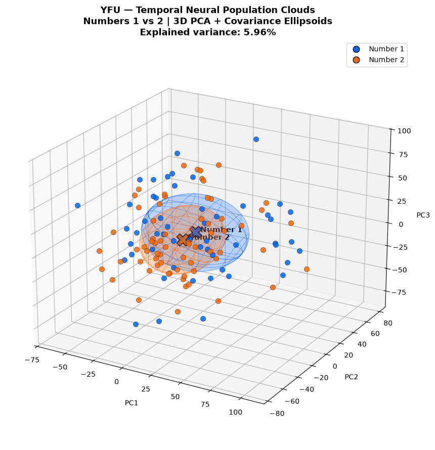
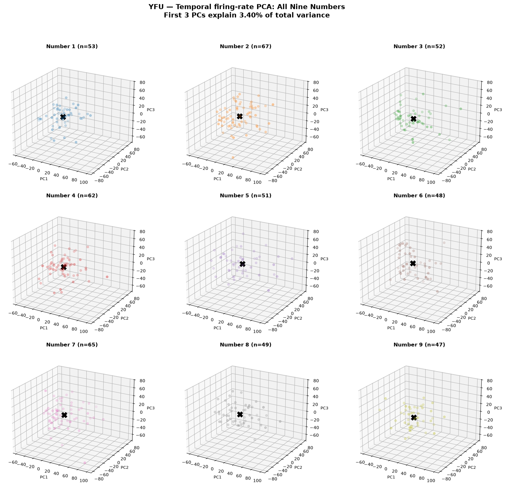
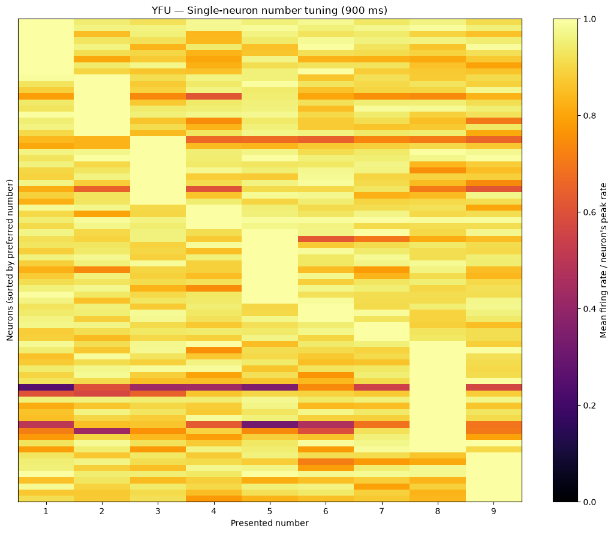
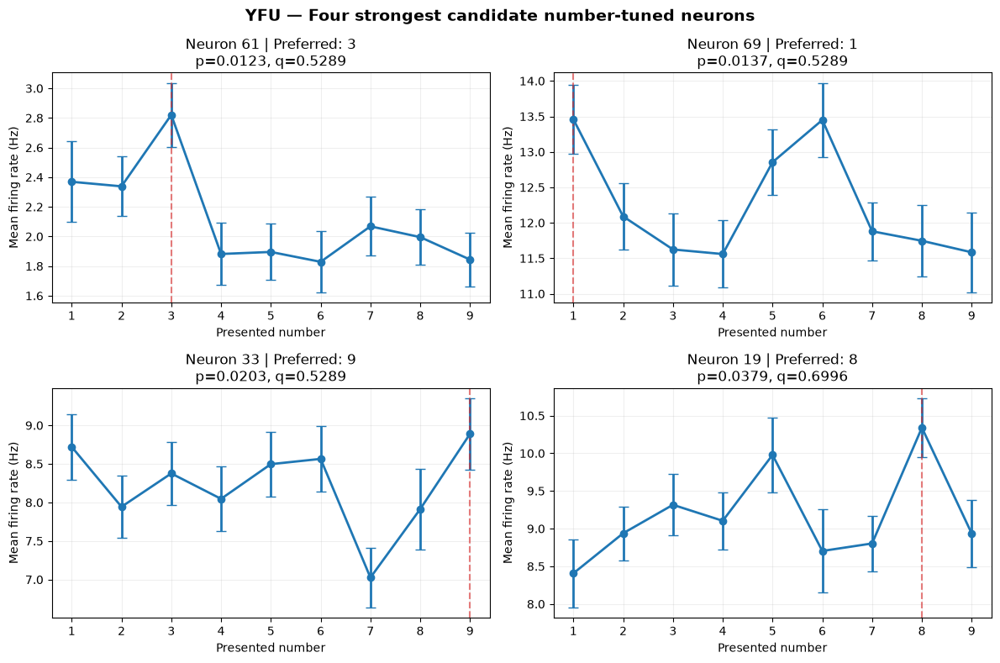

# YFU — Direct Neural Population Geometry Analysis

**Subject:** YFU  
**Task:** Arithmetic  
**Analysis:** Raw population geometry, temporal population geometry, and single-neuron number tuning

## 1. 

1. Do the neural population responses to numbers 1–9 form an eight-dimensional simplex?
2. Does the same geometry emerge from randomly sampled neural responses?
3. Does preserving temporal firing-rate information improve the geometric representation?
4. Are there individual neurons that respond selectively to particular numbers?

---

## 2. Dataset Summary

| Feature | Description |
|---|---|
| Subject | YFU |
| Brain region | Medial temporal lobe (MTL) |
| Task | Arithmetic |
| Behavioral trials | 300 |
| Number presentations | 494 |
| Presented numbers | 1–9 |
| Recorded neurons | 78 |
| Spike data | MATLAB sparse matrix (`spikes.mat`) |
| Behavioral data | `photoBehavEvents.csv` |
| Spike matrix dimensions | 78 × 2,273,935 |
| Response window | 50–950 ms after operand onset |
| Response duration | 900 ms |
| Total-count population matrix | 494 × 78 |
| Temporal population matrix | 494 × 702 |
| Temporal bin size | 100 ms |
| Number of temporal bins | 9 |
| Mean firing rate | 8.7187 Hz |

### Number presentations

| Number | Presentations |
|---|---:|
| 1 | 53 |
| 2 | 67 |
| 3 | 52 |
| 4 | 62 |
| 5 | 51 |
| 6 | 48 |
| 7 | 65 |
| 8 | 49 |
| 9 | 47 |
| **Total** | **494** |

---

## 3. Data Preparation and Population Representation

### 3.1 Raw population firing rates

For each number presentation, we extracted the spike counts of all 78 neurons during the 900 ms response window.

```math
r_j=\frac{\text{Spike count of neuron }j}{0.9}
```

Each presentation was represented as a 78-dimensional neural population vector.

```math
\mathbf{x}_t=(r_1,r_2,\ldots,r_{78})
```

**Population matrix:** 494 presentations × 78 neurons.

### 3.2 Temporal population firing rates

The 900 ms response window was divided into nine nonoverlapping 100 ms bins.

| Bin | Time after operand onset |
|---|---|
| 1 | 50–150 ms |
| 2 | 150–250 ms |
| 3 | 250–350 ms |
| 4 | 350–450 ms |
| 5 | 450–550 ms |
| 6 | 550–650 ms |
| 7 | 650–750 ms |
| 8 | 750–850 ms |
| 9 | 850–950 ms |

```math
r_{j,b}=\frac{\text{Spike count of neuron }j\text{ in bin }b}{0.1}
```

Each presentation was represented by 78 neurons × 9 time bins = **702 temporal firing-rate features**.

**Temporal population matrix:** 494 × 702.

**Validation:** Summing the nine temporal spike-count bins exactly recovered the original 900 ms spike counts.

---

## 4. Population Geometry — Methods

For each number, we calculated its mean population response (centroid).

```math
\boldsymbol{\mu}_k=\frac{1}{N_k}\sum_{t:y_t=k}\mathbf{x}_t
```

The nine centroids form a 9 × 78 matrix for raw responses or a 9 × 702 matrix for temporal responses.

### Five geometric analyses

| Method | Procedure |
|---|---|
| **1. Original centroids** | Calculate the mean population response for each of the nine numbers |
| **2. Bootstrap centroids** | Resample presentations within each number group with replacement and recalculate centroids; 1,000 repetitions |
| **3. Pooled-noise centroids** | Ignore number labels; sample from the pooled population with the original class sizes and calculate nine centroids; 1,000 repetitions |
| **4. Labeled single vectors** | Randomly select one actual population response from each of the nine number groups; 1,000 repetitions |
| **5. Pooled single vectors** | Randomly select nine distinct population responses from the pooled data without using number labels; 1,000 repetitions |

The same five methods were applied to the raw and temporal population representations.

### Geometric features

| Feature | Description |
|---|---|
| Affine rank | Number of linearly independent directions among the centered centroids |
| Mean distance | Mean of the 36 pairwise Euclidean distances |
| Minimum / maximum distance | Smallest and largest pairwise centroid distances |
| Distance CV | Standard deviation / mean of pairwise distances |
| Effective dimension | Participation ratio of squared singular values |
| Condition number | Largest / smallest nonzero singular value |
| Log volume | Logarithm of the eight-dimensional simplex volume |
| Relative volume | Simplex volume divided by the regular-simplex volume at the same mean edge length |
| Singular values | Eight singular values of the centered nine-point configuration |

---

## 5. Stage 1 — Raw Population Geometry (78D)

**Input:** 900 ms spike counts, 494 × 78.

The raw analysis used spike counts rather than rates; converting every feature to Hz by dividing by 0.9 would not change the scale-independent geometric measures.

### 5.1 Comparison of all five methods

Values are the original measurement or the mean across 1,000 repetitions.

| Geometric feature | Original centroids | Bootstrap | Pooled-noise centroids | Labeled single vectors | Pooled single vectors |
|---|---:|---:|---:|---:|---:|
| Rank | 8 | 8 | 8 | 8 | 8 |
| Mean distance | 5.1072 | 7.1984 | 5.1393 | 37.8305 | 37.7003 |
| Minimum distance | 4.0716 | 5.6417 | 3.9989 | 29.6015 | 29.4716 |
| Maximum distance | 6.0452 | 8.9944 | 6.4621 | 47.4412 | 47.3836 |
| Distance CV | 0.1034 | 0.1117 | 0.1128 | 0.1132 | 0.1138 |
| Effective dimension | 6.6710 | 6.5693 | 6.4512 | 6.5007 | 6.4967 |
| Condition number | 2.0124 | 2.1093 | 2.1976 | 2.1387 | 2.1436 |
| Log volume | 0.4231 | 3.1149 | 0.3751 | 16.3694 | 16.3417 |
| Relative volume | 0.7093 | 0.6788 | 0.6511 | 0.6694 | 0.6689 |

### 5.2 Original raw centroid singular values

| Singular value | Value |
|---|---:|
| SV1 | 4.9599 |
| SV2 | 4.3319 |
| SV3 | 4.0937 |
| SV4 | 3.4254 |
| SV5 | 3.1275 |
| SV6 | 3.1001 |
| SV7 | 2.8499 |
| SV8 | 2.4647 |

### 5.3 Raw centroid separation and variability

| Feature | Value |
|---|---:|
| Mean centroid distance | 5.1072 |
| Mean within-number RMS spread | 26.68 |
| Centroid distance / spread | 0.191 |
| Correlation of centroid distance with numerical distance | 0.056 |

**Observation:** The original centroids have affine rank 8, but the pooled-noise and single-vector controls produce similar geometric properties.

---



## 6. Stage 2 — Temporal Population Geometry (702D)

**Input:** Nine 100 ms firing-rate bins per neuron, 494 × 702.

### 6.1 Comparison of all five temporal methods

| Geometric feature | Original centroids | Bootstrap | Pooled-noise centroids | Labeled single vectors | Pooled single vectors |
|---|---:|---:|---:|---:|---:|
| Rank | 8 | 8 | 8 | 8 | 8 |
| Mean distance | 46.7111 | 66.4176 | 47.6022 | 350.5535 | 350.2518 |
| Minimum distance | 40.5437 | 57.5550 | 41.6490 | 322.2964 | 322.1534 |
| Maximum distance | 52.1387 | 75.0661 | 53.4979 | 380.3712 | 380.2259 |
| Distance CV | 0.0642 | 0.0647 | 0.0594 | 0.0398 | 0.0398 |
| Effective dimension | 7.6605 | 7.6466 | 7.6072 | 7.8016 | 7.8003 |
| Condition number | 1.3860 | 1.3992 | 1.4296 | 1.2827 | 1.2824 |
| Log volume | 18.3970 | 21.2105 | 18.5330 | 34.5521 | 34.5451 |
| Relative volume | 0.9265 | 0.9260 | 0.9138 | 0.9569 | 0.9567 |

### 6.2 Original temporal centroid singular values

| Singular value | Value |
|---|---:|
| SV1 | 38.0480 |
| SV2 | 36.2129 |
| SV3 | 35.4942 |
| SV4 | 34.2575 |
| SV5 | 32.9020 |
| SV6 | 29.7931 |
| SV7 | 29.1129 |
| SV8 | 27.4512 |

### 6.3 Raw versus temporal centroid geometry

Scale-independent geometric features:

| Feature | Raw 78D | Temporal 702D |
|---|---:|---:|
| Rank | 8 | 8 |
| Distance CV | 0.1034 | 0.0642 |
| Effective dimension | 6.6710 | 7.6605 |
| Condition number | 2.0124 | 1.3860 |
| Relative volume | 0.7093 | 0.9265 |

**Observation:** Temporal binning produces a more regular eight-dimensional simplex, but matched pooled-noise controls also produce near-regular configurations.

---

## 7. Cross-Validated Temporal Population Distances

We divided whole behavioral trials into two groups, A and B, and calculated number centroids independently.

```math
D_{ij}^{CV}=(\boldsymbol{\mu}_i^A-\boldsymbol{\mu}_j^A)^\top(\boldsymbol{\mu}_i^B-\boldsymbol{\mu}_j^B)
```

| Feature | Result |
|---|---:|
| Random trial-grouped splits | 1,000 |
| Number pairs | 36 |
| Mean cross-validated squared distance | −97.9948 Hz² |
| Minimum | −430.8383 Hz² |
| Maximum | 311.2100 Hz² |
| Positive number pairs | 8/36 |

**Observation:** Most estimated cross-validated squared distances were negative, suggesting that number-specific difference directions were not consistently recovered across the sampled trial splits. Task-composition and dependence effects require further investigation.

---

## 8. PCA and Neural Response Clouds

We performed unsupervised PCA on the temporal firing-rate responses and visualized the individual number clouds.

| Analysis | Result |
|---|---|
| All nine numbers, first three PCs | 3.40% explained variance |
| Numbers 1, 5, and 9, first three PCs | 5.53% explained variance |
| Numbers 1 and 2, first three PCs | 5.96% explained variance |
| Covariance ellipsoids | Substantial overlap for numbers 1 and 2 |
| Temporal centroid separation / RMS spread | Approximately 0.15–0.21 across number pairs |

**Observation:** Individual neural response clouds overlap substantially in the first three PCs, although most of the total variance lies outside these projections.

---

## 9. Stage 3 — Individual-Neuron Number Tuning

### 9.1 Methods

For each of the 78 neurons, we calculated the mean firing rate for each presented number using the 900 ms response window.

```math
f_j(k)=\frac{1}{N_k}\sum_{t:y_t=k}r_{tj}
```

The observed preferred number was defined as the number with the maximum mean firing rate.

```math
k_j^*=\operatorname*{arg\,max}_{k\in\{1,\ldots,9\}}f_j(k)
```




### 9.2 Distribution of preferred numbers

| Preferred number | Neurons |
|---|---:|
| 1 | 9 |
| 2 | 10 |
| 3 | 11 |
| 4 | 4 |
| 5 | 12 |
| 6 | 3 |
| 7 | 3 |
| 8 | 18 |
| 9 | 8 |
| **Total** | **78** |

Every neuron has an observed maximum, so preferred-number counts alone do not establish number selectivity.

### 9.3 Number-selectivity testing

We applied a Kruskal–Wallis test across the nine number groups for each neuron, followed by Benjamini–Hochberg FDR correction across all 78 tests.

| Statistical result | Neurons |
|---|---:|
| Total tested | 78 |
| Nominal p < 0.05 | 4 |
| FDR-adjusted q < 0.05 | 0 |

### 9.4 Four strongest candidate neurons

| Neuron index (0-based) | Preferred number | Raw p-value | FDR q-value |
|---|---:|---:|---:|
| 61 | 3 | 0.0123 | 0.5289 |
| 69 | 1 | 0.0137 | 0.5289 |
| 33 | 9 | 0.0203 | 0.5289 |
| 19 | 8 | 0.0379 | 0.6996 |

**Observation:** Four neurons were nominally significant, but none survived FDR correction. These remain exploratory candidates, not confirmed number-selective neurons.

The statistical screening did not yet account for within-trial dependence, operand position, or arithmetic-task conditions.

---

## 10. Main Findings

| Analysis | Main finding |
|---|---|
| Raw population centroids | Full affine rank 8 |
| Raw pooled-noise controls | Similar simplex geometry |
| Temporal population centroids | More regular simplex, relative volume 0.9265 |
| Temporal pooled-noise controls | Similar regularity, relative volume 0.9138 |
| Temporal single-vector controls | Labeled and pooled results nearly identical |
| Cross-validated distances | 8/36 positive pairs |
| PCA visualization | Strong overlap in the first three PCs |
| Single-neuron tuning | 4 nominal candidates; 0 FDR-significant |

**Preliminary interpretation:** The observed high-dimensional simplex geometry is reproducible under pooled-noise sampling and therefore is not, by itself, sufficient evidence of a number-specific simplex representation.

These analyses use raw population responses rather than the paper's complete supervised temporal-LDA pipeline.

---




## 11. Questions and Next Steps

1. Could the neural population represent numbers along a line, curved manifold, or mixed-selectivity geometry instead of a simplex?
2. How can we distinguish genuine number-specific geometry from generic high-dimensional sampling effects?
3. Would temporal tuning analyses reveal number-selective neurons missed by the 900 ms firing-rate analysis?
4. How should operand position, arithmetic operation, and trial dependencies be controlled?
5. Can synthetic data with known 1D, 2D, and 8D geometries establish whether our analysis pipeline reliably recovers the correct representation?

---

## 12. Data and Output Files

| File | Description |
|---|---|
| `photoBehavEvents.csv` | Original arithmetic behavioral events |
| `spikes.mat` | Original sparse spike recordings |
| `YFU_arithmetic_presentations.csv` | Extracted number presentations and onset times |
| `YFU_arithmetic_raw_spike_counts.csv` | 494 × 78 total spike counts |
| `YFU_arithmetic_temporal_counts_100ms.csv` | 494 × 702 temporal spike counts |
| `YFU_arithmetic_temporal_rates_100ms.csv` | 494 × 702 temporal firing rates |
| `YFU_count_vs_temporal_geometry_comparison.csv` | Combined geometry comparison |
| `YFU_single_neuron_number_selectivity.csv` | Single-neuron tuning and statistical screening |

**Analysis notebook:** `notebooks1/direct_population_geometry.ipynb`