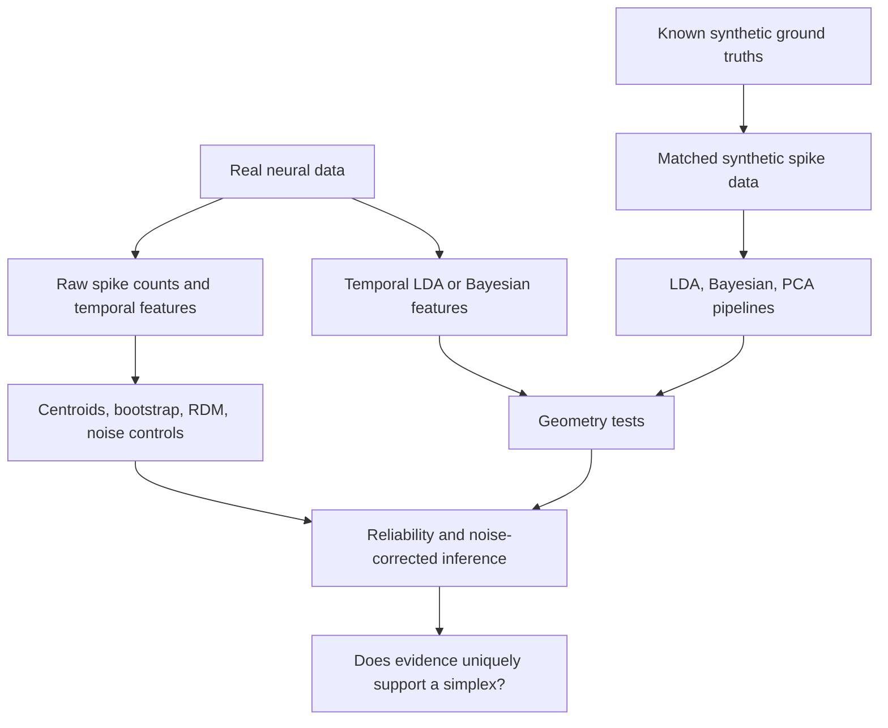
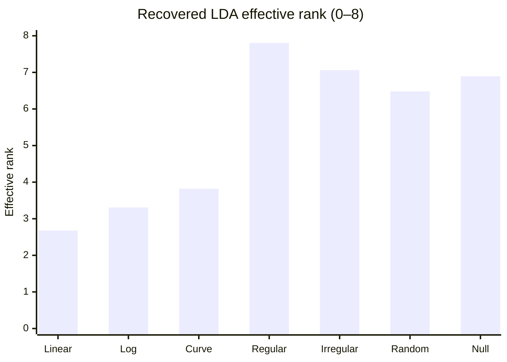
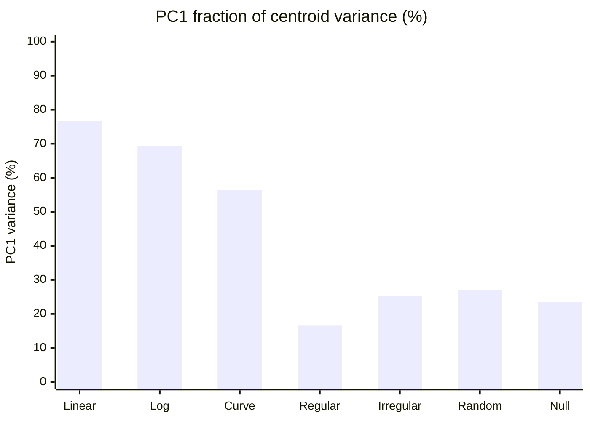
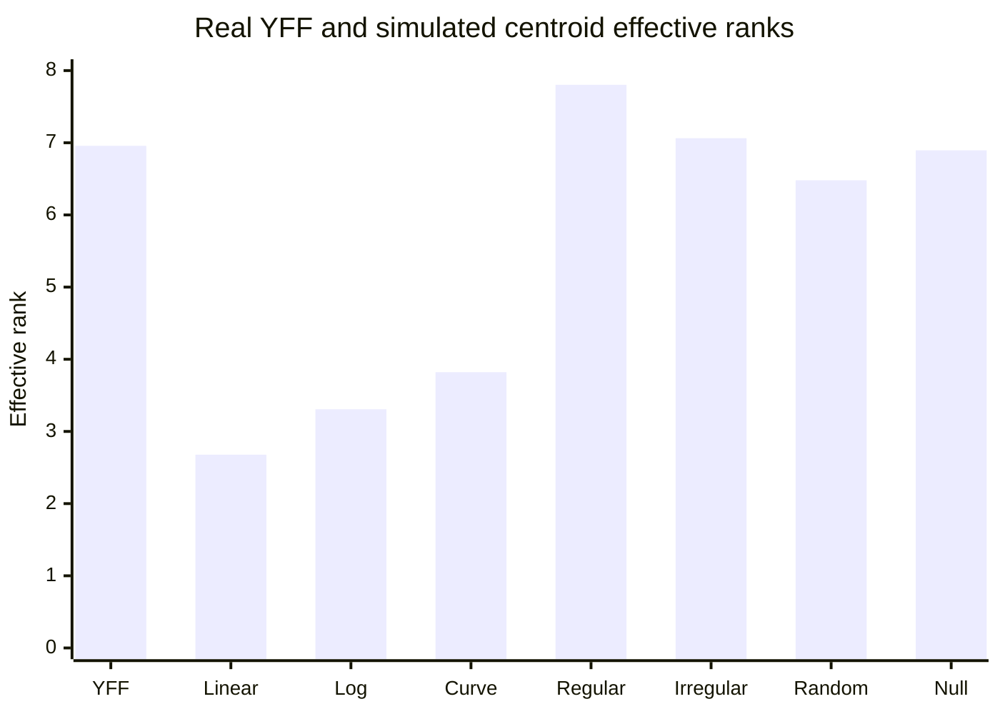

# Number Simplex Reproduction 
 
 Neural representation of symbolic numbers 1–9; real MTL recordings, raw-population controls, Bayesian representations, temporal LDA, and synthetic ground-truth recovery.  

## 1.  structure

| Workstream | Data/representation | Primary question | Current position |
|---|---|---|---|
| A. Real neural geometry | Raw spike counts, temporal counts, class centroids, RDMs | Is number-dependent geometry reliable without supervised projection? | Raw controls and split-half tests performed; reliability weak |
| B. Model-derived geometry | Temporal LDA components; Bayesian-derived features | Do modeling choices preserve or distort geometry? | LDA real-data effective rank computed; Bayesian geometry explored |
| C. Ground-truth recovery | Simulated line, log line, curve, simplexes, random high-D, null | Can the pipeline recover known dimensionality and simplex-specific structure? | Seven LDA simulations completed, one replicate each |
| D. Reviewer-directed robustness | Random Poisson controls, unsupervised PCA, selection thresholds, permutation nesting | Could reported simplex evidence be a pipeline artifact? | Several controls started; major robustness tests remain |

## 2. How the project developed

| Stage | Analyses | What we learned | Status |
|---|---|---|---|
| 1. Decoder comparisons | Single-neuron LDA, multinomial logistic regression, Poisson/Gamma–Poisson Bayesian classifiers | Accuracy alone does not establish a representation; some results near nine-class chance (11.11%) | Explored |
| 2. Population and paired tests | Paired-neuron and population-level decoding; temporal features | Population effects depend on feature construction and fitting | Explored; not a geometry proof |
| 3. Raw neural geometry | Spike-count vectors, number centroids, PCA/temporal features | Raw centroid geometry can be dominated by sampling noise | Measured |
| 4. Bootstrap and controls | Resampling, label-free pooled control, split-half RDM | Geometry appears weakly reproducible in tested YFU analysis | Measured, preliminary |
| 5. Bayesian representation | Bayesian-derived Lambda geometry, fit to geometric references | A simplex-like fit does not guarantee regularity or reliability | Preliminary |
| 6. LDA ground-truth recovery | Seven synthetic geometries through temporal LDA | Effective rank distinguishes some low-D from high-D inputs; affine rank does not | Measured, one replicate |
| 7. Real LDA geometry | YFF temporal LDA centroid spectrum | Effective rank 6.957, affine rank 8 | Measured, in-sample |

## 3. Real data: extraction and setup

| Item | YFU raw arithmetic analysis | YFF temporal LDA analysis |
|---|---|---|
| Task | Arithmetic operand presentations | Arithmetic, population temporal LDA |
| Number labels | 1–9 | 1–9 |
| Presentations | 494 | 109 |
| Neurons | 78 extracted raw units | Selected neuron-derived features |
| Feature matrix | 494 × 78 spike counts | 109 × 59 LDA components |
| Window | 50–950 ms after operand onset (900 ms) | Temporal LDA features from selected bins |
| Standardization | Raw counts / firing rates depending on test | Columnwise z-scored (`X_z`) |
| Centroids | 9 × 78 | 9 × 59 |
| Caution | Sampling noise and class imbalance | Supervised, in-sample projection |

**YFU class counts:**

| Number | 1 | 2 | 3 | 4 | 5 | 6 | 7 | 8 | 9 | Total |
|---|---:|---:|---:|---:|---:|---:|---:|---:|---:|---:|
| Presentations | 53 | 67 | 52 | 62 | 51 | 48 | 65 | 49 | 47 | 494 |

## 4. Raw neural geometry, bootstrap and RDM controls

The following numbers are retained from the prior working summary; **verify exact estimator, feature scaling, and saved notebook output before publication**.

| Analysis | Mean pairwise distance | Shannon effective rank | Interpretation / caution |
|---|---:|---:|---|
| Original raw YFU centroids | 5.107 | 6.671 | Observed geometry; not necessarily reliable signal |
| Pooled label-free noise control | 5.139 | 6.451 | Similar to raw centroids: important negative control |
| Raw temporal centroids | — | 7.661 | Different feature space; cannot compare ranks naively |
| Single-vector-per-number sampling | 350.55 | 7.802 | Very noisy estimator; distance scale differs |
| Earlier centroid bootstrap | 7.198 | — | Resampling changes estimated distance; not evidence of better geometry |

### Bootstrap and split-half reproducibility

| Quantity | Observed value | Meaning |
|---|---:|---|
| Bootstrap samples | 500 | Resampling analysis |
| Original mean squared centroid distance | 18.1005 | Scale-specific baseline |
| Bootstrap mean SD | 4.1994 | Variability of resampled estimate; verify precise definition |
| Split-half presentation counts | 247 / 247 | Independent trial partitions |
| Split-half mean distances | 6.0947 / 6.0611 | Similar overall scale |
| **Split-half RDM correlation** | **−0.1093** | **Pairwise distance pattern not reproducible in this split** |

**Interpretation:** Similar mean distances do not imply similar *patterns* of distances. The weak/negative split-half RDM correlation suggests that the tested raw geometry is noise-dominated or too weak to estimate reliably at current sample size. One split is not a confidence interval; repeat across random splits and subjects. It does **not** prove the absence of number representations.

## 5. Bayesian-derived geometry and decoding

| Test | Result | Interpretation / qualification |
|---|---:|---|
| Bayesian-derived Lambda centroid affine rank | 8 | Affine independence alone is inconclusive |
| Lambda Shannon effective rank | 5.686 | Distributed variance, but not a definitive simplex test |
| Pairwise distance coefficient of variation | 0.400 | Considerable irregularity; regular simplex has equal edges |
| Regular-simplex reference fit MSE | 0.814 | Lower than tested line/log reference MSEs under this metric |
| Linear reference fit MSE | 3.416 | Model/scale-specific |
| Logarithmic reference fit MSE | 4.020 | Model/scale-specific |

| YFU Poisson naive Bayes decoding | Result | Context |
|---|---:|---|
| Single-neuron average accuracy | 0.1112 | 62 MTL neurons; chance 0.1111 |
| Population, 900 ms total counts | 0.0891 | 494 × 62 matrix |
| Population, 10 × 100 ms temporal features | 0.1093 | 558 features |
| Best individual temporal bin | 0.1316 | 750–850 ms; exploratory selection |

**Important distinction:** Bayesian *decoding accuracy* and geometry of Bayesian-derived parameters are different questions. The seven-model temporal-LDA recovery experiment does **not** establish that the Bayesian pipeline has matched ground-truth recovery. The 500-random-Poisson-neuron Bayesian control and its exact outcome should be verified from saved outputs before stating a quantitative conclusion.

## 6. Synthetic ground-truth recovery: experimental setup

| Parameter | Value / implementation note |
|---|---|
| Number classes | 9 (1–9) |
| Synthetic neurons | **62** per seven-model run (not 500) |
| Presentations | 494, calibrated to YFU class counts |
| Observation window | 900 ms |
| Spike generator | Poisson; firing rates calibrated to YFU |
| Ground truths | Linear, logarithmic, curved, regular simplex, irregular simplex, random high-dimensional, null |
| Permutations | 99 per neuron |
| Selection threshold | p ≤ 0.125 |
| Maximum components | Up to 3 temporal LDA components per selected neuron |
| Replicates | **1 per model** |
| Validation | In-sample descriptive LDA centroid geometry; not held-out geometry |
| Code | `~/geometry_recovery/repo/src/geometry_recovery.py` |
| Outputs | `~/geometry_recovery/full_results/<model>/rep_000/` |
| Files | `summary.json`, `metadata.json`, `neuron_selection.csv` |

### Ground truth versus recovered LDA geometry

| Model | True affine rank | Raw estimated rank | LDA estimated rank | LDA Shannon effective rank | LDA PC1 variance | Selected neurons |
|---|---:|---:|---:|---:|---:|---:|
| Linear | 1 | 8 | 8 | **2.678** | 76.72% | 52 / 62 |
| Logarithmic | 1 | 8 | 8 | **3.307** | 69.44% | 49 / 62 |
| Curved | 2 | 8 | 8 | **3.821** | 56.39% | 49 / 62 |
| Regular simplex | 8 | 8 | 8 | **7.803** | 16.60% | 54 / 62 |
| Irregular simplex | 8 | 8 | 8 | **7.063** | 25.20% | 55 / 62 |
| Random high-dimensional | 8 | 8 | 8 | **6.480** | 26.93% | 54 / 62 |
| Null | 0 | 8 | 8 | **6.895** | 23.44% | 6 / 62 |

| Additional comparison | Raw effective rank | LDA effective rank | Comment |
|---|---:|---:|---|
| Linear | 7.351 | 2.678 | LDA concentrates genuine linear signal in leading directions |
| Null | 7.945 | 6.895 | Noise alone yields broad estimated spectrum; selected only 6 neurons |

**Main positive result:** LDA retains some ordering of dimensional structure: line/log/curve recover substantially lower effective ranks than the regular simplex. **Main negative result:** numerical affine rank is 8 for *every* noisy estimated nine-centroid configuration, even before LDA and even for null data. Thus it is incorrect to say LDA alone *caused* affine independence.

### Figure 1 — Recovered effective rank (GitHub Mermaid)

### Figure 2 — LDA PC1 variance by ground truth

## 7. Real YFF temporal LDA: corrected dimensionality

| Measurement | Result |
|---|---:|
| Population features | 109 × 59 |
| Centroid matrix | 9 × 59 |
| Numerical affine rank | **8** |
| Shannon effective rank using **squared** singular values | **6.957213** |
| PC1 variance | **29.6469%** |
| Earlier nonmatching effective rank (using unsquared singular values) | 7.742127 — **do not compare** |

| Representation | Effective rank | Comparability note |
|---|---:|---|
| Real YFF temporal LDA | **6.957** | Real data, 59 standardized features, 109 presentations |
| Synthetic regular simplex | 7.803 | 62-neuron simulation; different processing/sample |
| Synthetic irregular simplex | 7.063 | Same synthetic pipeline |
| Synthetic random high-D | 6.480 | Same synthetic pipeline |
| Synthetic null | 6.895 | Same synthetic pipeline; high rank from noise |

**Interpretation:** The real-data effective rank is high, but closeness to a particular synthetic model is **not a model-fit test**. Match neuron counts, trials, standardization, feature selection, and noise before drawing geometric conclusions.

### Figure 3 — Real YFF alongside simulated effective ranks

## 8. Additional tests :

Let `C` be the 9 × feature-dimension centroid matrix, `A = C - mean(C, axis=0)`, with nonzero singular values `s_i`. Define `p_i = s_i² / sum_j s_j²`.

| Statistic | Definition | What it answers | Main limitation | Status |
|---|---|---|---|---|
| Numerical affine rank | `rank(A)` | Are estimated centroids affinely independent? | Noise generically yields rank 8 | **Measured** |
| Shannon effective rank | `exp(-sum_i p_i log(p_i))` | How broadly is centroid variance distributed? | Noise inflates effective dimensionality | **Measured** |
| Participation ratio | `1 / sum_i p_i²` | How many strong variance directions dominate? | Still noise-sensitive | **Planned for matched table** |
| PC1 fraction | `s_1² / sum_i s_i²` | Is geometry dominated by one direction? | Does not establish simplex structure | **Measured** |
| Centered Gram matrix | `G = A Aᵀ` | Are lengths/angles consistent with a reference geometry? | Scale/noise dependence | **Planned** |
| Pairwise distance CV | `SD(edge lengths) / mean(edge lengths)` | Are simplex edges approximately equal? | Noisy distances may be nearly equal | **Partially measured (Bayesian)** |
| Simplex volume | Product of eight nonzero singular values times geometric normalization | Is geometry full-dimensional and how large? | Highly noise- and scale-sensitive | **Planned** |
| Singular-value condition number | `s_1 / s_8` for nonzero spectrum | Is geometry nearly degenerate? | Sensitive to small singular values | **Planned** |
| Split-half RDM correlation | Correlation of 36 unique off-diagonal distances | Is the geometry reproducible across trials? | Must repeat splits; fitting must be independent | **Measured for raw YFU** |
| Cross-validated distances | E.g. crossnobis / independent-split inner products | Are distances above noise? | Requires appropriate noise covariance and independent splits | **Planned** |
| Subspace alignment | Principal angles / cross-validated overlap | Are dominant geometric directions reproducible? | Selection and alignment bias | **Planned** |
| Transition angles | Angles between successive number-transition vectors | Does a particular sequence match simplex predictions? | 120° not unique evidence of 8D simplex | **Benchmarking planned** |

**Key mathematical point:** Maximum affine rank, high effective rank, large volume, and approximately 120° transition angles are **not individually simplex-specific**. A regular simplex additionally imposes strong constraints on equal pairwise distances and the centered Gram matrix. Statistical *independence* of neural codes is stronger than linear independence of nine estimated centroids; neither rank nor participation ratio proves statistical independence.

## 9. Neural distance versus numerical distance

| Hypothesis | Numerical separation `abs(i-j)` versus neural distance | Predicted RDM pattern | Test |
|---|---|---|---|
| Linear number line | Neural distance grows with numerical separation | Graded bands | Correlate cross-validated neural distances with `abs(i-j)` |
| Logarithmic number line | Neural distance tracks `abs(log(i)-log(j))` | Nonuniform graded bands | Compare line/log model RDM fits |
| Regular simplex | All distinct numbers approximately equidistant | Nearly constant off-diagonal | Edge CV and Gram-matrix regularity |
| Irregular high-D | Distances differ without a simple numerical rule | Structured but nonuniform | Fit to high-D controls |
| Null/noisy geometry | Apparent distances reflect finite sampling | Unstable across independent splits | Split-half RDM, permutation and crossnobis |

**Open scientific question:** Why is neural distance weakly related to numerical distance? A non-number-line code is one possible explanation, but unreliable raw RDMs make it premature to prefer that explanation over noise. Test model RDMs only after establishing reliable number-specific distances.

## 10. Reviewer criticisms ,evidence and remaining to do list

| Reviewer concern | What we have done | Result / interpretation | What remains |
|---|---|---|---|
| Affine independence may be generic | Seven synthetic models; raw controls | All noisy estimated centroids rank 8 | Report noise-corrected and held-out evidence |
| Compare 1D, 2D, simplex and high-D alternatives | Line, log, curve, regular/irregular simplex, random high-D, null | Effective rank partly tracks ground truth | Multiple seeds, recovery error and uncertainty |
| Supervised LDA can introduce misleading geometry | Raw vs LDA spectra | Linear effective rank falls 7.351 → 2.678 | Held-out LDA and matched unsupervised PCA |
| Random Poisson neuron control (~500 units) | Bayesian-side control explored; seven-model LDA uses 62 neurons | **Not equivalent to 500-neuron LDA test** | Run 500 random Poisson neurons through full LDA pipeline |
| LDA feature selection threshold too lenient | Used `p ≤ 0.125` | Selection includes 6/62 null neurons | Repeat `p ≤ 0.05`, `p ≤ 0.01`; sensitivity analysis |
| Bin/shrinkage optimization may not be nested in shuffles | Hyperparameter selection exists | Nested permutation implementation **not verified** | Re-select bin and shrinkage **within each permutation** and each training fold |
| Geometry may be noisy | Bootstrap and split-half RDM | Raw YFU split-half RDM correlation −0.1093 | Repeat splits; held-out LDA; crossnobis |
| Transition-angle metric may be nonspecific | Geometric reasoning and proposed controls | 120° can occur for consecutive equal-edge triangle transitions | Compare angle distributions for all seven ground truths and random orderings |
| Regular simplex vs generic high-dimensional structure | Regular, irregular, random high-D simulated | Rank/effective rank alone not diagnostic | Gram matrix, edge CV, volume, condition number |
| Cross-format and motor-plan confounds | Identified from review | Not resolved by present simulations | Arabic/dots comparison; task/operand/motor controls |

## 11. to check 
| Check | Why it matters | Required verification |
|---|---|---|
| Permutation nesting | Hyperparameter optimization on observed data only may bias significance | In each shuffled-label run, repeat the **entire** feature-selection/tuning procedure |
| Cross-validation nesting | Leakage from test presentations inflates fitted geometry | Fit tuning, z-scoring and LDA **inside training folds** |
| Selection threshold | Loose selection changes feature count and geometry | Repeat across thresholds and record null false-positive rates |
| Feature normalization | Effective rank changes under feature rescaling | Apply identical normalization across real and synthetic models |
| Population size | 62-neuron simulation does not answer 500-neuron null | Run separate 500-neuron benchmark |
| Replicate count | One simulation per model does not estimate variability | Repeat across seeds; show intervals/distributions |
| Ground-truth target | Rank of noisy sample means differs from true rank | Compare estimated metrics with noiseless true means |
| Bayesian vs LDA comparison | Feature spaces differ and Bayesian parameters may have different geometry | Use identical simulated inputs, splits, controls and output metrics |

## 12. Bayesian versus LDA versus PCA: methodological decision

| Approach | Strength | Risk | Recommendation |
|---|---|---|---|
| Temporal LDA | Supervised method already used in paper; synthetic line signal remains low effective rank | In-sample geometry, feature selection, hyperparameter leakage | **Continue as primary reproduction pipeline**, with strict nested selection and held-out controls |
| Bayesian/Poisson representation | Generative probabilistic interpretation; useful independent check | Parameter/posterior geometry is not automatically neural geometry; may show high rank under null | **Secondary comparison**, not a replacement until validated |
| Unsupervised PCA | Tests reviewer concern that supervised LDA induces structure | PCA can emphasize trial noise and global firing variability | **Run matched PCA control** on same simulated data and held-out real data |
| Raw temporal counts | Minimal transformation, avoids supervised geometry construction | High sampling noise; unreliable raw RDM | Retain as essential baseline and noise control |

## 13.  unresolved?

| Assessment | Evidence | Defensible conclusion |
|---|---|---|
| **Positive** | Linear LDA effective rank 2.678; PC1 76.72% | LDA can retain a dominant low-dimensional signal |
| **Positive** | Regular-simplex effective rank 7.803; PC1 16.60% | LDA can preserve broadly distributed high-D centroid variance |
| **Positive methodological progress** | Ground-truth comparisons plus multiple geometry statistics | Stronger framework than relying on affine rank/transition angles |
| **Negative for affine-rank criterion** | Every synthetic model recovered affine rank 8, including null | Rank 8 alone cannot distinguish generating geometry |
| **Negative for raw YFU reliability** | Label-free control resembles raw; split-half RDM −0.1093 | Tested raw geometry not reproducible in this split |
| **Caution for effective rank** | Null effective rank 6.895 | High rank does not prove signal or simplex |
| **Unresolved** | Real YFF effective rank 6.957 | Not sufficient to identify underlying geometry |
| **Unresolved** | Bayesian-derived fit and rank | Need matched ground-truth recovery and reliability |

## 14. to do 

| Priority | Concrete task | Deliverable / success criterion |
|---:|---|---|
| **1** | **Add participation ratio, Gram-matrix regularity, edge CV, singular-value spectrum, condition number, and normalized simplex volume** to all seven synthetic models and YFF | Single matched geometry-results table; model-specific benchmarks |
| **2** | **Run held-out/split-half LDA geometry**, with feature selection and preprocessing fitted only on training presentations | Reliability distribution, noise-corrected RDM and signal dimensionality |
| **3** | **Verify and fix permutation nesting** for bin size, LDA shrinkage and neuron selection | Auditable full-pipeline permutation p-values |
| **4** | **Run 500 random Poisson neurons through the full temporal LDA pipeline** | Null distributions for rank, effective rank, angles and regularity |
| **5** | **Run matched unsupervised PCA control** on identical synthetic and real splits | PCA vs LDA vs raw recovery comparison |
| **6** | **Repeat seven ground truths across seeds** and apply matched real-data sampling/noise | Confidence intervals and quantitative geometry-recovery errors |
| **7** | **Test numerical-distance versus neural-distance predictions** and transition angles | Model RDM comparisons with independent-split reliability |
| **8** | **Optionally complete Bayesian ground-truth recovery** on the same simulations | Fair Bayesian vs LDA comparison, including null and low-D cases |

### Two 

1. **Ground-truth recovery with LDA + full geometric diagnostics:** Retain the existing seven models, repeat over seeds, include the 500-neuron null, and calculate **effective rank + participation ratio + Gram-matrix/edge regularity + volume + transition-angle null distributions**. Ensure tuning and neuron selection are nested inside permutations and folds.
2. **Real-data reliability before geometry claims:** On YFF/YFU, estimate **held-out, noise-corrected centroid geometry** and compare with matched synthetic benchmarks. If RDM reliability is near zero, report that the present data cannot resolve simplex versus line versus random high-D, rather than assigning a model from effective rank alone.

---

## 15. Technical notes and provenance

| Item | Location |
|---|---|
| Main reproduction repository | `https://github.com/Shafiq-Abdu/number-simplex-reproduction` |
| Synthetic recovery source | `src/geometry_recovery.py` |
| Synthetic results (UH server) | `~/geometry_recovery/full_results/` |
| Seven-model summary files | `<model>/rep_000/summary.json` |
| Original YFF geometry notebook | `figure2_population_geometry.ipynb` |
| YFF LDA population variable | `X_population` |
| Standardized YFF matrix | `X_z` |
| Number labels | `reference_labels` |
| Centered centroid matrix | `C_centered` |
| Correct entropy-rank formula | `p = S**2 / sum(S**2); exp(-sum(p*log(p)))` |

