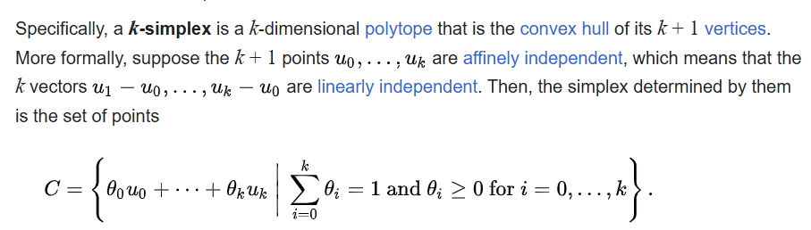
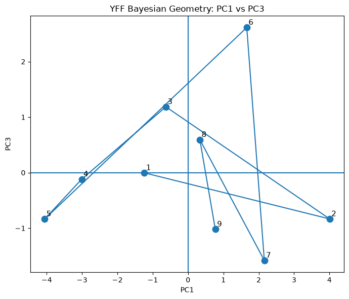
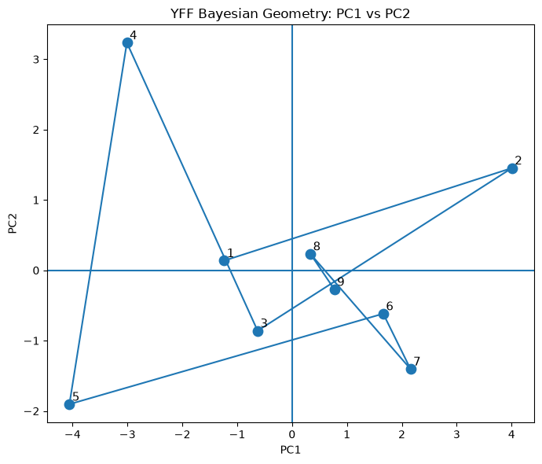
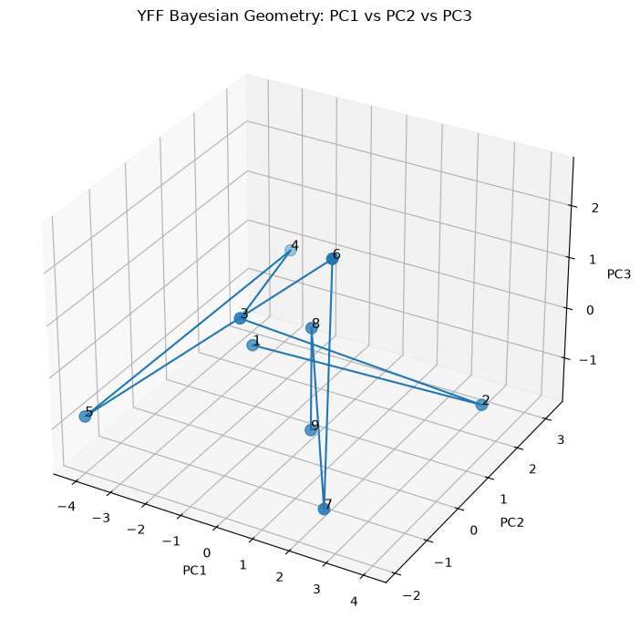

## Population-Level Decoder Comparison

We compared four decoding approaches across the 11 subjects.

| Decoder | Mean Accuracy | Main Observation |
|---|---:|---|
| **Poisson MLE** | **15.70%** | Highest mean accuracy, but only slightly above LDA |
| **LDA (100-ms bins)** | **15.53%** | Very similar to Poisson MLE |
| **Gamma–Poisson Bayesian** | **14.95%** | Similar overall performance; prior helps some subjects but hurts others |
| **Multinomial Logistic Regression (100-ms bins)** | **12.80%** | Lowest mean accuracy among the four decoders |
| **Nominal Chance (9 classes)** | **11.11%** | Reference level only |

### Main observations

- **Poisson MLE and LDA give almost identical average decoding performance.**
  - MLE: **15.70%**
  - LDA: **15.53%**

- The **Gamma–Poisson Bayesian decoder** also gives a similar average accuracy of **14.95%**.
  - The Gamma prior improves decoding for some subjects.
  - It decreases decoding accuracy for other subjects.
  - Therefore, introducing the prior does not systematically improve decoding.

- **Multinomial logistic regression** gives the lowest average accuracy at **12.80%**.

- Overall, changing the decoder does **not** produce a large increase in decoding accuracy.

### Preliminary interpretation

The three substantially different approaches — LDA, Poisson MLE, and Gamma–Poisson Bayesian decoding — all produce average accuracies around **15–16%**.

This suggests that the relatively low decoding accuracy may not be primarily caused by the choice of decoder.

Instead, an important next question is whether the limitation comes from:

1. the neural features used to represent each number,
2. the amount or reliability of number-related information in the recorded population,
3. variability across subjects and neurons, or
4. the way temporal neural responses are represented.

**Important:** These mean accuracies are descriptive results. Nominal chance is 11.11%, but statistical evidence for above-chance decoding should be evaluated using the appropriate permutation/null analysis.


## Subject-Level Comparison of Population Decoders

| Subject | LDA Accuracy | Logistic Accuracy | Poisson MLE Accuracy | Gamma–Poisson Accuracy |
|:---|---:|---:|---:|---:|
| **YFF** | 18.35% | 18.27% | 18.35% | 19.27% |
| **YFI** | 18.39% | 17.39% | 22.12% | 22.12% |
| **YFJ** | 14.88% | 11.28% | 19.30% | 16.67% |
| **YFK** | 22.82% | 13.89% | 21.93% | 16.67% |
| **YFL** | 15.83% | 12.27% | 14.91% | 15.79% |
| **YFM** | 14.87% | 14.95% | 14.04% | 12.28% |
| **YFP** | 17.12% | 13.27% | 13.29% | 15.19% |
| **YFR** | 14.65% | 10.52% | 11.28% | 11.28% |
| **YFS** | 9.12% | 6.44% | 12.88% | 10.61% |
| **YFT** | 16.34% | 12.36% | 13.63% | 13.63% |
| **YFU** | 8.50% | 10.12% | 10.93% | 10.93% |
| **Mean** | **15.53%** | **12.80%** | **15.70%** | **14.95%** |
| **Nominal Chance** | **11.11%** | **11.11%** | **11.11%** | **11.11%** |

### Preliminary observations

- **Poisson MLE:** highest mean accuracy at approximately **15.70%**.
- **LDA:** very similar mean accuracy at **15.53%**.
- **Gamma–Poisson:** mean accuracy of approximately **14.95%**.
- **Logistic regression:** lowest mean accuracy at approximately **12.80%**.
- Performance varies substantially across subjects.
- No decoder consistently dominates across every subject.
- LDA, MLE, and Gamma–Poisson remain in a broadly similar accuracy range.
- Nominal 9-class chance accuracy is **11.11%**.

> **Note:** These are descriptive decoding accuracies. Comparison with 11.11% nominal chance does not establish statistical significance; the appropriate permutation/null analysis is still required.


---
# Gamma–Poisson Bayesian Population Decoder


1. reproduce the subject-level Bayesian decoding results,
2. understand how the Gamma prior changes the Poisson rate estimates,
3. distinguish MLE, posterior-mean, and posterior-predictive decoding,
4. identify a Bayesian-derived population vector that could later be used for simplex geometry.

---

## Population representation

For each number presentation, neural activity is represented using fixed 100-ms temporal bins from 50–950 ms after operand onset.

Each neuron therefore contributes 9 spike-count features.

For $N$ neurons,

```math
p = 9N
```

features are used.

A single presentation is represented as

```math
\mathbf{x} = [x_1, \ldots, x_p],
```

where each $x_j$ is a spike count.

---

## Poisson model

For number class $c$ and feature $j$,

```math
X_j \mid c, \lambda_{cj} \sim \operatorname{Poisson}(\lambda_{cj} \Delta t),
```

where

```math
\Delta t = 0.1 \text{ s}.
```

Here, $\lambda_{cj}$ is the firing rate in spikes/s associated with number $c$ for neural feature $j$.

---

## Gamma prior

We place a Gamma prior on each Poisson firing rate:

```math
\lambda_{cj} \sim \operatorname{Gamma}(\alpha, \beta),
```

using the shape–rate parameterization.

The Gamma distribution is conjugate to the Poisson likelihood.

---

## Posterior

If class $c$ has $n_c$ training presentations and the total spike count for feature $j$ is

```math
S_{cj} = \sum_i x_{ij},
```

then

```math
\lambda_{cj} \mid D \sim \operatorname{Gamma}\left(\alpha + S_{cj},\; \beta + n_c \Delta t\right).
```

The posterior mean is

```math
E[\lambda_{cj} \mid D] = \frac{\alpha + S_{cj}}{\beta + n_c \Delta t}.
```

For comparison, the Poisson maximum-likelihood estimate is

```math
\hat{\lambda}^{\mathrm{MLE}}_{cj} = \frac{S_{cj}}{n_c \Delta t}.
```

---

## Posterior prediction

After observing the training data, the firing rate for class $c$ and feature $j$ has posterior

```math
\lambda_{cj} \mid D \sim \operatorname{Gamma}\left(\alpha'_{cj},\; \beta'_{cj}\right).
```

There are two ways to use this posterior for decoding.

### 1. Posterior-mean plug-in decoder

Use the posterior mean

```math
\hat{\lambda}_{cj} = E[\lambda_{cj} \mid D] = \frac{\alpha'_{cj}}{\beta'_{cj}}
```

as the estimated firing rate and evaluate a Poisson likelihood:

```math
x_j \sim \operatorname{Poisson}\left(\hat{\lambda}_{cj} \Delta t\right).
```

This uses Bayesian estimation of the firing rate but reduces the posterior distribution to a single point estimate.

### 2. Full Gamma–Poisson posterior-predictive decoder

Instead of selecting one value of $\lambda$, integrate over its complete posterior uncertainty:

```math
p(x_j \mid c, D) = \int p(x_j \mid \lambda_{cj}) \, p(\lambda_{cj} \mid D) \, d\lambda_{cj}.
```

For a Gamma posterior and Poisson observation model, this integral is available analytically:

```math
p(x_j \mid c, D)
=
\frac{\Gamma(\alpha'_{cj} + x_j)}{\Gamma(\alpha'_{cj}) \, x_j!}
\left( \frac{\beta'_{cj}}{\beta'_{cj} + \Delta t} \right)^{\alpha'_{cj}}
\left( \frac{\Delta t}{\beta'_{cj} + \Delta t} \right)^{x_j}.
```

This is the Gamma–Poisson, or negative-binomial, posterior-predictive distribution.

-----
# Gamma-Poisson Bayesian Decoding Pipeline

## 1. Temporal Population Features

For each presentation $i$, construct a temporal population vector

```math
\mathbf{x}_i=(x_{i1},x_{i2},\ldots,x_{ip})
```

where $x_{ij}$ is the spike count of feature $j$ during a fixed 100-ms time bin.

If there are $N$ neurons and 9 temporal bins per neuron,

```math
p=9N
```

For a subject with $n$ presentations,

```math
X\in\mathbb{R}^{n\times p},\qquad y_i\in\{1,2,\ldots,9\}
```

Each class $k\in\{1,\ldots,9\}$ corresponds to one presented number.

---

## 2. Poisson Likelihood

For number $k$ and feature $j$, assume

```math
X_{ij}\mid Y_i=k,\lambda_{kj}\sim\operatorname{Poisson}(\lambda_{kj})
```

where $\lambda_{kj}$ is the expected spike count for number $k$ at feature $j$.

The Poisson probability mass function is

```math
P(X_{ij}=x\mid\lambda_{kj})=\frac{\lambda_{kj}^{x}e^{-\lambda_{kj}}}{x!}
```

Here, $\lambda_{kj}$ is measured in expected spikes per 100-ms bin.

---

## 3. Gamma Prior

Place a Gamma prior on each Poisson rate:

```math
\lambda_{kj}\sim\operatorname{Gamma}(\alpha,\beta)
```

using the shape-rate parameterization.

Parameterize the prior using a prior mean $m$ and prior strength $\tau$:

```math
\alpha=m\tau,\qquad\beta=\tau
```

Therefore,

```math
E[\lambda_{kj}]=\frac{\alpha}{\beta}=m
```

and

```math
\operatorname{Var}(\lambda_{kj})=\frac{\alpha}{\beta^2}=\frac{m}{\tau}
```

Thus:

- $m$ controls the center of the prior.
- $\tau$ controls the strength of the prior.

---

## 4. Sufficient Statistics

For each number $k$ and feature $j$, calculate the total spike count

```math
S_{kj}=\sum_{i:Y_i=k}X_{ij}
```

and the number of training presentations belonging to class $k$:

```math
n_k=\#\{i:Y_i=k\}
```

The pair $(S_{kj},n_k)$ contains the information required to update the Gamma-Poisson model.

---

## 5. Posterior Distribution

Because the Gamma prior is conjugate to the Poisson likelihood,

```math
\lambda_{kj}\mid D\sim\operatorname{Gamma}(\alpha^*_{kj},\beta^*_k)
```

where

```math
\alpha^*_{kj}=\alpha+S_{kj}
```

and

```math
\beta^*_k=\beta+n_k
```

Substituting $\alpha=m\tau$ and $\beta=\tau$ gives

```math
\lambda_{kj}\mid D\sim\operatorname{Gamma}(m\tau+S_{kj},\tau+n_k)
```

---

## 6. Posterior Mean

The posterior mean of the Poisson rate is

```math
\lambda^*_{kj}=E[\lambda_{kj}\mid D]=\frac{m\tau+S_{kj}}{\tau+n_k}
```

This can also be written as

```math
\lambda^*_{kj}=\frac{\tau}{\tau+n_k}m+\frac{n_k}{\tau+n_k}\frac{S_{kj}}{n_k}
```

Since

```math
\hat{\lambda}^{\mathrm{MLE}}_{kj}=\frac{S_{kj}}{n_k}
```

the posterior mean can be interpreted as

```math
\lambda^*_{kj}=w_{\mathrm{prior}}m+w_{\mathrm{data}}\hat{\lambda}^{\mathrm{MLE}}_{kj}
```

where

```math
w_{\mathrm{prior}}=\frac{\tau}{\tau+n_k},\qquad w_{\mathrm{data}}=\frac{n_k}{\tau+n_k}
```

and

```math
w_{\mathrm{prior}}+w_{\mathrm{data}}=1
```

Thus the Bayesian estimate shrinks the class-specific MLE toward the prior mean $m$.

---

## 7. Posterior Predictive Distribution

For a new spike count $x$, the unknown rate $\lambda_{kj}$ is integrated out:

```math
P(x\mid Y=k,D)=\int P(x\mid\lambda_{kj})P(\lambda_{kj}\mid D)\,d\lambda_{kj}
```

Let

```math
a_{kj}=m\tau+S_{kj},\qquad b_k=\tau+n_k
```

Then the Gamma-Poisson posterior predictive distribution is

```math
P(x\mid Y=k,D)=\frac{\Gamma(a_{kj}+x)}{\Gamma(a_{kj})x!}\left(\frac{b_k}{b_k+1}\right)^{a_{kj}}\left(\frac{1}{b_k+1}\right)^x
```

---

## 8. Naive Bayes Population Likelihood

Assuming conditional independence across the $p$ temporal population features,

```math
P(\mathbf{x}\mid Y=k,D)=\prod_{j=1}^{p}P(x_j\mid Y=k,D)
```

For numerical stability, use log probabilities:

```math
\log P(\mathbf{x}\mid Y=k,D)=\sum_{j=1}^{p}\log P(x_j\mid Y=k,D)
```

With a uniform class prior,

```math
P(Y=k)=\frac{1}{9}
```

the predicted number is

```math
\hat{k}=\operatorname*{argmax}_{k\in\{1,\ldots,9\}}\log P(\mathbf{x}\mid Y=k,D)
```

Terms that are constant across all candidate classes, such as $-\log(x_j!)$ and $\log(1/9)$, can be omitted from the `argmax`.

---

## 9. Hyperparameter Grid

The prior parameters $m$ and $\tau$ are selected using grid search.

The prior-mean grid is

```math
m\in\operatorname{geomspace}(0.03,0.4,10)
```

and the prior-strength grid is

```math
\tau\in\operatorname{geomspace}(10,250,12)
```

Therefore, the total number of candidate priors is

```math
10\times12=120
```

For every candidate pair $(m,\tau)$,

```math
\alpha=m\tau,\qquad\beta=\tau
```

---

## 10. Nested Grouped Cross-Validation

Use 5-fold outer grouped cross-validation:

```math
D=D_{\mathrm{outer\ train}}\cup D_{\mathrm{outer\ test}}
```

The behavioral trial ID is used as the grouping variable so that presentations originating from the same trial cannot appear in both training and test sets.

For each outer fold, use 4-fold grouped cross-validation inside the outer training data:

```math
D_{\mathrm{outer\ train}}=D_{\mathrm{inner\ train}}\cup D_{\mathrm{inner\ validation}}
```

For every candidate $(m,\tau)$:

1. Fit the Gamma-Poisson model using the inner-training data.
2. Predict the inner-validation data.
3. Combine predictions across the four inner folds.
4. Calculate balanced accuracy and ordinary accuracy.

The selected hyperparameters are

```math
(m^*,\tau^*)=\operatorname*{argmax}_{m,\tau}\operatorname{BalancedAccuracy}_{\mathrm{inner}}(m,\tau)
```

with ordinary accuracy used as a tie-breaker.

The outer-test data are never used to select $m$ or $\tau$.

---

## 11. Outer-Fold Model

After selecting $(m^*,\tau^*)$, define

```math
\alpha^*=m^*\tau^*,\qquad\beta^*=\tau^*
```

Refit the Gamma-Poisson model using the complete outer-training set.

For every class $k$ and feature $j$,

```math
\lambda^*_{kj}=\frac{m^*\tau^*+S_{kj}}{\tau^*+n_k}
```

The posterior predictive distribution is then used to classify the untouched outer-test presentations.

Repeat this procedure for all five outer folds.

---

## 12. Final Decoding Accuracy

Concatenate the held-out predictions from all five outer folds:

```math
\hat{\mathbf{y}}=(\hat{\mathbf{y}}_1,\hat{\mathbf{y}}_2,\ldots,\hat{\mathbf{y}}_5)
```

The final decoding accuracy is

```math
\operatorname{Accuracy}=\frac{1}{n}\sum_{i=1}^{n}\mathbf{1}(\hat{y}_i=y_i)
```

Balanced accuracy is

```math
\operatorname{BalancedAccuracy}=\frac{1}{9}\sum_{k=1}^{9}\operatorname{Recall}_k
```

---

## 13. Bayesian Representation Matrix

After selecting a prior for the full subject dataset, calculate the posterior mean for every number-feature combination:

```math
\lambda^*_{kj}=\frac{m\tau+S_{kj}}{\tau+n_k}
```

Collect these posterior means into the matrix

```math
\Lambda^*=\begin{bmatrix}\lambda^*_{1,1}&\lambda^*_{1,2}&\cdots&\lambda^*_{1,p}\\\lambda^*_{2,1}&\lambda^*_{2,2}&\cdots&\lambda^*_{2,p}\\\vdots&\vdots&\ddots&\vdots\\\lambda^*_{9,1}&\lambda^*_{9,2}&\cdots&\lambda^*_{9,p}\end{bmatrix}\in\mathbb{R}^{9\times p}
```

Each row

```math
\boldsymbol{\lambda}^*_k=(\lambda^*_{k1},\lambda^*_{k2},\ldots,\lambda^*_{kp})
```

is the Bayesian posterior-mean population representation of number $k$.

Therefore, the nine numbers correspond to nine points in the $p$-dimensional neural representation space:

```math
\boldsymbol{\lambda}^*_1,\boldsymbol{\lambda}^*_2,\ldots,\boldsymbol{\lambda}^*_9\in\mathbb{R}^{p}
```

These nine posterior-mean vectors form the input for the subsequent Bayesian geometry and simplex analysis.

---

## Pipeline Summary

```text
Spike trains
    ↓
50–950 ms analysis window
    ↓
100-ms temporal bins
    ↓
Population spike-count matrix X
    ↓
Poisson likelihood
    ↓
Gamma(mτ, τ) prior
    ↓
Sufficient statistics: S_kj and n_k
    ↓
Gamma posterior
    ↓
Posterior predictive distribution
    ↓
Naive Bayes classification
    ↓
Nested grouped cross-validation
    ↓
Select m and τ
    ↓
Held-out decoding accuracy
    ↓
Posterior means λ*_kj
    ↓
9 × p Bayesian representation matrix Λ*
    ↓
Bayesian geometry / simplex analysis
```
-----


bayesian representations

# Bayesian Lambda Geometry Analysis — YFF

## Goal

We want to characterize the geometry of the Bayesian number representations without assuming beforehand that the representation must be a regular simplex.

The main question is:

> **What geometric structure is formed by the Bayesian representations of numbers 1–9?**

We first analyze the posterior-mean representation for subject **YFF**. Later, the same pipeline will be applied to all subjects and to Bayesian posterior samples and matched control geometries.

---

# Step 1 — Bayesian representation matrix

For every number $k \in \{1,\dots,9\}$ and neural-temporal feature $j$, the Gamma-Poisson model gives a posterior distribution for the Poisson intensity:

```math
\lambda_{kj}\mid D \sim \mathrm{Gamma}(\alpha^*_{kj},\beta^*_k)
```

The current geometry analysis uses the **posterior mean**

```math
\lambda^*_{kj}=E[\lambda_{kj}\mid D]=\frac{\alpha^*_{kj}}{\beta^*_k}
```

For YFF:

- 37 neurons
- 9 temporal bins per neuron
- $37\times9=333$ neural-temporal features
- 9 number conditions

Therefore:

```math
\Lambda \in \mathbb{R}^{9\times333}
```

Each row

```math
\lambda_k=(\lambda_{k1},\dots,\lambda_{k,333})
```

is the Bayesian population representation of number $k$.

### YFF checks

- Shape: `(9, 333)`
- All finite: `True`
- Negative values: `False`
- Minimum: `0.0111`
- Maximum: `2.7038`
- Mean over all entries: `0.6488`

The scalar row means, such as

```text
Number 1: 0.5986
Number 2: 0.7997
...
```

are only descriptive summaries of the 333-dimensional vectors. They are **not** the geometric representation itself.

---

# Step 2 — Center the number representations

We want the geometry of the nine points relative to each other, not relative to the arbitrary origin of firing-rate space.

The centroid is

```math
\bar{\lambda}=\frac{1}{9}\sum_{k=1}^{9}\lambda_k
```

and the centered vectors are

```math
C_k=\lambda_k-\bar{\lambda}
```

giving

```math
C\in\mathbb{R}^{9\times333}
```

This is **centering**, not standardization.

We did **not** divide features by their standard deviations.

### Why centering matters

Centering removes translation of the whole configuration while preserving:

- pairwise distances
- relative angles
- shape
- affine dimension

Because the centroid is the average,

```math
C_1+C_2+\cdots+C_9=0
```

Therefore one centered row is determined by the other eight, so

```math
rank(C)\leq8
```

### Distances from the centroid

We calculated

```math
r_k=\|C_k\|_2
```

and obtained approximately:

| Number | Radius |
|---|---:|
| 1 | 3.275 |
| 2 | 4.695 |
| 3 | 3.031 |
| 4 | 4.618 |
| 5 | 4.850 |
| 6 | 3.588 |
| 7 | 3.786 |
| 8 | 2.971 |
| 9 | 3.193 |

The radii are clearly unequal.

This already shows that the geometry is **not an exact regular simplex**.

### Metric assumption

For the current analysis we use ordinary Euclidean geometry.

Later we can compare this against a geometry more naturally adapted to Poisson-rate vectors, for example using square-root transformed Poisson intensities.

---

# Step 3 — SVD, affine dimension, and effective dimensionality

To determine how many independent directions are present, we performed the singular value decomposition

```math
C=U\Sigma V^\top
```

The nonzero singular values were:

| Dimension | Singular value | Variance | Cumulative |
|---|---:|---:|---:|
| 1 | 7.185 | 38.81% | 38.81% |
| 2 | 4.408 | 14.61% | 53.42% |
| 3 | 3.680 | 10.18% | 63.60% |
| 4 | 3.431 | 8.85% | 72.45% |
| 5 | 3.292 | 8.15% | 80.60% |
| 6 | 3.138 | 7.40% | 88.00% |
| 7 | 2.915 | 6.39% | 94.39% |
| 8 | 2.732 | 5.61% | 100% |
| 9 | ~0 | 0% | 100% |

The ninth singular value is zero because the nine centered rows satisfy

```math
C_1+\cdots+C_9=0
```

### Numerical rank

```math
rank(C)=8
```

This is the maximum possible affine rank for nine points.

Therefore the nine posterior-mean number centers are **affinely independent**.

---

## Affine independence and simplex structure



For nine points, affine independence means that the eight vectors

```math
\lambda_2-\lambda_1,\dots,\lambda_9-\lambda_1
```

are linearly independent.

A $d$-simplex is defined as the convex hull of $d+1$ affinely independent points.

Therefore:

```math
9\text{ affinely independent points }\Rightarrow\text{ an }8\text{-simplex}
```

Thus the convex hull of the nine YFF posterior-mean number centers is mathematically an:

> **irregular 8-dimensional simplex**

This does **not** establish that the simplex is biologically special, because nine generic continuous points in a high-dimensional space will also usually be affinely independent.

That is why matched controls will be essential later.

---

## Effective dimensionality

Algebraic rank only asks whether a direction exists.

We also measured how evenly the eight directions contribute.

### Effective rank

```math
r_{\mathrm{eff}}=\exp\left(-\sum_i p_i\log p_i\right)
```

where

```math
p_i=\frac{\sigma_i^2}{\sum_j\sigma_j^2}
```

Result:

```text
Effective rank = 6.23
```

### Participation ratio

```math
PR=\frac{1}{\sum_i p_i^2}
```

Result:

```text
Participation ratio = 4.77
```

Interpretation:

- algebraic affine dimension = 8
- the eight directions are not equally weighted
- the representation is high-dimensional but anisotropic

---

# Step 4 — Representational Distance Matrix

We calculated Euclidean distances between every pair of number representations:

```math
D_{ij}=\|\lambda_i-\lambda_j\|_2
```

There are

```math
\binom{9}{2}=36
```

unique number pairs.

This gives a $9\times9$ representational distance matrix, or **RDM**.

### YFF results

- Mean distance: `5.683`
- SD: `0.979`
- Minimum: `4.476`
- Maximum: `8.815`
- Coefficient of variation: `0.172`
- Maximum/minimum ratio: `1.97`

Closest pair:

```text
(3, 8)
distance = 4.476
```

Farthest pair:

```text
(2, 5)
distance = 8.815
```

---

## Pairwise distance regularity

We used

```math
CV_D=\frac{SD(D_{ij})}{Mean(D_{ij})}
```

and obtained

```text
CV = 0.172
```

For an exact regular simplex, all pairwise distances are equal, so

```math
CV_D=0
```

YFF therefore does not have equal pairwise distances.

However, CV alone is not sufficient evidence for or against meaningful simplex geometry because random high-dimensional points may also have relatively similar distances.

Later we will compare the empirical CV against matched random controls.

---

# Step 5 — PCA visualization





Because PCA of centered data follows directly from the SVD,

```math
C=U\Sigma V^\top
```

the PCA coordinates are

```math
Z=U\Sigma
```

The first three PCs explain:

- PC1: 38.81%
- PC2: 14.61%
- PC3: 10.18%

Total:

```math
PC1+PC2+PC3=63.60\%
```



### Important observations

PC1 strongly separates numbers 2 and 5.

Approximate PC1 coordinates:

```text
Number 2: +4.01
Number 5: -4.06
```

PC2 strongly separates numbers 4 and 5.

PC3 strongly separates numbers 6 and 7.

The numerical path

```text
1 → 2 → 3 → ... → 9
```

zigzags substantially in the PCA projections.

There is no obvious smooth one-dimensional numerical ordering in the first three PCs.

However, PCA is only a visualization.

The first three PCs retain only 63.6% of the centered geometry, so all quantitative geometric tests are performed in the full space.

We also created:

- PC1 vs PC2 plot
- PC1 vs PC3 plot
- 3D PC1-PC2-PC3 plot
- interactive/rotating 3D visualization

---

# Step 6 — Gram matrix geometry

The centered Gram matrix is

```math
G=CC^\top
```

with

```math
G\in\mathbb{R}^{9\times9}
```

Each entry is

```math
G_{ij}=C_i^\top C_j
```

The Gram matrix contains several geometric properties at once.

### Diagonal

```math
G_{ii}=\|C_i\|^2
```

so the diagonal contains the squared distances from the centroid.

### Off-diagonal

```math
G_{ij}=\|C_i\|\|C_j\|\cos(\theta_{ij})
```

so the off-diagonal terms describe the orientation between centered number vectors.

Positive inner product:

```math
\theta_{ij}<90^\circ
```

Negative inner product:

```math
\theta_{ij}>90^\circ
```

Near-zero inner product:

```math
\theta_{ij}\approx90^\circ
```

The empirical Gram matrix again had

```math
rank(G)=8
```

because

```math
rank(CC^\top)=rank(C)
```

---

## Connection to MDS

We discussed but did not yet perform classical multidimensional scaling.

If $D$ is the Euclidean RDM, then after squaring the distances and double-centering,

```math
B=-\frac{1}{2}JD^{(2)}J
```

we recover

```math
B=CC^\top=G
```

where

```math
J=I-\frac{1}{9}\mathbf{1}\mathbf{1}^\top
```

This is why the rank of the raw distance matrix itself is not the geometric dimension.

The Gram matrix recovered from distances contains the relevant dimensional geometry.

MDS remains optional for visualization because we already have the original coordinates.

---

# Step 6B — Matched regular-simplex Gram matrix

To compare the empirical geometry with a regular simplex, we constructed an ideal regular 8-simplex with the same overall radial scale.

The empirical mean squared radius was

```math
r^2=\frac{1}{9}\sum_i G_{ii}=14.781
```

so

```math
r=3.845
```

For a centered regular simplex with 9 vertices,

```math
G_{ii}=r^2
```

and for $i\neq j$,

```math
G_{ij}=-\frac{r^2}{8}
```

giving

```text
Ideal diagonal = 14.781
Ideal off-diagonal = -1.848
```

The ideal Gram matrix has:

```math
rank(G_{\mathrm{ideal}})=8
```

---

## Regular-simplex centroid angle

For two distinct vertices of a regular 8-simplex,

```math
\cos(\theta)=-\frac{1}{8}
```

so

```math
\theta=\cos^{-1}\left(-\frac{1}{8}\right)\approx97.18^\circ
```

This is a **centroid-based Gram angle**.

It is different from the paper's sequential transition angle of $120^\circ$.

---

# Step 6C — Gram deviation from a regular simplex

We measured the difference between empirical and ideal Gram matrices using the Frobenius norm:

```math
E_G=\frac{\|G-G_{\mathrm{ideal}}\|_F}{\|G_{\mathrm{ideal}}\|_F}
```

Results:

```text
Empirical Gram norm = 60.89
Ideal Gram norm = 47.03
Difference norm = 38.67
Relative Gram error = 0.822
```

Thus:

```text
Relative Gram error ≈ 0.82
```

This is not a probability or a percentage of "non-simplexness."

It is simply a scale-relative matrix deviation.

Its scientific meaning will come from comparison with matched controls.

---

## Diagonal and off-diagonal RMSE

RMSE means **Root Mean Squared Error**:

```math
RMSE=\sqrt{\frac{1}{n}\sum_i(x_i-y_i)^2}
```

We obtained:

```text
Diagonal RMSE = 5.58
Off-diagonal RMSE = 4.11
```

The diagonal error measures deviations in centroid radii.

The off-diagonal error measures deviations in angular/inter-vertex relationships.

Because there are many more off-diagonal entries, approximately 81% of the total squared Gram deviation came from off-diagonal structure.

Thus much of the irregularity arises from heterogeneous relationships between different number representations, not only unequal radii.

---

# Step 7 — Centroid-based angular structure

Using the Gram matrix, we calculated

```math
\theta_{ij}=\cos^{-1}\left(\frac{G_{ij}}{\sqrt{G_{ii}G_{jj}}}\right)
```

for all 36 unique pairs.

These are **Gram/centroid angles**.

They are not yet the transition angles used in the paper.

### Results

```text
Mean angle = 97.20°
SD = 12.95°
Minimum = 70.67°
Maximum = 134.85°
```

Counts:

```text
Acute angles (<90°): 9
Obtuse angles (>90°): 27
Near orthogonal (85°–95°): 8
```

Most acute pair:

```text
(2, 7)
70.67°
```

Most obtuse pair:

```text
(2, 5)
134.85°
```

Interestingly, the mean angle

```text
97.20°
```

is extremely close to the regular-simplex value

```text
97.18°
```

but the individual angles vary greatly.

Therefore the mean alone does not imply regularity.

The correct interpretation is:

> The average angular scale is close to a regular simplex, but the simplex has strongly heterogeneous individual angular relationships.

---

# Step 8 — Simplex volume and conditioning

We constructed the eight edge vectors from number 1:

```math
A=
\begin{bmatrix}
\lambda_2-\lambda_1\\
\lambda_3-\lambda_1\\
\vdots\\
\lambda_9-\lambda_1
\end{bmatrix}
```

with

```math
A\in\mathbb{R}^{8\times333}
```

and obtained

```math
rank(A)=8
```

again confirming affine independence.

### Edge-matrix singular values

```text
10.772
6.548
4.406
3.680
3.431
3.147
2.924
2.735
```

The smallest singular value is far from zero.

Therefore the simplex is not merely technically rank 8 or almost collapsed onto a 7D space.

It is genuinely expanded across all eight directions.

---

## 8D simplex volume

The volume of an 8-simplex is

```math
V_8=\frac{\sqrt{\det(AA^\top)}}{8!}
```

Equivalently,

```math
V_8=\frac{\prod_{i=1}^{8}s_i}{8!}
```

where $s_i$ are the singular values of $A$.

For YFF:

```text
Empirical volume = 2.449
```

The determinant and singular-value methods agreed exactly.

---

# Step 8B — Scale-free shape characterization

Because raw volume depends strongly on scale, we compared YFF with a regular 8-simplex matched to the same mean squared centroid radius.

Matched regular-simplex volume:

```text
5.689
```

Empirical YFF volume:

```text
2.449
```

Therefore:

```math
V_{\mathrm{norm}}=\frac{V_{\mathrm{YFF}}}{V_{\mathrm{regular}}}=0.430
```

So YFF occupies approximately 43% of the 8D volume of the matched regular simplex.

---

## Symmetric condition number

Using the centered singular values rather than a reference-vertex edge matrix:

```math
\kappa_{\mathrm{sym}}=\frac{\sigma_1}{\sigma_8}
```

we obtained

```text
Symmetric condition number = 2.63
```

For a perfectly isotropic regular simplex:

```math
\kappa_{\mathrm{sym}}=1
```

YFF is therefore substantially anisotropic.

---

## Isotropy ratio

We also calculated

```math
I=\frac{\sigma_8}{\sigma_1}
```

giving

```text
Isotropy ratio = 0.380
```

A perfectly isotropic configuration has

```text
I = 1
```

so YFF is clearly stretched unevenly across dimensions.

---

## Normalized effective dimensionality

```text
Effective-rank fraction = 0.779
Participation-ratio fraction = 0.597
```

Thus the configuration uses a substantial fraction of all eight available dimensions, but those dimensions are not equally weighted.

---

# Current geometric conclusion for YFF

The nine Bayesian posterior-mean number representations have:

```math
rank(C)=8
```

and therefore form an **8-dimensional simplex**.

However, the simplex is clearly not regular.

The current best description is:

> **YFF forms a nondegenerate, full-rank, high-dimensional, anisotropic irregular 8-simplex.**

Its main properties are:

| Property | YFF |
|---|---:|
| Ambient feature dimension | 333 |
| Number of vertices | 9 |
| Affine dimension | 8 |
| Effective rank | 6.23 |
| Participation ratio | 4.77 |
| Pairwise-distance CV | 0.172 |
| Mean centroid angle | 97.20° |
| Centroid-angle SD | 12.95° |
| Relative Gram error | 0.822 |
| Normalized volume | 0.430 |
| Symmetric condition number | 2.63 |
| Isotropy ratio | 0.380 |

The simplex is not close to being degenerate because the eighth singular value remains substantial.

At the same time, it is far from geometrically isotropic or regular.

---

# Important scientific limitation

Affine rank 8 by itself is **not strong evidence for a special neural simplex code**.

Nine generic continuous points in a sufficiently high-dimensional space will generally also be affinely independent.

Therefore the central scientific question is now:

> **Is the geometry of this neural 8-simplex different from what would be expected from generic high-dimensional random representations?**

This requires matched controls.

---

# Analyses Not Yet Performed

The following analyses remain.

## 1. Sequential transition angles

This is the paper-inspired analysis using

```math
d_k=\lambda_{k+1}-\lambda_k
```

and

```math
\theta_k=\cos^{-1}\left(\frac{d_k^\top d_{k+1}}{\|d_k\|\|d_{k+1}\|}\right)
```

These are different from the centroid-based Gram angles already calculated.

A number line predicts approximately:

```math
0^\circ
```

while a regular simplex predicts:

```math
120^\circ
```

---

## 2. Number-line tests

Test whether neural distances increase with numerical distance:

```math
|i-j|
```

and logarithmic numerical distance.

Also quantify how much representation is explained by the best linear or logarithmic number axis.

---

## 3. Matched geometric controls

Run the same geometric metrics on:

- regular simplex
- random irregular simplex
- Gaussian high-dimensional points
- random Poisson population centers
- one-dimensional linear number line
- logarithmic number line
- low-dimensional curved manifolds
- mixed-selectivity representations

This is necessary to determine whether the empirical simplex is actually unusual.

---

## 4. Bayesian posterior geometry

The current analysis uses only posterior means.

Later sample

```math
\Lambda^{(s)}\sim p(\Lambda\mid D)
```

and repeat all geometry measurements across posterior draws.

This will provide uncertainty distributions for:

- singular values
- effective dimensionality
- pairwise distances
- centroid angles
- transition angles
- Gram deviation
- simplex volume
- isotropy
- conditioning

---

## 5. Trial-level analyses

Return to the original single-trial neural responses for analyses that cannot properly be performed using only nine condition centers:

- SSD
- magnitude-residualized SSD
- PCA-restricted SSD
- CCGP
- number-line variance decomposition
- all $9!$ possible one-dimensional orderings

---

## 6. Repeat across subjects

After establishing the pipeline on YFF, repeat it for all 11 subjects.

The final analysis should distinguish:

- properties consistent across subjects
- subject-specific geometry
- regularity versus irregularity
- generic high-dimensional behavior versus statistically unusual structure

---

# Current Pipeline

```text
Bayesian posterior mean Lambda
            ↓
Center the 9 number representations
            ↓
SVD / affine rank / effective dimensionality
            ↓
Affine independence → 8-simplex
            ↓
Representational distance matrix
            ↓
PCA visualization
            ↓
Gram matrix geometry
            ↓
Comparison with matched regular simplex
            ↓
Centroid-angle structure
            ↓
8D volume and conditioning
            ↓
Scale-free simplex characterization
            ↓
[CURRENT POSITION]
            ↓
Sequential transition-angle analysis
            ↓
Number-line tests
            ↓
Matched Gaussian / Poisson / geometric controls
            ↓
Bayesian posterior uncertainty
            ↓
Trial-level SSD / CCGP / ordering analyses
            ↓
Repeat for all subjects
```

## Current working interpretation

The analysis so far does **not** support describing YFF as a regular simplex.

It does support the more precise mathematical statement:

> **The nine YFF Bayesian posterior-mean number centers are numerically affinely independent and therefore define a nondegenerate irregular 8-simplex in the 333-dimensional neural feature space.**

The next scientific question is not simply whether it is a simplex.

The next question is:

> **What is special, if anything, about the geometry of this irregular neural simplex compared with appropriate high-dimensional control representations?**